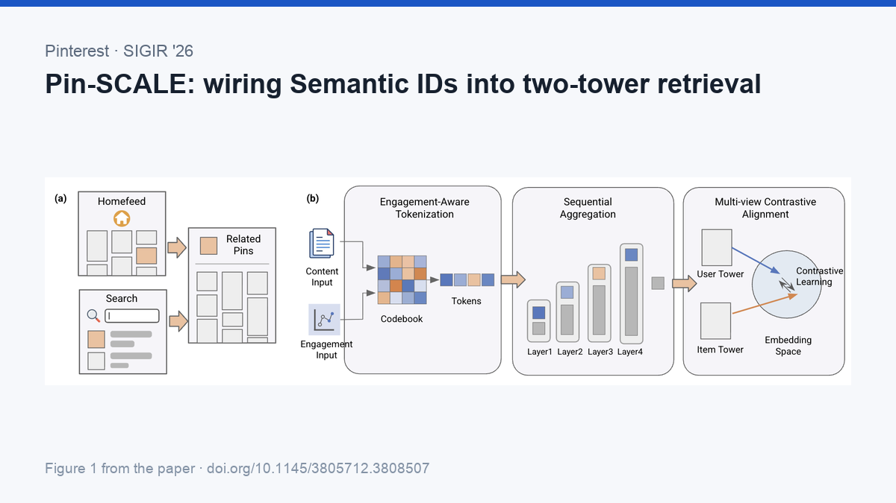

*↑ 发帖时作为图片附件上传，不要复制这一行。正文从下面的分隔线之后开始。*

---

Everyone agrees Semantic IDs help cold start. Nobody had tested how to wire them into a discriminative two-tower retriever. Pinterest did, and ran the method comparisons on live traffic.

Paper: Pin-SCALE, Pinterest, SIGIR '26 — doi.org/10.1145/3805712.3808507

Generating the SID. Standard practice quantizes a content embedding. Pin-SCALE feeds the quantizer something that already carries collaborative signal: OmniSAGE, their GNN over the user-item graph. Against an in-house text embedding and PinCLIP (image-text aligned), the graph wins - fresh impressions +1.72%.

More useful than the winner is the proxy that predicted it. First-level codebook entropy tracks online performance: OmniSAGE at 10.93 against a ceiling of 11 with 100% utilisation, PinCLIP fusion at 7.42 with 9.7%. Screen tokenizers offline instead of burning experiment slots. Collision rate predicts nothing - OmniSAGE collides more and still wins. The cost: collaborative signal causes drift, so the quantizer needs retraining more often.

Feeding the tower. A SID is a token sequence; a two-tower model wants one vector. Most work pools tokens as an unordered set or hashes n-grams, but RQ-VAE residuals are ordered - level 1 explains the most variance, later levels refine. Pin-SCALE fuses coarse to fine instead. Attention pooling only partly recovers the hierarchy, since it weighs tokens independently.

Where the SID sits differs by surface. Closeup is pin-to-pin, so both towers carry SIDs. Search, Home Feed and shopping are query- or user-to-item, so the SID lives only on the item side.

Training the tower. Long-tail SIDs appear rarely, so gradients are weak and embeddings noisy. Two contrastive views supply dense label-free signal.

Cross-tower alignment treats the same item passed through both towers as a positive pair, fixing the representation divergence two-tower models suffer from. A pin with zero engagement still gets aligned, as long as it is a candidate in one batch and a query in another. The biggest single win: sitewide fresh repins +3.67%, with Home Feed DAU +0.05% on rollout. It only works where query and candidate are the same type - on user-to-item surfaces the loss cannot be constructed at all.

Co-occurrence alignment pairs two queries sharing a candidate, and two candidates sharing a query. A cold item has no engagement of its own, but its co-occurrence with popular items is free supervision.

Takeaways

- Codebook entropy as an offline screen is the cheapest finding here. Low entropy means a few tokens absorb everything, so a fresh item inherits an average over thousands - no prior at all.
- Two ways to push collaborative signal into SIDs: change what you feed the quantizer, or let the task loss backprop into the codebook. The first is lighter and keeps the codebook frozen.
- Eight hierarchy levels is deep. Generative retrieval mostly uses three or four, and eight is uncommon even in discriminative retrieval.

#RecSys #RecommenderSystems #Pinterest #ColdStart #SIGIR2026
