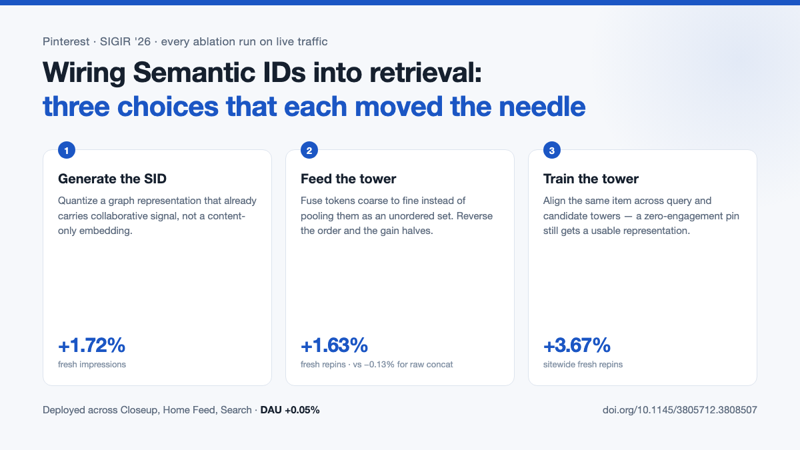

*↑ 发帖时作为图片附件上传，不要复制这一行。正文从下面的分隔线之后开始。*

---

Pinterest ran its ablations online. Not offline-then-confirm - each design choice took a real experiment slot.

Paper: Pin-SCALE, Pinterest, SIGIR '26 — doi.org/10.1145/3805712.3808507

Semantic IDs help cold start: a fresh item gets an ID at creation, and shared tokens let it inherit parameters from warm ones. What nobody had tested systematically is how to wire them into a discriminative retrieval model.

Generating the SID.  Standard practice quantizes a content embedding. Pin-SCALE swaps the quantizer's input for a representation that already carries collaborative signal - OmniSAGE, their GNN over the user-item graph. Against an in-house text LLM embedding and PinCLIP (image-text aligned), the graph wins: fresh impressions +1.72%.

More useful than the winner is the proxy that predicted it. First-level codebook entropy correlates with online performance: OmniSAGE sits at 10.93 against a ceiling of 11 with 100% utilisation, PinCLIP fusion at 7.42 with 9.7%. So you can screen tokenizers offline instead of burning experiment slots - while collision rate predicts nothing, since OmniSAGE collides more and still wins. The cost: collaborative signal causes drift, so the quantizer needs retraining more often.

Feeding the tower.  A SID is a token sequence; a two-tower model wants one vector. Most work pools them as an unordered set or hashes n-grams, but RQ-VAE residuals are ordered - level 1 explains the most variance, later levels refine - so flattening discards that. Pin-SCALE fuses coarse to fine.

Two numbers make the case. Raw concatenation moves repins -0.13%: wiring SIDs in badly is not neutral, it costs. And reversing the order, fine to coarse, halves the gain (+1.63% to +0.61%) - the direction does real work, not just the extra parameters.

Training the tower.  Long-tail SIDs appear rarely, so gradients are weak and embeddings stay noisy. Contrastive losses supply dense label-free signal. Cross-tower alignment (Q2C) treats the same item passed through both towers as a positive pair, fixing the representation divergence two-tower models suffer from. A pin with zero engagement still gets aligned, as long as it appears as a candidate in one batch and a query in another. Sitewide fresh repins +3.67%, an order of magnitude above co-occurrence alignment

One caveat the paper does not raise: Q2C needs query and candidate to be the same type. Closeup is pin-to-pin, so it works. In user-to-item retrieval the loss cannot even be constructed.

Takeaways

- Codebook entropy as an offline screen is the cheapest finding here. Low entropy means a few tokens absorb everything, so a fresh item inherits an average over thousands - no prior at all.
- Two ways to push collaborative signal into SIDs: change what you feed the quantizer, or let the task loss backprop into the codebook. The first is far lighter and keeps the codebook frozen - which matters if your SIDs are shared across models.

#RecSys #RecommenderSystems #MachineLearning #ColdStart #SIGIR2026
