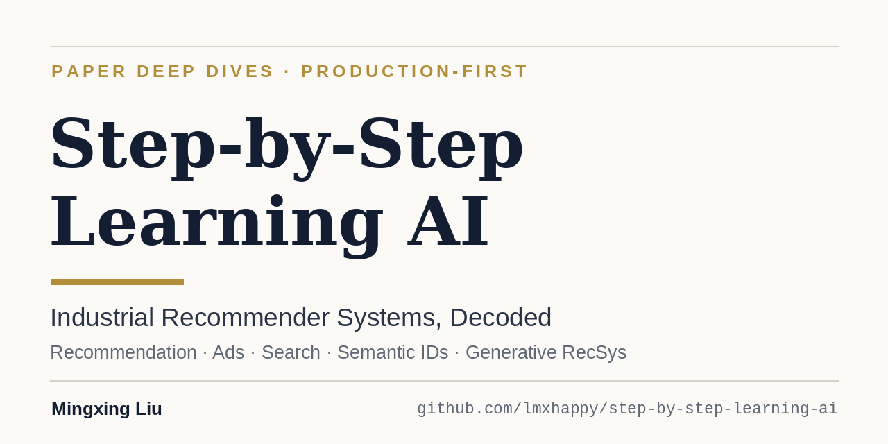

# Step-by-Step Learning AI

**300+ deep-dive notes on industrial recommendation, ads and search papers — 16 topics, updated continuously since October 2024.**

Every note answers three questions about a production system: **what the method actually does, what it gained in online A/B tests, and where the paper's claims are stronger than the evidence.** No paper-summary filler, no copied abstracts.

> ⭐ **If this repo helps you, please give it a star.** It takes a second, and it helps other recsys engineers find it.

## Why this repo

- **Production first.** The papers covered here run (or ran) at Meta, Google, LinkedIn, Pinterest, Netflix, Kuaishou, Alibaba, Tencent, ByteDance and Meituan — retrieval, ranking, generative recommendation and the infra underneath.
- **Numbers included.** Online gains are quoted with the metric and the baseline, e.g. CTR +6.02%, revenue +3.07%, eCPM +0.65% — so you can judge whether a technique is worth your roadmap.
- **Read critically.** Each note flags what the paper doesn't say: missing ablations, offline-only results, gains that shrink at scale.
- **Fully bilingual.** Every note is written in Chinese for the WeChat newsletter **稳扎稳打学AI** (10,000+ subscribers) and ships with a complete English version next to it, with the suffix `.full.en.md`.
- **Notes, not code.** This is a reading repo, not a reproduction repo. The value is in the judgement calls, not in runnable demos.

## 🚀 Start here

New to the repo? These three reading paths are the fastest way in:

**Generative recommendation**
1. [GR4AD-X](./generative-recommendation/kuaishou-gr4ad-x.full.en.md) — a deployed generative ad retriever, fixed in three places (Kuaishou)
2. [BRIDGE](./generative-recommendation/kuaishou-bridge.full.en.md) — three decoder tricks for guessing Semantic IDs better (Kuaishou)

**Semantic IDs**
1. [Pin-SCALE](./sid/pinterest-pin-scale.full.en.md) — wiring Semantic IDs into two-tower retrieval for cold start (Pinterest)
2. Then browse the [SID folder](./sid/) — 18 notes on how items get turned into discrete tokens

**Long behavior sequences**
1. [TransX](./behavior-sequence-modeling/ultra-long-behavior-sequence-modeling/linkedin-transx.full.en.md) — compress the user sequence offline, let candidates attend online (LinkedIn)
2. [PAIR](./deep-retrieval/linkedin-pair.full.en.md) — why a surface-specific embedding beat the platform-wide one (LinkedIn)

## Recent highlights

| Paper | Company | What it's about |
|---|---|---|
| [TransX](./behavior-sequence-modeling/ultra-long-behavior-sequence-modeling/linkedin-transx.full.en.md) | LinkedIn | Compress the user's behavior sequence offline into 64 vectors stored as KV; online, candidates only attend to them. CTR +6.02% over an HSTU-style model. |
| [BRIDGE](./generative-recommendation/kuaishou-bridge.full.en.md) | Kuaishou | Three decoder tricks for guessing Semantic IDs better: a codebook-anchored reasoning token before the first token, privileged EMA self-distillation on the student's own prefix, and a shared loop block that gives harder SID positions more passes. eCPM +0.65%, QPS +20%. |
| [GR4AD-X](./generative-recommendation/kuaishou-gr4ad-x.full.en.md) | Kuaishou | Three parallel fixes to a deployed generative ad retriever: two first-level SID codes for boundary ads, serving-cheap capacity scaling, and per-prefix eCPM value heads in beam search plus a one-step rerank. Revenue +3.07%. |
| [PAIR](./deep-retrieval/linkedin-pair.full.en.md) | LinkedIn | Embedding retrieval for Premium people recommendation: a platform-wide member embedding replaced by one fine-tuned on the surface's own clicks. CTR +7.5%, Premium retention +2.1%. |
| [Pin-SCALE](./sid/pinterest-pin-scale.full.en.md) | Pinterest | Wiring Semantic IDs into two-tower retrieval for cold start. Fresh repins +3.67%. |

## 🚪 Browse by topic (number of notes)

[Behavior sequence modeling](./behavior-sequence-modeling/) 54 · [Generative recommendation](./generative-recommendation/) 45 · [LLM4Rec](./llm4rec/) 42 · [Deep retrieval](./deep-retrieval/) 36 · [Item-to-item](./item-to-item/) 26 · [Multi-task learning](./multi-task-learning/) 20 · [Semantic IDs](./sid/) 18 · [Feature interaction](./feature-cross/) 18 · [Long tail](./long-tail/) 17 · [Cross-domain](./cross-domain-recommendation/) 16 · [Loss functions](./loss-func/) 15 · [ML infra](./ml-infra/) 12 · [Representation quality](./representation-quality/) 8 · [Graph recommendation](./graph-recommendation/) 7 · [Feature selection](./feature-selection/) 3 · [Auto research](./auto-research/) 2

Plus 15 [early paper lists](./paper-lists/) (Oct–Nov 2024: paper titles with one-line tags, no write-ups).

## Topics by layer

The 16 topics sit at different layers of a recsys stack. The layers are orthogonal — Semantic IDs, for example, can feed a generative model or an ordinary discriminative ranker — and one paper often spans several layers; each note is filed under its main contribution.

| Layer | Question it answers | Topics |
|---|---|---|
| Recommendation paradigm | How do we recommend? | [Generative recommendation](./generative-recommendation/) · [LLM4Rec](./llm4rec/) |
| Representation | How are items / users represented? | [Semantic IDs](./sid/) · [Representation quality](./representation-quality/) |
| Model architecture | How is the network built? | [Behavior sequence modeling](./behavior-sequence-modeling/) · [Feature interaction](./feature-cross/) · [Deep retrieval](./deep-retrieval/) · [Graph recommendation](./graph-recommendation/) |
| Data & features | What goes in? | [Feature selection](./feature-selection/) |
| Training objective | What do we optimize? | [Loss functions](./loss-func/) · [Multi-task learning](./multi-task-learning/) |
| Scenarios | Where is it used? | [Cross-domain](./cross-domain-recommendation/) · [Item-to-item](./item-to-item/) |
| Problems | What does it fix? | [Long tail](./long-tail/) |
| Engineering | How does it run and iterate? | [ML infra](./ml-infra/) · [Auto research](./auto-research/) |

The full per-paper index is in the [Chinese README](README.zh-CN.md).

## 📖 Also in this repo

- [**Industrial Generative Recommendation: go / no-go judgement for production**](./book/generative-recommendation/) — a book in progress (v0.1 draft, in Chinese). Not another survey of classic recsys: only generative recommendation, read with a production engineer's eye.

## How to use this repo

1. **Read online** — pick a topic above, open a note, read the `.full.en.md` file for English.
2. **Clone it** — `git clone https://github.com/lmxhappy/step-by-step-learning-ai.git` and grep your own copy.
3. **Follow along** — new notes land here as they are published on the WeChat newsletter **稳扎稳打学AI**; more long-form content on the [Zhihu column](https://zhuanlan.zhihu.com/stupid-ai) (200+ posts).
4. **Contribute** — corrections and your own paper notes are welcome via PR or issue.

---

**Author:** Mingxing Liu · WeChat `lmxhappy` · [Zhihu](https://zhuanlan.zhihu.com/stupid-ai)

This is a notes repo, not a code or reproduction repo.

⭐ **Enjoying it? A star helps other engineers discover these notes — thank you!**
