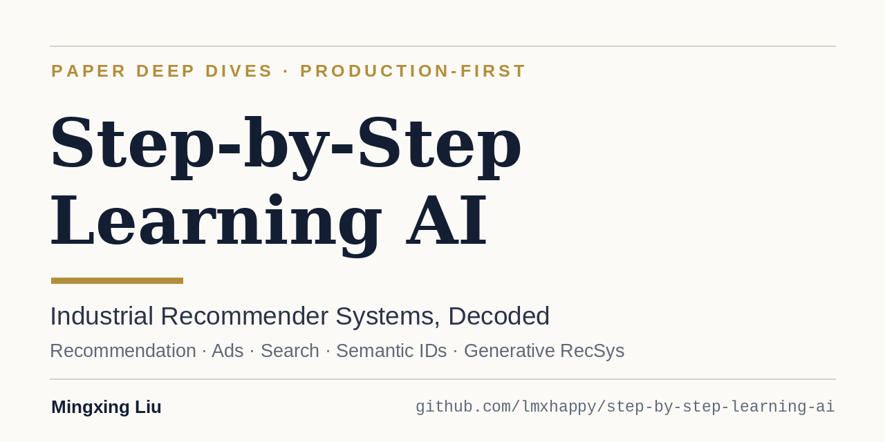

 

**300+ paper notes on industrial recommendation, ads and search, across 16 topics, updated since October 2024.**
This is a **notes repo, not a code or reproduction repo**. Every note has a full English version.

### 🚪 Browse by topic (number of notes)
[Behavior sequence modeling](./behavior-sequence-modeling/) 54 · [Generative recommendation](./generative-recommendation/) 45 · [LLM4Rec](./llm4rec/) 42 · [Deep retrieval](./deep-retrieval/) 36 · [Multi-task learning](./multi-task-learning/) 20 · [Semantic IDs](./sid/) 18 · [Feature interaction](./feature-cross/) 18 · [Cross-domain](./cross-domain-recommendation/) 16 · [Long tail](./long-tail/) 16 · [Loss functions](./loss-func/) 15 · [ML infra](./ml-infra/) 12 · [Representation quality](./representation-quality/) 8 · [Graph recommendation](./graph-recommendation/) 7 · [Item-to-item](./item-to-item/) 5 · [Feature selection](./feature-selection/) 3 · [Auto research](./auto-research/) 2

Plus 15 [early paper lists](./paper-lists/) (Oct–Nov 2024: paper titles with one-line tags, no write-ups).

Paper write-ups on industrial **recommendation, ads and search** systems: what the method does, what it gained in production A/B tests, and where the claims are weaker than they look.

Every note is written in Chinese for the WeChat account **稳扎稳打学AI** and has a full English version next to it, with the suffix `.full.en.md`. The table below picks a few recent ones.

## Recent highlights

| Paper | Company | What it's about |
|---|---|---|
| [TransX](./behavior-sequence-modeling/ultra-long-behavior-sequence-modeling/linkedin-transx.full.en.md) | LinkedIn | Compress the user's behavior sequence offline into 64 vectors stored as KV; online, candidates only attend to them. CTR +6.02% over an HSTU-style model. |
| [BRIDGE](./generative-recommendation/kuaishou-bridge.full.en.md) | Kuaishou | Three decoder tricks for guessing Semantic IDs better: a codebook-anchored reasoning token before the first token, privileged EMA self-distillation on the student's own prefix, and a shared loop block that gives harder SID positions more passes. eCPM +0.65%, QPS +20%. |
| [GR4AD-X](./generative-recommendation/kuaishou-gr4ad-x.full.en.md) | Kuaishou | Three parallel fixes to a deployed generative ad retriever: two first-level SID codes for boundary ads, serving-cheap capacity scaling, and per-prefix eCPM value heads in beam search plus a one-step rerank. Revenue +3.07%. |
| [PAIR](./deep-retrieval/linkedin-pair.full.en.md) | LinkedIn | Embedding retrieval for Premium people recommendation: a platform-wide member embedding replaced by one fine-tuned on the surface's own clicks. CTR +7.5%, Premium retention +2.1%. |
| [Pin-SCALE](./sid/pinterest-pin-scale.full.en.md) | Pinterest | Wiring Semantic IDs into two-tower retrieval for cold start. Fresh repins +3.67%. |

## Topics

All notes are organized by topic folder; open a folder and read the `.full.en.md` files. The full per-paper index is in the [Chinese README](README.zh-CN.md).

| Layer | Topics |
|---|---|
| Recommendation paradigm | [Generative recommendation](./generative-recommendation/) · [LLM4Rec](./llm4rec/) |
| Representation | [Semantic IDs](./sid/) · [Representation quality](./representation-quality/) |
| Model architecture | [Behavior sequence modeling](./behavior-sequence-modeling/) · [Feature interaction](./feature-cross/) · [Deep retrieval](./deep-retrieval/) · [Graph recommendation](./graph-recommendation/) |
| Data & features | [Feature selection](./feature-selection/) |
| Training objective | [Loss functions](./loss-func/) · [Multi-task learning](./multi-task-learning/) |
| Scenarios | [Cross-domain](./cross-domain-recommendation/) · [Item-to-item](./item-to-item/) |
| Problems | [Long tail](./long-tail/) |
| Engineering | [ML infra](./ml-infra/) · [Auto research](./auto-research/) |

**Author:** Mingxing Liu · WeChat `lmxhappy` · [Zhihu](https://zhuanlan.zhihu.com/stupid-ai). If this repo helps you, a ⭐ helps others find it.

This is a notes repo, not a code or reproduction repo.
