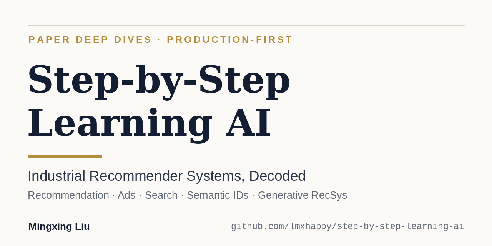

 

**300+ 篇搜广推论文解读，16 个方向，2024 年 10 月起持续更新。**
这是**解读笔记库，不是代码复现**：每篇讲清楚方法做了什么、线上 A/B 涨了多少、哪里说得比实际强。

### 🚪 按主题入口（篇数）
[用户行为序列建模](./behavior-sequence-modeling/) 54 · [生成式推荐](./generative-recommendation/) 45 · [LLM4Rec](./llm4rec/) 42 · [深度召回](./deep-retrieval/) 36 · [多任务学习](./multi-task-learning/) 20 · [SID](./sid/) 18 · [特征交叉](./feature-cross/) 18 · [跨域](./cross-domain-recommendation/) 16 · [长尾问题](./long-tail/) 17 · [损失函数](./loss-func/) 15 · [ML Infra](./ml-infra/) 12 · [表示质量](./representation-quality/) 8 · [图推荐](./graph-recommendation/) 7 · [I2I推荐](./item-to-item/) 59 · [特征选择](./feature-selection/) 3 · [Auto Research](./auto-research/) 2

另有 [早期论文清单](./paper-lists/) 15 期（2024 年 10–11 月，只列论文和一句话标签，没有解读）。

如果这个仓库对你有帮助，欢迎点击右上角 **Star ⭐** 支持一下，让更多人发现它！

欢迎来到本仓库！这是微信公众号「稳扎稳打学AI」的配套资源库，聚焦推荐 / 广告 / 搜索论文解读，陪你一起保持进步、不断精进。

## 关于公众号“稳扎稳打学AI”
- **公众号介绍**：关注我，每天为你精选推荐算法paper，帮助你稳扎稳打地学习AI。公众号由刘明星（微信: lmxhappy）运营，内容聚焦于推荐、广告和搜索等。

- **paper推荐原则**：我们优先选择高影响力、实用性强的论文，包括但不限于LLM在推荐中的应用、搜索词推荐等实际案例分析。
- **知乎专栏**：更多内容可查看[稳扎稳打学AI - 知乎专栏](https://zhuanlan.zhihu.com/stupid-ai)，已更新200+篇内容，涵盖热门论文解读。

## 仓库内容

### 📖 开源小书（进行中）
- [**工业生成式推荐：新范式下的上线判断**](./book/generative-recommendation/)（v0.1 草稿）— 另起炉灶，不写经典搜广推大全，只写生成式推荐的工业阅读与上线判断。

这个仓库是公众号「稳扎稳打学AI」的**配套解读笔记库**（与公众号同步更新），主要包括：
- **论文解读 / 笔记**：针对搜广推相关论文的结构化解读（方法、心得、可信度等），按主题目录组织。
- **英文版**：每篇解读都有完整英文版，与中文稿同目录、同名，后缀 `.full.en.md`（如 [sid/pinterest-pin-scale.full.en.md](./sid/pinterest-pin-scale.full.en.md)）。新写的解读也同步写英文版。
- **配图与索引**：文中插图与 README 目录导航，方便连读与检索。
- **说明**：当前以笔记为主，**不以可运行代码 / 实验复现为主**；若个别文章附带脚本或外链，会在文内单独说明。

## 如何开始
1. **关注公众号**：搜索“稳扎稳打学AI”或扫描二维码，获取每日论文推荐。
2. **克隆仓库**：`git clone https://github.com/lmxhappy/step-by-step-learning-ai.git`
3. **贡献**：欢迎提交 PR，分享你的论文笔记或纠错。我们一起进步！

## 目录结构 & 内容说明

### 🧭 按技术层次导航

下面 16 个分类分属不同的技术层次，这里按层次归组，便于定位；**目录结构本身是平铺的**，每个分类的论文清单见后面的「子目录导航」。

| 层次 | 关注的问题 | 分类 |
|---|---|---|
| **任务范式** | 怎么做推荐 | [生成式推荐](./generative-recommendation/) · [LLM4Rec](./llm4rec/) |
| **表示层** | item / user 怎么表示 | [SID](./sid/) · [表示质量](./representation-quality/) |
| **模型结构** | 网络怎么搭 | [用户行为序列建模](./behavior-sequence-modeling/) · [特征交叉](./feature-cross/) · [深度召回](./deep-retrieval/) · [图推荐](./graph-recommendation/) |
| **数据与特征** | 喂什么进去 | [特征选择](./feature-selection/) |
| **训练目标** | 优化什么 | [损失函数](./loss-func/) · [多任务学习](./multi-task-learning/) |
| **业务场景** | 用在哪 | [跨域](./cross-domain-recommendation/) · [I2I推荐](./item-to-item/) |
| **问题导向** | 治什么病 | [长尾问题](./long-tail/) |
| **工程与研发体系** | 怎么跑得动、迭代得快 | [ML Infra](./ml-infra/) · [Auto Research](./auto-research/) |

需要注意的是，**层次之间是正交的**：比如 SID 是表示层技术，既可以喂给生成式模型，也可以当普通特征喂给判别式模型，所以它和「生成式推荐」不是从属关系。同理，一篇论文常常跨多个层次，归类时取其主要贡献所在。

### 📁 子目录导航

- **[跨域](./cross-domain-recommendation/)**
  跨领域推荐。
  - [MTFM — 异构多场景推荐 Foundation Model (美团)](./cross-domain-recommendation/meituan-mtfm.md)
  - [YouTube Music 跨域蒸馏 — 零样本跨域知识蒸馏，新歌收听+11% (YouTube)](./cross-domain-recommendation/youtube-music-cross-domain.md)

- **[用户行为序列建模](./behavior-sequence-modeling/)**
  用户的历史行为序列建模，包括超长序列建模和普通序列建模。
  - [STCA — 超长序列建模，完播率+3% (字节)](./behavior-sequence-modeling/ultra-long-behavior-sequence-modeling/bytedance-stca.md)
  - [Ultra-HSTU — HSTU 2.0 超长序列建模 (Meta)](./behavior-sequence-modeling/ultra-long-behavior-sequence-modeling/meta-ultra-HSTU.md)
  - [MoS — 序列聚类+MoE 搞定长序列 (Meta)](./behavior-sequence-modeling/meta-mos.md)
  - [Sample Is Feature — 序列样本分词，CTR+2% (美团)](./behavior-sequence-modeling/meituan-sample-is-feature.md)
  - [GenLI — 生成式长兴趣建模，RPM+1.6% (美团)](./behavior-sequence-modeling/meituan-genli.md)
  - [UxSID — 用聚类搞定超长序列建模，收入+0.3% (快手)](./behavior-sequence-modeling/ultra-long-behavior-sequence-modeling/kuaishou-uxsid.md)
  - [TransX — 用户序列离线压缩，线上只做候选交叉，CTR+6% (LinkedIn)](./behavior-sequence-modeling/ultra-long-behavior-sequence-modeling/linkedin-transx.md) · [EN](./behavior-sequence-modeling/ultra-long-behavior-sequence-modeling/linkedin-transx.full.en.md)
  - [TokenMinds — 用户生成式SID特征双输出表征 (YouTube)](./behavior-sequence-modeling/tokenminds.md)
  - [UniSGR — 增加用户SID特征，GMV+6% (阿里)](./behavior-sequence-modeling/alibaba-unisgr.md)
  - [CMSL — 用户行为序列转成纯净意图流 (Meta)](./behavior-sequence-modeling/meta-cmsl.md)
  - [EST — 异构特征统一建模，RPM+3% (阿里)](./behavior-sequence-modeling/alibaba-est.md)

- **[生成式推荐](./generative-recommendation/)**
  **任务范式**：把推荐建模成「生成」——自回归地吐出 item、序列或重排结果，而不是对候选逐个打分。关注的是「怎么做推荐」。
  - [LazFormer — 生成式预训练迁移到精排，GMV+9.85% (阿里国际)](./generative-recommendation/ali-lazformer.md)
  - [CONGRATS — 生成式重排，图结构解码器+一致性训练，Long Views+2.18% (快手)](./generative-recommendation/kuaishou-congrats.md)
  - [TGR-Reason — 离线reason token注入，新用户曝光转化+13.09% (腾讯)](./generative-recommendation/tencent-tgr.md)
  - [BRIDGE — 三招让生成式推荐把SID猜得更准，eCPM+0.65% (快手)](./generative-recommendation/kuaishou-bridge.md)
  - [GR4AD-X — 生成式广告召回三处打磨，收入+3.07% (快手)](./generative-recommendation/kuaishou-gr4ad-x.md)
  - [OneLatent — 思维链压进3个token，线上不写字也能推理，收入+9.6% (快手)](./generative-recommendation/kuaishou-onelatent.md)
  - [OneLive — 生成式推荐落地直播场景 (快手)](./generative-recommendation/kuaishou-onelive.md)
  - [Sigma — 生成式推荐，GMV+8% (阿里)](./generative-recommendation/ali-sigma.md)
  - [VectorizingTrie — 生成式召回解码提速最高1000倍 (Google)](./generative-recommendation/google-static.md)
  - [GEM-Rec — 统一推荐与广告的生成式推荐 (Google)](./generative-recommendation/google-gem-rec.md)
  - [RCLRec — 稀疏目标的生成式推荐，广告收入+2% (阿里国际)](./generative-recommendation/ali-rclrec.md)
  - [CQ-SID — 搜索LLM生成式召回，贡献七成成交 (阿里)](./generative-recommendation/ali-cq-sid.md)
  - [DGI — SID与GR联合训练，RPM+1.11% (阿里)](./generative-recommendation/ali-dgi.md)

- **[SID](./sid/)**
  **表示层技术**：怎么把一个 item 压成一串离散的语义 token。关注的是「item 怎么表示」，和上面的任务范式是正交的两件事——SID 可以喂给生成式模型，也可以当普通特征喂给判别式模型。
  本目录收「如何生成 SID」以及不便归入其它分类的用法；SID 作为横切技术，在生成式召回（见上）、序列建模（[UniSGR](./behavior-sequence-modeling/alibaba-unisgr.md)、[UxSID](./behavior-sequence-modeling/ultra-long-behavior-sequence-modeling/kuaishou-uxsid.md)、[TokenMinds](./behavior-sequence-modeling/tokenminds.md)）、负反馈迁移（[SARA](./llm4rec/kuaishou-sara.md)）等场景均有应用，论文散落在相应分类中。
  - [Pin-SCALE — SID接入双塔召回，冷启转存+3.67%，DAU+0.05% (Pinterest)](./sid/pinterest-pin-scale.md) · [EN](./sid/pinterest-pin-scale.full.en.md)
  - [Tokens are All You Need — 从SID重建内容embedding，长序列用得起内容特征 (YouTube)](./sid/youtube-dual-sid.md)
  - [QuaSID — SID 量化新方法，GMV+2% (快手)](./sid/kuaishou-quasid.md)
  - [AKT-Rec — 聚类相关特征提升长尾，GMV+3% (阿里)](./sid/alibaba-akt-rec.md)

- **[LLM4Rec](./llm4rec/)**
  LLM 在推荐/召回中的各类应用范式。
  - [SARA — MLLM把用户说的偏好理由扩到千万作者，Hate反馈-8.16% (快手)](./llm4rec/kuaishou-sara.md)
  - [LLM语义召回 — LLM as annotator (Meta)](./llm4rec/meta-llm-retrieval.md)
  - [LLM合成查询生成 — 数据增强 (Airbnb)](./llm4rec/airbnb-llm-synthetic-query.md)
  - [级联生成式LLM首页个性化 — LLM as ranker (Instacart)](./llm4rec/instacart-cascaded-generative.md)
  - [GenRec — LLM直接当精排，一次前向给全目录打分 (Netflix)](./llm4rec/netflix-genrec.md)

- **[特征交叉](./feature-cross/)**
  - [MGDIN — 特征交叉新方法，CTR+3% (阿里)](./feature-cross/ali-mgdin.md)
  - [SlimPer — 多层多槽位 Target Attention 增强 (Meta)](./feature-cross/meta-slimper.md)
  - [DANet — 折扣率显式建模，GMV+2% (阿里)](./feature-cross/ali-danet.md)
  - [CCFormer — 长序列层次化压缩+三字段定向交叉，广告收入最高+1.71% (腾讯)](./feature-cross/tencent-ccformer.md)

- **[特征选择](./feature-selection/)**
  特征重要性评估、低价值特征淘汰等特征治理类论文。
  - [LO-FAR — 免GPU筛特征，稀疏参数最多砍掉75% (Meta)](./feature-selection/meta-lo-far.md)

- **[I2I推荐](./item-to-item/)**
  I2I（Item-to-Item）推荐。
  - [DAIAN — 详情页 I2I 推荐，成交额+2% (阿里)](./item-to-item/alibaba-daian.md)
  - [CAIM — 详情页相关推荐，动态 trigger + 子意图拆分，订单+6.9%、GMV+7.7% (阿里国际)](./item-to-item/alibaba-caim.md)
  - [CRRN — 后推荐 CTR 模型，trigger-target 门控交叉 + 意图软切换 + 类目 pairwise 损失，CTR+3.87% (阿里天猫)](./item-to-item/alibaba-crrn.md)
  - [Mercari 相似推荐 — 图文两路 ANN 召回 + MLP 排序，购买+20.4%、再+12.7% (Mercari)](./item-to-item/mercari-hybrid-i2i.md)
  - [CAMIE — 广告 I2I 召回，共同互动对微调多模态大模型 embedding，一个模型替换两套编码器，CVR+1.9% (Snap)](./item-to-item/snap-camie.md)
  - [Contextual Ranker — 详情页相似推荐，种子锚定的会话感知排序，CPU 服务，购买率+1.5%~2.4% (eBay)](./item-to-item/ebay-contextual-ranker.md)
  - [MEDAL — 搭配推荐，穿搭照片挖伪标签 + 自蒸馏 + 按品类对分子空间，仅离线 (Amazon)](./item-to-item/amazon-medal.md)
  - [E-goi 替代品与互补品 — TF-IDF 找替代、共同购买图上 GAT 找互补，中小商家，仅离线 (E-goi)](./item-to-item/egoi-crossmarket-gat.md)
  - [GraFS — 功能替代品推荐，Claude 打伪标签 + 语义/行为双通道 HetGAT + 功能组内排序，仅离线 (Amazon)](./item-to-item/amazon-grafs.md)
  - [Snap 互补品广告 — LLM 生成互补搜索词再检索，many-shot 提示 vs LoRA 微调，仅离线 (Snap)](./item-to-item/snap-llm-complementary-query.md)
  - [互补品的两种矩阵分解 — user–item 分解 + 类目 PMI 过滤 vs 直接分解共购矩阵，后者线上收入增幅为前者两倍多 (俄罗斯科学院)](./item-to-item/ras-mf-complementary.md)
  - [Pinterest Closeup 商品召回 — 3 个优先语料库代替全量索引 + 多任务对比学习双塔，转存+33% (Pinterest)](./item-to-item/pinterest-closeup-shopping-ebr.md)
  - [MESH — Related Pins 召回，query 塔按用户/query Pin/上下文拆三个 DHEN 子塔 + 上下文门控，新内容转存+4.9%、大盘转存+0.96% (Pinterest)](./item-to-item/pinterest-mesh.md)
  - [GSComGNN — 互补品推荐，频谱 GNN 低通/中通两路表示改用逐维门控融合 + LayerNorm，仅离线 (渤海大学)](./item-to-item/bohai-gscomgnn.md)
  - [LRN4HCAR — 给一组云 API 推荐互补 API，共调用/功能共现/替代三张图逐个投影 + 交并非组合，仅离线 (燕山大学)](./item-to-item/ysu-lrn4hcar.md)
  - [PCM-ADHL — 个性化搭配补全，属性专家按重要性残差解耦 + 品类偏好/共现兼容两张超图，仅离线 (青岛科技大学)](./item-to-item/qust-pcm-adhl.md)
  - [Recommendation by Generation — 不完整 outfit 先在 StyleGAN2 潜空间生成互补单品，再按潜码检索最像的商品，仅离线 (TCS Research)](./item-to-item/tcs-recommendation-by-generation.md)
  - [CFALR — LoRA 微调 Vicuna 做个性化搭配补全，图像/CF 向量各压成一个 token，整套生成时混入 CF 概率，仅离线 (香港理工大学等)](./item-to-item/polyu-cfalr.md)
  - [PDOR — 个性化搭配补全，CLIP 向量空间里用扩散模型生成缺的单品再检索，冻结的兼容性判别器当奖励，仅离线 (浙江理工大学)](./item-to-item/zstu-pdor.md)
  - [Hybrid Music Similarity — 音乐采样相似推荐，元数据超图随机游走 + Word2Vec、音频 Siamese，按属性分列表，仅离线 (韩国电子技术研究院)](./item-to-item/keti-hybrid-music.md)
  - [UAFM — 穿搭逐件补全，共享 Transformer 接策略头（检索下一件）和价值头（TD 估套装潜力、增益不够就停），仅离线 (香港理工大学等)](./item-to-item/polyu-uafm.md)
  - [MRMoCo — 上衣配下装打分，MoCo 记忆库把负样本扩到 512 个 + 风格相同、长得像的下装当弱正样本，仅离线 (东华大学)](./item-to-item/dhu-mrmoco.md)
  - [HW-GATCR — 互补品推荐，按文本语义和类目树给共购边打分当边权 + 双曲加权 GAT + 按度数加噪的对比学习，仅离线 (内蒙古大学)](./item-to-item/imu-hw-gatcr.md)
  - [SR-Rec — 互补品推荐，低通/中通两个图滤波器分别学相似和相关，内积 + 双线性各打一个分，成对注意力加权，仅离线 (浙江工业大学)](./item-to-item/zjut-sr-rec.md)
  - [DRSD — 新闻互补推荐，LLM 每轮提新的文章关系标签 + 门控 + 每个关系一个 CTR 专家，去掉专家验证集 loss 不升就剪掉标签，仅离线 (MicroAd 作者个人工作)](./item-to-item/drsd-news-complementary.md)
  - [Expedia 相似房源多路召回 — IBKNN（ItemCF）+ 异构图 GNN（查询/候选双向量，链接预测）按路内排名百分位取最大值合并，LightGBM 粗排，Recall@300 +14.8%，仅离线 (Expedia)](./item-to-item/expedia-gnn-hybrid-cg.md)
  - [Swing / Surprise — 淘宝相似图按「两个用户都点过」计分、按这对用户的共同点击数降权；互补图先圈相关类目、再算带时间衰减的先后购买，用相似图聚类补稀疏，线上 A/B (阿里巴巴)](./item-to-item/alibaba-swing.md)
  - [TGQ-Former — 京东多模态 i2i，用标题、类目引导模型看主图、避开促销贴纸，两路视觉 token 按通道门控后送进 LLM 出向量，仅离线 (清华、京东)](./item-to-item/jd-tgq-former.md)
  - [APCL — 个性化穿搭补全，偏好分 + 搭配分用 BPR 训练，用相似用户、相似商品聚合出候选的间接表示，对比学习对齐，仅离线 (香港科技大学)](./item-to-item/hkust-apcl.md)
  - [TATTOO — 免训练穿搭补全，GPT-4o 按颜色、风格、材质等六个审美维度推理缺的那件，FashionCLIP 融合图文检索，仅离线 (华中科技大学、CMU)](./item-to-item/hust-tattoo.md)
  - [CCA-Lite — 电子产品配件推荐，TF-IDF 取候选 + 人工类目互补规则过滤 + CCA 两套线性投影对齐主商品和配件，仅离线 (GIET 大学等，印度)](./item-to-item/giet-cca-lite.md)
  - [DPB-LLM — 套装补全做成选择题，先把用户–商品、套装–商品关系翻译成问答微调 LLM，再用交叉注意力融入 LightGCN 向量，仅离线 (北京邮电大学、清华等)](./item-to-item/bupt-dpb-llm.md)
  - [上下文 i2i 分解（2013）— 用带时段的隐式反馈张量分解（iTALS、iTALSx）学商品向量，相似度分只在训练时用时段、随时段变化两级，仅离线 (Gravity R&D)](./item-to-item/gravity-ca-i2i-factorization.md)
  - [多样化相关新闻（2013）— 按实体 Jaccard 圈出相关文章，再按读者评论（实体、情感、评论用户）用贪心最大最小打散，最小哈希 LSH 保实时，仅离线 (QCRI、MIT 等)](./item-to-item/qcri-diverse-related-articles.md)
  - [冷门商品 i2i（2018）— 用商品到一组热门锚点的距离向量描述商品，由马尔可夫随机场的 Fisher 分数和 Fisher 距离打分，免训练、可融合多种距离，仅离线 (MTA SZTAKI)](./item-to-item/sztaki-fisher-i2i.md)
  - [CDKG-CE — 多领域知识图谱上的 i2i，实体向量按领域切段、跨领域交叉拼接，ConvKB 式卷积给三元组打分，再按链接预测推荐，不用用户数据，仅离线 (西南交通大学等)](./item-to-item/swjtu-cdkg-ce.md)
  - [DAEMON — 有向商品图上的相关推荐，每个商品学 source/target 两个向量表达方向，共同浏览边缓解选择偏差，新品按内容接进图，销量+170% (Amazon)](./item-to-item/amazon-daemon.md)
  - [PF-GNN — 商品图上用变分图自编码器（简化 GCN）学商品向量、按内积推荐，小市场用联邦学习借大市场的经验，仅离线 (AWS 等)](./item-to-item/aws-pf-gnn.md)
  - [RecoBERT — 没有用户数据的冷启动 i2i，在商品目录上用「标题配不配描述」自监督训练 BERT，推理时标题、描述交叉比较四个相似度，仅离线 (微软)](./item-to-item/microsoft-recobert.md)
  - [SoundCloud 单曲相似推荐 — 滑动窗口统计前后听过的歌，因子分解机加负采样学向量，顺带加入创作者信息帮长尾，仅离线 (SoundCloud)](./item-to-item/soundcloud-item-item-fm.md)
  - [DPE-Rec — 扩散语言模型补全套装（生成缺失商品的语义 ID），GRPO 先定大类保多样性，轨迹蒸馏一步填多个 token 提速，仅离线 (亚利桑那州立大学等)](./item-to-item/asu-dpe-rec.md)
  - [CLHE — 套装补全，每件商品融合图文/音频、LightGCN 协同向量和 ID 向量，已选几件经自注意力编码成套装向量与候选内积，两级对比学习应对冷启动和残缺输入，仅离线 (新加坡国立大学等)](./item-to-item/nus-clhe.md)
  - [Bundle-MLLM — 套装补全做成选择题，每件商品写成标题文字加一个多模态 token（图像/音频、LightGCN 向量融合），先纯文字 LoRA 微调 LLM，再训练融合模块，仅离线 (新加坡国立大学等)](./item-to-item/nus-bundle-mllm.md)
  - [DDBC — 套装补全，每件商品量化成 4 个 token 的语义 ID，整套排成序列做掩码离散扩散（随机遮住再还原），推理时遮住缺的几件分轮填出，DPE-Rec 的基础模型，仅离线 (新加坡国立大学等)](./item-to-item/nus-ddbc.md)
  - [CFL — 每件商品算出 K 个搭配向量（搭配款该在的位置），候选靠近任一个即算搭配，查询用搭配向量、候选用嵌入使距离不对称，仅离线 (Appier等)](./item-to-item/appier-cfl.md)
  - [CSA-Net — 子空间权重只由源、目标类目决定，候选按每个可能的源类目各存一份向量建 ANN 索引，部分穿搭里每件单品分别检索再平均融合，仅离线 (亚马逊)](./item-to-item/amazon-csa-net.md)
  - [OutfitTransformer — 半套单品加写着目标类目/描述的目标 token 一起过 Transformer，输出一个查询向量 KNN 找互补单品，先兼容性预训练再用 set-wise 排序损失微调，仅离线 (亚马逊、普渡大学)](./item-to-item/amazon-outfittransformer.md)
  - [Li 等（Pinterest Complete The Look）— 从站内穿搭拼贴图自动挖出 100 万套穿搭，三元组损失（负样本取正样本同类目）训风格向量，线上预测类目扩成互补类目后各类目内 ANN 检索，仅离线 (Pinterest)](./item-to-item/pinterest-ctl.md)
  - [CANN — 已选几件的整图和按颜色、纹理切出的局部区域各过一组注意力，拼成缺的那件的向量与候选内积打分，仅离线 (中国科学技术大学、京东 AI 研究院等)](./item-to-item/ustc-cann.md)
  - [TransNFCM — 每对互补类目学一个平移向量，触发单品向量加平移向量后按欧氏距离找搭配，图文编码器端到端训练，仅离线 (新加坡国立大学等)](./item-to-item/nus-transnfcm.md)
  - [AIC — GBDT 从两件单品拼接的属性里抽跨单品规则，规则按属性交叉编码后与图像向量三项联合打分，注意力和交叉贡献给出解释，仅离线 (新加坡国立大学等)](./item-to-item/nus-aic.md)
  - [DREP — 只用替代边和用户评分边建图，按关系做注意力传播得到商品向量，再用学出的逐维加权距离（含图文跨模态项）给搭配打分，仅离线 (新加坡国立大学等)](./item-to-item/nus-drep.md)
  - [AKD — 人工筛出 15 条搭配规则改写学生打分作教师，注意力按样本给规则定权重，蒸馏进上下装图文内积打分网络，仅离线 (山东大学等)](./item-to-item/sdu-akd.md)
  - [PAICM — 冻结属性分类器的属性概率当特征、上衣下装各过 MLP 内积打分，NMF 学兼容/不兼容原型做原型级 BPR，再对照最近兼容原型定位并替换不协调属性，仅离线 (山东大学等)](./item-to-item/sdu-paicm.md)
  - [NCR — 已搭的几件用 GRU 编码、候选走 MLP，逐维相乘的语义匹配加 TF-IDF 词匹配，一个可学权重向量合成兼容分，仅离线 (沃尔玛、圣克拉拉大学等)](./item-to-item/walmart-ncr.md)

- **[深度召回](./deep-retrieval/)**
  用深度模型做召回，不限架构：双塔、树状索引、图召回都在这里。
  - [CS3 — 双塔召回，广告收入最高+8% (快手)](./deep-retrieval/kuaishou-cs3.md)
  - [HILL — 树状聚类索引+深度召回，业务指标+2.57% (Meta)](./deep-retrieval/meta-hill.md)
  - [HSNN — 深度召回，业务指标+3% (Meta)](./deep-retrieval/meta-hsnn.md)
  - [RankGraph — 聚类用于图召回，降本增效 (Meta)](./deep-retrieval/meta-rankgraph.md)
  - [PAIR — 小场景的向量召回，场景定制带来增益，CTR+7.5% (LinkedIn)](./deep-retrieval/linkedin-pair.md) · [EN](./deep-retrieval/linkedin-pair.full.en.md)

- **[图推荐](./graph-recommendation/)**
  用图结构（用户-物品图、异构图等）建模推荐关系。

- **[多任务学习](./multi-task-learning/)**
  同时优化点击、转化、时长等多个目标，以及多目标之间的融合与平衡。

- **[损失函数](./loss-func/)**
  排序、分类等核心损失函数的创新与优化。
  - [VarBPR — 改进 BPR 成对损失，应对隐式反馈噪声](./loss-func/varbpr.md)

- **[表示质量](./representation-quality/)**
  连续表示的健康度：隐层表示的秩、表示坍缩等问题的诊断与优化。与 SID 的区别是，这里关注的是模型内部的连续向量，不是 item 的离散编码。
  - [RankUp — 解决大规模排序模型表示坍缩 (腾讯)](./representation-quality/tencent-rankup.md)

- **[ML Infra](./ml-infra/)**
  机器学习基础设施 / 特征运维 / 模型部署等工程系统类论文。
  - [Light Heads — 加精排新任务从改代码变成改配置，验证周期24天压到11天 (Google)](./ml-infra/google-light-heads.md)
  - [IEFF — 特征优雅下线，又快又稳 (Meta)](./ml-infra/meta-ieff.md)
  - [Versioned Late Materialization — 推荐工程架构/特征物化 (Meta)](./ml-infra/meta_late_materialization.md)

- **[Auto Research](./auto-research/)**
  用AI自动化算法研发循环本身：提优化方向、写代码、跑实验、闭环反馈。
  - [Astar — 模型进化机器人，自己提优化方向，GMV+4.86% (阿里)](./auto-research/ali-astar.md)
  - [A-MLE — 排序模型调优交给Agent，迭代吞吐翻几倍 (Meta)](./auto-research/meta-amle.md)

- **[长尾问题](./long-tail/)**
  长尾样本、稀疏特征、低频物品、新用户、新item的建模与优化。
  - [UTTSI — 特征随机丢弃+集成解决稀疏样本预测不准 (阿里)](./long-tail/uttsi.md)
  - [Vrbo 长尾召回 — LLM 由房源信息生成查询做稠密检索，只追加地并入 ItemCF，免训练，仅离线 (Expedia)](./long-tail/vrbo-llm-candidate-gen.md)

## 联系方式
- 作者：刘明星（Mingxing Liu）
- 微信：lmxhappy
- 知乎：[@思达-刘明星](https://www.zhihu.com/people/wang-wang-20-73)
- GitHub：[`lmxhappy/step-by-step-learning-ai`](https://github.com/lmxhappy/step-by-step-learning-ai)
- 反馈：欢迎在公众号留言或 issue 中讨论。

感谢你的关注！让我们稳扎稳打，学好AI！🚀
