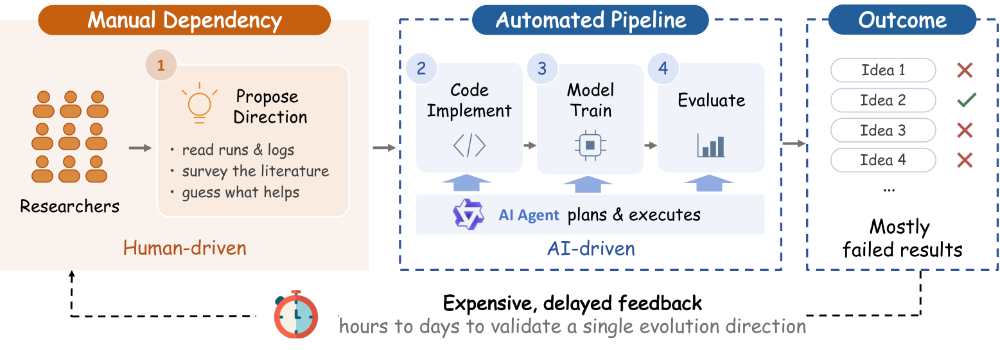
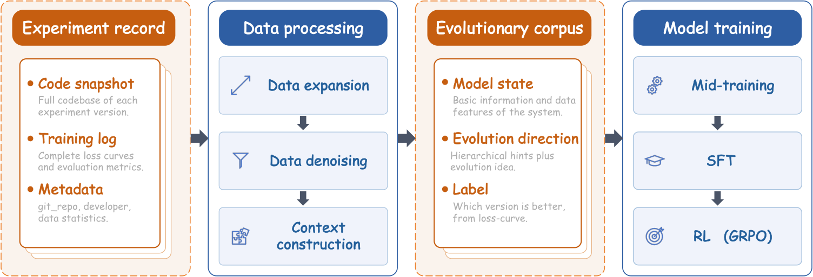
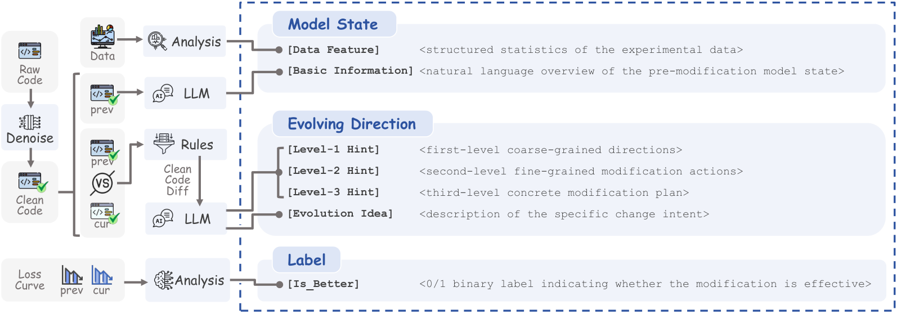
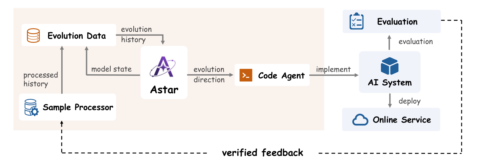

# Alibaba's model-evolution bot: 20 iterations in two weeks, ad GMV +4.86%

> [中文版](ali-astar.md)

### Paper: Astar: Learning to Propose Evolution Directions for Self-Evolving Industrial AI Systems
### Link: https://arxiv.org/html/2608.27287
### Company: Alibaba
### Idea: learn experience from iteration history, constrain the search space hierarchically, use a Reward Model as a cheap proxy validator
### Area: Auto Research (automating algorithm R&D)

## Overview:

Progress in industrial AI systems comes from a four-step loop: **propose an optimization direction → write code → train the model → evaluate**. Coding agents have largely taken over the last three steps. Only the first step, "what should we change this time", is still stuck in the hands of senior experts. And validating a direction means going through the full implement-train-evaluate pipeline, which often takes days; pick the wrong one and days of compute are wasted.



Using a general-purpose LLM to propose directions directly does not work: it knows nothing about your business, your data or your codebase, and its suggestions "all sound right, but none of them match a real pain point". Injecting the knowledge via prompts or skills is also hard, because **this kind of experience is learned by practice, not written down**. So Alibaba took a different route: **train a dedicated small model on the system's own git commit history**. Each commit records "what state we started from, what was changed, and whether the result got better or worse", which is exactly the signal needed to tell good directions from bad ones.



The whole work has just two parts: **on the data side**, boil a pile of messy commits down into a trainable evolution corpus; **on the model side**, run that corpus through mid-training → SFT → RL. The four challenges fall neatly into these two parts:

| Challenge | Design | Belongs to |
|---|---|---|
| C1 Sparse supervision (a repo usually has only a few hundred experiment records) | pairwise data augmentation | data side |
| C2 Useful samples buried in noise (logging, refactoring, config changes) | two-level denoising (rules + LLM semantics) | data side |
| C3 Huge space of optimization directions | three-level hierarchical hints | data-side labeling + model-side output format |
| C4 One validation takes hours to days | Reward Model as a proxy evaluator | model side |

## 1 Data side: boiling messy commits down into an evolution corpus

The raw material is a full snapshot of each experiment: the code repository, the per-step loss series, and metadata such as git_repo/commit/dataset_uri. To turn these into training samples, three hurdles must be cleared: **too few samples → augment**, **too noisy → denoise**, **directions too scattered → label**.

### (1.1) Augmentation: pairwise pairing
Using only adjacent experiments `E_t → E_{t+1}` yields very little data, and adjacent commits are mostly small tweaks. The authors **pair any two versions** `(E_prev, E_cur)`, so the sample count grows from linear to quadratic. The label is obtained automatically by **directly comparing the full loss curves of the two versions**, with no human labeling (note that the loss here is the training loss of the target system being optimized, which online is Lazada's retrieval model; it has nothing to do with the loss of Astar, the LLM, itself; the original experiment records already store the per-step loss series). A by-product is that the model learns evolution trajectories over different time spans.

### (1.2) Denoising: a two-level funnel, rules first, then LLM
First comes rule-level Execution Logic Filtering: **reachability analysis** (build the call graph; changes in dead code are dropped), **AST normalization** (strip print/assert/comments, normalize formatting and import order; identical ASTs mean no logic change), and a **config whitelist** (engineering variables like `output_dir` and `gpu_count` are dropped; algorithm parameters like `learning_rate`, `optimizer` and `dnn_blocks` are kept).

Then Evolution Intent Filtering: an LLM does semantic analysis of the clean diff and maps it to a predefined intent taxonomy; **anything that can't be mapped is dropped entirely**.

Many teams doing similar things get stuck not on the model but on "the history data is too messy". This "rules first, then LLM" funnel can be copied directly.

### (1.3) Labeling: three-level hierarchical hints
Define **Level-1 coarse direction → Level-2 fine-grained modification action → Level-3 concrete modification plan**. Level-1 has 7 categories: model architecture, loss design, optimization strategy, training engineering, RL strategy, data processing, code refactoring. Level-2 is the specific module under each category (attention mechanism, learning-rate schedule, negative sample generation…). Only Level-3 is the action (switch to gated attention, adjust the cosine annealing period, oversample hard examples). In addition, an LLM generates an **Evolution Idea** paragraph to fill in details the taxonomy can't capture.

In training, this provides dense multi-granularity supervision and makes similar directions cluster naturally. At inference, it forces the model to **first pick the broad direction, then the module, and finally produce the plan**, narrowing the space level by level. Removing the hierarchical hints drops the AUC of the model's "will this direction work" judgment from 0.8487 to 0.7910.

### (1.4) The finished product: what one sample looks like



**Model State** = structured dataset statistics + **a natural-language overview of the previous version of the codebase**; **Evolving Direction** = three-level Hint + Evolution Idea; **Label** = `[Is_Better]` 0/1.

A counter-intuitive ablation: using a **natural-language summary** as input is far better than feeding the **raw code repository** directly; the single-proposal hit rate is 67.9% vs 41.5%. Rather than having the model read tens of thousands of lines of code and figure it out, it is better to first have another LLM summarize the codebase into a paragraph.

## 2 Model side: Mid-training → SFT → RL

The base is Qwen3, trained at three sizes, 0.6B/4B/8B, with max seq len 8192. Each of the three stages handles one thing: **learn how to say it → learn to say the right things → learn to say things never said before**.

### (2.1) Mid-training: learn how to say it (112B tokens)
Next-token prediction on the full evolution history, **with no positive/negative filtering at all**. The purpose is domain adaptation plus burning the structured output format with three-level hints into the model. This step contributes the vast majority of the gain: **the single-proposal hit rate jumps from 3.8% straight to 60.4%**, and SFT plus RL afterwards add only 11 more points together. This matches intuition: injecting domain knowledge takes you from 0 to 1; the last two stages take you from 1 to 1.2.

### (2.2) SFT: learn to say the right things (81.1M tokens)
Only positive samples are fed. How is a positive sample defined? Again by the target system's loss curve; the authors define a composite metric

```
s = (1−α)·ℓ_T + α·ℓ̄_k + γ·σ̂_k
```

The three terms are the final-step loss (the converged result), the mean over the last k steps (filtering out momentary fluctuations), and the standard deviation over those k steps (penalizing training oscillation). Then `z = 1[s_cur < s_prev]`, and only z=1 samples are kept for SFT. This shifts the output distribution from "what has been tried historically" toward "what has worked historically".

### (2.3) RL: learn to say things never said before (8.06M tokens)
SFT's ceiling is fitting historically successful trajectories; it can't explore anything new. So GRPO is applied, initialized from the SFT checkpoint, with group size 16. But RL needs an immediate reward, and actually validating a direction takes days: this is C4.

The solution is to **train a separate Reward Model**: LLM backbone + mean pooling + MLP head, trained as a binary classifier on the positive and negative samples selected in the SFT stage, predicting whether this direction will make the loss go down. It supplies rewards for RL and also ranks candidate directions at inference, turning days of validation into seconds of scoring.

Here is a sobering number: **senior algorithm experts judging whether a direction will work have an AUC of only 0.6142**, a bit better than a coin flip but not by much; general models like GPT-5.5 and Claude-4.8-Opus all hover between 0.53 and 0.60, basically random. Astar's reward model, meanwhile, **reaches 0.8094 at 0.6B and 0.8487 at 8B**. This shows that in the question of "which direction will work", there really is a set of patterns that can only be learned from this system's own history and are out of reach of general knowledge.

**Calibrate while training**: as RL training goes on, Astar (in RL jargon, the policy, i.e. the generative model being optimized) gets bolder at proposing new tricks, and the directions it proposes gradually drift away from the historical data distribution. The reward model has only seen history, so beyond its range it can't score accurately: the judge can't read the contestant's new moves. The authors' fix is periodic spot checks: every `T_audit` steps, sample a few directions from the most recently generated batch and **actually run training on them**, comparing the real results with the reward model's scores; if the deviation exceeds a threshold several times in a row, add these measured samples to a calibration set, update the reward model first, then continue training.

## 3 Deployment: connecting the data side and model side into a closed loop
The online workflow has six steps: Astar generates a batch of candidate directions from the current system state → **the Reward Model scores and ranks them, picking the most promising to move forward** → a Code Agent (a general model like Qwen/Claude) translates them into runnable code → training + offline evaluation → winners are pushed online → results go through the denoising pipeline once, are extracted as structured samples, and flow back to keep training Astar.

The second step is where the economics of the whole chain lie: really validating a direction is measured in days, RM scoring is measured in seconds, and its AUC is 0.8487. **Use the seconds-level step to filter out most candidates first, then spend the days-level compute on the few that survive.** The RM trained in the RL stage is reused online; it is not thrown away after training.

The last step goes through the same denoising pipeline from the data side: **every online iteration produces its own training data**. The authors stress that this closed loop is required: **a static Astar falls behind**; once the system evolves into a state the training data doesn't cover, its suggestions are outdated.

(One more note: the paper's Figure 6 and the enumeration in Section 3.4 actually both leave out the RM step; the figure connects Astar directly to the Code Agent. But the caption says "six stages" while only five are listed below it, and both Section 1 and the C4 paragraph explicitly say the RM is used at inference for "rapid ranking of generated evolution direction candidates". It is filled in here following the actual logic.)

## 4 Online results
First, hit rate. It is judged by actually implementing the direction and running it to see whether the loss goes down: **the probability that Astar-8B hits on a single proposal is 67.9%, vs 32.3% for senior algorithm experts and 30.7% for the strongest general model, GPT-5.5**. Even the 0.6B Astar gets 54.4%, crushing all baselines.

Deployed on the retrieval model of the Lazada ad platform, it guided **20 consecutive iterations** within two weeks, with offline Hitrate@200 up **+23.6%** cumulatively. A/B from July 1-5, 2026: **GMV +4.86%, ad revenue +1.82%, clicks +0.84%, orders +1.79%**, all significant at p<0.05. The authors specifically note that retrieval is the upper bound of the whole chain, so this gain will compound downstream.

More worth looking at than the metrics is the order-of-magnitude change in efficiency: throughput of validated directions goes from Θ(1)–Θ(10) per week to **Θ(100) per week**, and the human cost per direction drops **from hours to minutes**. This is no longer "efficiency improvement"; it replaces the whole economics of iteration.

## 5 What directions did it actually propose
**Level-specialized decoder FFN**: Astar found that the decoder shares one FFN, so the same set of parameters has to fit both coarse- and fine-grained codebook token distributions at once, causing cross-level interference. It suggested switching to MoE, with one dedicated expert per codebook level and deterministic routing by level index: FLOPs unchanged, interference removed.

**Spectral denoising for the Muon optimizer**: Astar identified that Newton-Schulz orthogonalization normalizes all singular values to 1, which also amplifies the noise directions that small singular values had been suppressing. It suggested inserting a signal/noise separation step before orthogonalization, using the Marchenko-Pastur bound from random matrix theory as the threshold, and attenuating the noise directions. No learnable parameters.

These two cases don't read like an automation script; they read more like something proposed by a senior colleague who knows this codebase well.

## Takeaways:
* A team should run two things in parallel: tracking external ideas, and labeling internally tried ideas as gained / no gain / not tested cleanly. Reading papers expands your options; going through your own experiment ledger ranks them. Do only the former and you end up chasing trends; do only the latter and you squeeze toothpaste in the same old subspace.
* Manage successful/failed experiments as assets on the same level as features, samples and monitoring. Successes tell you where to go; failures tell you not to pay for the same GPUs again. Manage failed experiments as assets; don't clean them up out of shame.
* The real barrier for this kind of system is data infrastructure: full code snapshots, structured training logs, parseable metrics, a unified commit convention. For teams whose data infrastructure isn't there yet, step one is not training Astar but standardizing experiment records first.

## Credibility: production

## Recommendation: highly recommended


