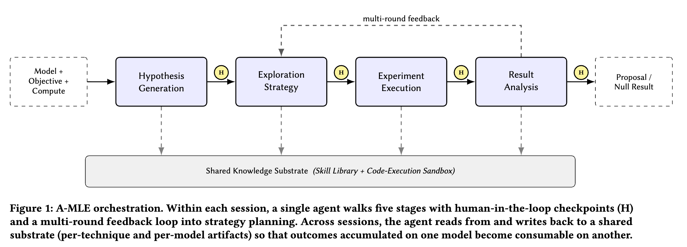

# Meta: handing ad ranking model tuning to an agent, iteration throughput up several times

> [中文版](meta-amle.md)

### Paper: Agentic ML Exploration (A-MLE) for Ads Ranking
### Link: https://arxiv.org/html/2609.08248
### Company: Meta
### Idea: LLM agent
### Area: auto-research

## Overview:

Meta's starting point here is very direct: what's holding ad ranking back right now is neither model capacity nor compute, but **the throughput of one human iteration**. How many rounds of "propose an idea — change the code — train the model — check metrics — write a conclusion" can a senior engineer get through in a week? Single digits. And Meta has dozens to hundreds of ranking models internally; most long-tail models simply never get expert time.

So they built A-MLE: an LLM agent system that runs this loop end to end, five stages chained together, with a human review checkpoint at each stage boundary.

Note that this paper is in the same race as Alibaba's Astar but plays it the opposite way: Astar holds that "proposing directions" requires training a dedicated model, while A-MLE holds that **general LLMs are good enough; what's missing is the engineering scaffolding around them**: a skill library that can actually read configs, change code, submit training jobs and run evaluations, plus a knowledge base recording "which technique has been tried on which model".

## 1 The five stages

**Proposing hypotheses**: read the model's recent training config, the current baseline, and a rolling history of **which techniques this model has tried in the past and how they turned out**, and produce a small batch of candidates (with rationale), each of which must clearly explain why it's worth trying. Besides the LLM's own ideas, it also hooks in a model internal-state analyzer, a training-efficiency analyzer and a literature retriever; finally, another LLM acts as a judge and scores and ranks the batch of candidates on novelty and feasibility. The authors stress that hypotheses must grow out of the model's **current live state**: ranking models change every day, and last week's diagnosis no longer holds this week.

**Setting the strategy**: given a budget (how many training runs, how many GPUs, how long), schedule an experiment sequence, alternating explore (validating a single hypothesis in isolation) and exploit (combining the winners and pushing deeper). "Burn GPUs aggressively or play it safe" is a value judgment, so it is explicitly put at a review checkpoint for a human to decide.

**Running experiments**: change code in a sandbox, run variable type checks and unit tests, submit training jobs, poll logs. The most critical capability is **telling infrastructure failures from training divergence**: if a machine died, retry; if the loss blew up, change the plan; getting it wrong costs days of compute.

**Analyzing results**: compute significance against a **rolling baseline** (not a frozen snapshot), break down local regressions by segment, and automatically rerun when metric variance within a single training run exceeds a threshold. The rolling baseline was forced on them: the online baseline itself keeps getting refreshed, so if you compare against a snapshot from three weeks ago, the offline win may well be just baseline drift.

**Knowledge base**: the only thing persisted across sessions and across models, a **versioned markdown tree stored in the code repository**, recording which models each technique has been tried on and how it turned out. At the start of work, the current model's situation is matched against the applicability annotations in the knowledge base to pull out "techniques that have already won on structurally similar models"; at the end, results (including failures) are written back, going through the code review process.

## 2 Results

**This paper has no online A/B**; model results are offline numbers only (the best tier is joint multi-source architecture + efficiency changes at **+2.56%**, QPS neutral). The real selling point is efficiency: iteration rounds per person per week are **several times** the manual baseline, and training success rate and proposal review pass rate are both higher too. The paper compares three tiers: fully manual, semi-automatic "human proposes hypotheses + scripts run execution", and fully automatic A-MLE. Notably, the middle tier improves much less, which shows that **the leverage is not in single-point tools but in connecting the whole orchestration chain**. The authors also say outright that **the biggest gains come not from new techniques but from transfer**: systematically rolling out what was validated on model A to structurally similar models B, C, D. People do this too, but people can't get through all of it.

## Takeaways:
* This paper and Astar are two answers to the same question, but **they don't contradict each other; it's a matter of stage**. The authors ran a comparison: an agent equipped with the domain skill library scores **68%** on a basic capability test, while a general ML agent scores only **16%**. This first proves that "an agent without domain scaffolding is completely unusable", a step everyone has to take first; only after that does it make sense to talk about whether to train a dedicated model to propose hypotheses.
* The biggest gain is **cross-model technique transfer**, which requires a structured record of "which technique was tried on which model and how it turned out". Most teams don't have one; it's scattered across individual experiment platforms, weekly reports and chat logs. The value of this record doesn't depend on the agent; it's useful for humans to look up too, and it's the only thing in the whole automation setup you can start accumulating today.
* "Semi-automatic gains are far smaller than fully automatic" is counter-intuitive but credible: as long as one point in the loop still needs a human to take over, human scheduling becomes the bottleneck again, and all the time saved earlier is given back.

## Credibility: production (run on Meta's real ranking models, but model gains are offline only, zero A/B)

## Recommendation: worth a look if you have time
