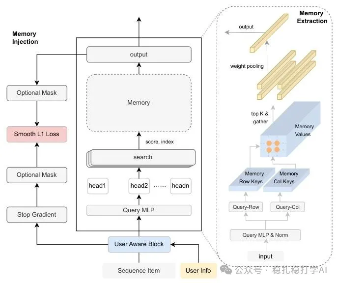

# Recommendation papers (2025.2.11): ByteDance Large Memory Network brings a clustering memory to behavior sequence modeling
> [中文版](2025-02-11-bytedance-large-memory-network.md)

> Source: WeChat post https://mp.weixin.qq.com/s?__biz=MzkzNDYyNjM1NA==&mid=2247484124&idx=1&sn=37480104e408fda8067195db0e0213cb&scene=21#wechat_redirect, published 2025-02-11.
> Split from the roundup "Recommendation algorithms: two industrial-style new results from ByteDance to keep you a step ahead!"; same issue: [ByteDance ADS cross-domain sequence modeling](../cross-domain-recommendation/2025-02-11-bytedance-adaptive-domain-scaling.full.en.md), [ByteDance Large Memory Network](../behavior-sequence-modeling/2025-02-11-bytedance-large-memory-network.full.en.md).

Large Memory Network for Recommendation

Link: https://arxiv.org/pdf/2502.05558

Company: ByteDance

Area: behavior sequence

Overview:

The basic idea is to apply k-means clustering information to behavior sequence modeling, for both the sequence items and the target item. Several recent papers from Tencent, ByteDance and others use this idea.

You maintain a shared piece of information (several papers call it a codebook or memory; here it is also called memory), and every sequence item and the target item both update and query this memory.

Concretely, (1) query: take the centroids of the top-k clusters from the memory and sum-pool them; (2) update: it uses an update called smooth L1 (don't be scared off by the name). In particular, this paper innovates on the query side by borrowing Transformer ideas: separate key/value embeddings, plus computational optimizations.

Takeaways:

The reason this idea works is that it borrows group information, which is especially useful for new items, long-tail items and so on. None of the existing related papers seems to call this out.

It looks like someone struck a mine, the news spread, and everyone rushed over to dig as hard as they can. When I have time later, I'll write an article that clears the fog and explains it systematically.

Similar papers:

* Real-time Indexing for Large-scale Recommendation by Streaming Vector Quantization Retriever (https://arxiv.org/pdf/2501.08695)
* Enhancing User Interest based on Stream Clustering and MemoryNetworks in Large-Scale Recommender Systems (https://arxiv.org/abs/2405.13238)

Credibility: production

Recommendation: worth reading

