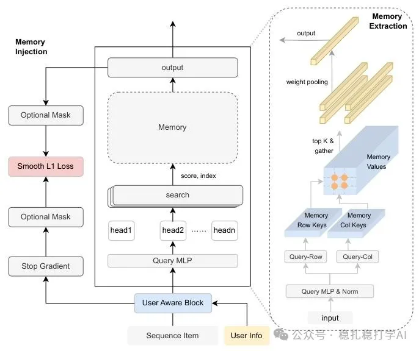

# 推荐算法(2025.2.11)：字节 Large Memory Network 把聚类 memory 用到行为序列建模

> 原文：https://mp.weixin.qq.com/s?__biz=MzkzNDYyNjM1NA==&mid=2247484124&idx=1&sn=37480104e408fda8067195db0e0213cb&scene=21#wechat_redirect
> 作者：算法工程师刘明星（稳扎稳打学AI）| 发表于 2025-02-11
> 本文拆自《推荐算法：字节两篇工业风的最新研究成果，助你领先一步！》，同期 2 篇：[字节 ADS 跨域序列建模](../cross-domain-recommendation/2025-02-11-bytedance-adaptive-domain-scaling.md)、[字节 Large Memory Network](../behavior-sequence-modeling/2025-02-11-bytedance-large-memory-network.md)。

关注我，每天为你精挑细选最优质、最新鲜的推荐算法paper，陪你一起保持进步、不断精进！

> [English version](2025-02-11-bytedance-large-memory-network.full.en.md)

Large Memory Network for Recommendation

网址：https://arxiv.org/pdf/2502.05558

公司：字节

方向：行为序列

解读：

基本idea是kmeans聚类信息应用到行为序列建模上，包括seq item和target item。最近，腾讯、字节等公司发表的多篇paper是利用了这个思想。

就是维护一个公共信息（多篇paper称呼codebook、memory，此处也称之memory），每个序列item以及target item，同时update、查询这个memory。

具体来说，（1）查询：从memory里提取top-k的cluster的centroid，做sum pool；（2）update：这里用一个叫smooth L1的更新（劝各位看官不要被吓退）。特别的，这个paper，在查询的时候，做了一些创新——借用transformer的思想，即key/value embed独立以及计算优化。

心得：

这个idea之所以work是因为借用了group信息，对于新物料、长尾物料等特别有用。已有几篇相关的paper貌似都没有点名这一点。

看上去，就是有人挖到矿了，消息扩散出去之后，大家一窝蜂的冲过去使劲挖。后面有时间，我写一篇文章，给大家系统拨云见雾的讲一下。

类似的paper有：

* Real-time Indexing for Large-scale Recommendation by Streaming Vector Quantization Retriever（https://arxiv.org/pdf/2501.08695）
* Enhancing User Interest based on Stream Clustering and MemoryNetworks in Large-Scale Recommender Systems（https://arxiv.org/abs/2405.13238）

可信度：生产

推荐等级：推荐看看

