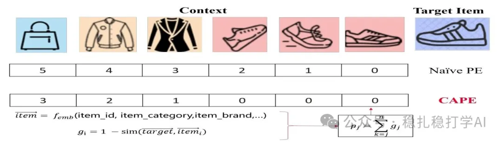

# Recommendation algorithm papers: Huawei's latest work on sequence position encoding, to help you stay a step ahead!

> [中文版](2025-02-14-huawei-cape.md)

1 A Contextual-Aware Position Encoding for Sequential Recommendation

Link: https://arxiv.org/pdf/2502.09027

Company: Huawei

Area: sequence modeling

Overview: Previous position embeddings only looked at an item's position in the sequence and ignored the relationships between items. This paper proposes a new position encoding called CAPE that takes the relationships between items into account. Specifically, CAPE computes the position encoding from the similarity between the target item and the items in the sequence.

Compute the similarity between the items in the sequence and the target item to get a similarity matrix, then use this similarity matrix to compute a position-encoding embedding matrix.

Takeaways: When modeling behavior sequences, considering the relationship between sequence items and the target item from other angles is a good trick and also a frontier direction. Mostly this is done to compute attention; this paper applies it to computing the position embedding, which is an innovation.

Credibility: production

Recommendation: worth a look

