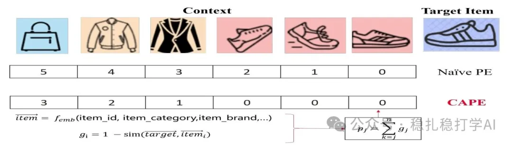

# 推荐算法paper华为序列位置编码最新研究成果，助你领先一步！

> 原文：https://mp.weixin.qq.com/s?__biz=MzkzNDYyNjM1NA==&mid=2247484136&idx=1&sn=4cdcc457302756a2be8aec0eb3fd5014&scene=21#wechat_redirect
> 作者：算法工程师刘明星（稳扎稳打学AI）| 发表于 2025-02-14

关注我，每天为你精挑细选最优质、最新鲜的推荐算法paper，陪你一起保持进步、不断精进！

[本公众号paper推荐原则](https://mp.weixin.qq.com/s?__biz=MzkzNDYyNjM1NA==&mid=2247484097&idx=1&sn=18322c279290b555eb030e12953b7c7f&scene=21#wechat_redirect)

1 A Contextual-Aware Position Encoding for Sequential Recommendation

网址：https://arxiv.org/pdf/2502.09027

公司：华为

方向：序列建模

解读：以往position embedding是只关注item在序列中的位置，而忽略了item之间的关系。本文提出了一个新的位置编码方式，叫CAPE，这个位置编码方式可以考虑item之间的关系。具体地说，CAPE是根据目标item和序列中item的相似性来计算位置编码的。

将序列中的item和目标item进行相似性计算，得到一个相似性矩阵，然后利用这个相似性矩阵，计算出一个位置编码的embed matix。

心得：行为序列建模时，从其它方面考虑seq item和target item的关系，是一个好的trick，也是一个前沿方向。大多数，为了计算attention，这个paper应用在position embed的计算上，是一种创新。

可信度：生产

推荐等级：推荐看看

**借此机会，祝我的妻子情人节快乐！也祝大家情人节快乐！**

请帮忙点赞、转发，谢谢。您认为哪篇论文最有潜力应用到实际业务中？

推荐您继续阅读：

■ [推荐算法paper](https://mp.weixin.qq.com/s?__biz=MzkzNDYyNjM1NA==&mid=2247484130&idx=1&sn=2910ddd3654355594f08011a69c6ab69&scene=21#wechat_redirect)

■ [推荐算法：字节两篇工业风的最新研究成果，助你领先一步！](https://mp.weixin.qq.com/s?__biz=MzkzNDYyNjM1NA==&mid=2247484124&idx=1&sn=37480104e408fda8067195db0e0213cb&scene=21#wechat_redirect)

■ [推荐算法月报：华为、阿里、快手等大厂最新研究成果，助你领先一步！](https://mp.weixin.qq.com/s?__biz=MzkzNDYyNjM1NA==&mid=2247484117&idx=1&sn=ca71dfe08c98de743fccfecd6f64d359&scene=21#wechat_redirect)

个人观点，仅供参考
