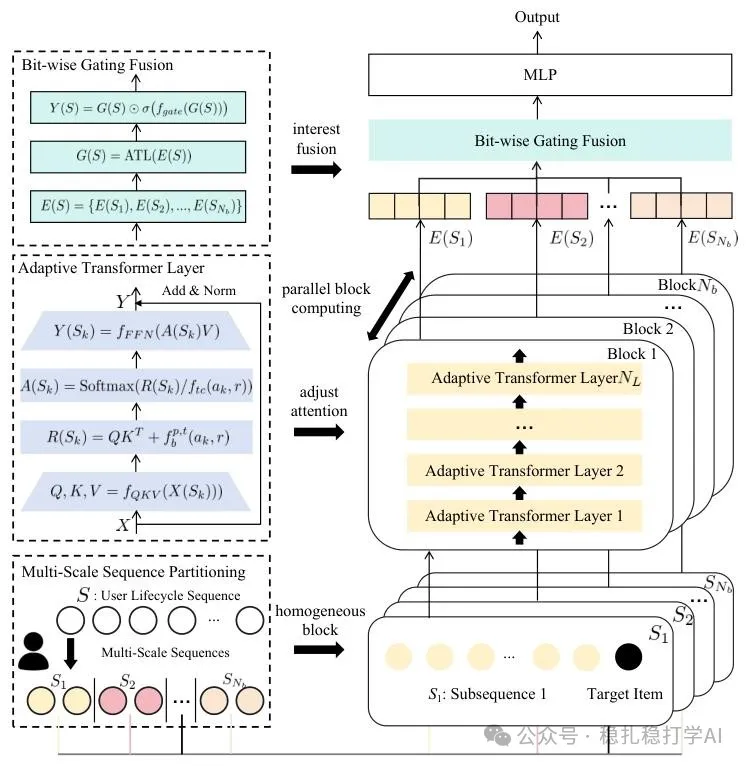

# Recommendation papers (2025.2.17): NetEase Cloud Music borrows from DeepSeek, splitting long sequences in parallel for a resource-optimal large recommendation model
> [中文版](2025-02-17-netease-resource-optimal-scaling.md)

> Source: WeChat post https://mp.weixin.qq.com/s?__biz=MzkzNDYyNjM1NA==&mid=2247484154&idx=1&sn=8f21bd9302b484f856855241759ca345&scene=21#wechat_redirect, published 2025-02-17.
> Split from the roundup "Must-read recommendation papers! Recommendation borrows deeply from DeepSeek for the first time, starting a journey of innovation"; same issue: [NetEase Cloud Music resource-optimal scaling law](../behavior-sequence-modeling/2025-02-17-netease-resource-optimal-scaling.full.en.md), [Meituan SessionRec](../generative-recommendation/2025-02-17-meituan-sessionrec.full.en.md), [JD hybrid cross-stage pre-ranking](../loss-func/2025-02-17-jd-pre-ranking-ssb.full.en.md).

An Efficient Large Recommendation Model: Towards a Resource-Optimal Scaling Law

Link: https://arxiv.org/pdf/2502.09888

Company: NetEase Cloud Music

Area: long behavior sequences

Overview:

(1) Split the sequence and model it in parallel.

The long sequence is split into several sub-sequences; each sub-sequence is treated as a mini-batch and modeled in parallel.

(2) Transformer layers with an adaptive temperature coefficient

For each sub-sequence, it uses a Transformer layer with an adaptive temperature coefficient.

(3) Fusing the embeddings obtained from different sub-sequences

A bit-wise gating fusion integrates the information from the sub-sequences corresponding to the blocks.

Takeaways: DeepSeek lowers cost by computing multiple experts in parallel, and this paper puts that idea into practice. If I'm not mistaken, this is the first recommendation paper to borrow from DeepSeek. I can't help remarking: while you were still wondering which large model is best, attentive people had already "cashed it in".

Credibility: production. Huge gains.

Recommendation: worth reading

