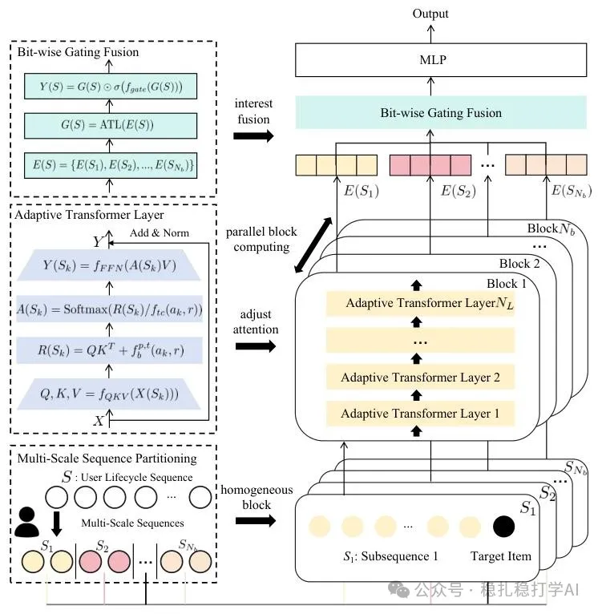

# 推荐算法(2025.2.17)：网易云音乐借鉴 DeepSeek 并行拆分长序列，做资源最优的大推荐模型

> 原文：https://mp.weixin.qq.com/s?__biz=MzkzNDYyNjM1NA==&mid=2247484154&idx=1&sn=8f21bd9302b484f856855241759ca345&scene=21#wechat_redirect
> 作者：算法工程师刘明星（稳扎稳打学AI）| 发表于 2025-02-17
> 本文拆自《推荐算法paper必看！推荐界首次深度借鉴 DeepSeek，开启创新探索之旅》，同期 3 篇：[网易云音乐资源最优 Scaling Law](../behavior-sequence-modeling/2025-02-17-netease-resource-optimal-scaling.md)、[美团 SessionRec](../generative-recommendation/2025-02-17-meituan-sessionrec.md)、[京东跨阶段协同粗排](../loss-func/2025-02-17-jd-pre-ranking-ssb.md)。

关注我，每天为你精挑细选最优质、最新鲜的推荐算法paper，陪你一起保持进步、不断精进！

> [English version](2025-02-17-netease-resource-optimal-scaling.full.en.md)

An Efficient Large Recommendation Model: Towards a Resource-Optimal Scaling Law

网址：https://arxiv.org/pdf/2502.09888

公司：网易云音乐

方向：长行为序列

解读：

（1）序列拆分，并行建模。

将长序列拆分成多个子序列，每个子序列作为一个mini-batch，并行地建模。

（2）自适应温度系数的transformer层

这个是针对每个子序列，做了自适应温度系数的transformer层。

（3）不同序列获得的embed的融合

通过bit-wise的gating fusion，用于整合与个块对应的个子序列的信息。

心得：deepseek多个expert并行计算降低成本，这paper是这一思路的落地。如果没搞错，这篇paper应该是推荐借鉴deepseek的第一篇paper。不得不感慨，你在想着大模型哪家强的时候，有心人已经将其"变现"了。

可信度：生产。涨幅巨大。

推荐等级：推荐看看

