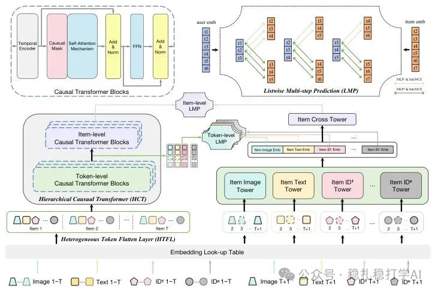

# Recommendation papers (2025.3.4): Alibaba Hierarchical Causal Transformer with heterogeneous information for sequential recommendation
> [中文版](2025-03-04-ali-hct-sequential-rec.md)

> Source: WeChat post https://mp.weixin.qq.com/s?__biz=MzkzNDYyNjM1NA==&mid=2247484283&idx=1&sn=179c3aae8b34adfa7cb679f5b5632af0&scene=21#wechat_redirect, published 2025-03-04.
> Split from the roundup "Recommendation papers (2025.3.4): quick look! New research from Alibaba and Meta"; same issue: [Alibaba Hierarchical Causal Transformer](../behavior-sequence-modeling/2025-03-04-ali-hct-sequential-rec.full.en.md), [Meta efficient LLM CTR training paradigm](../llm4rec/2025-03-04-meta-llm-ctr-training.full.en.md).

Hierarchical Causal Transformer with Heterogeneous Information for Expandable Sequential Recommendation

Link: https://arxiv.org/pdf/2503.01469

Company: Alibaba

Area: sequential recommendation

Overview:

Sequential recommendation is a classic problem, and researchers in this area keep exploring how to better model users' behavior sequences. Recently, with the development of large models, sequential recommendation methods have kept evolving. In recommender systems, a user's behavior sequence usually contains many kinds of heterogeneous information, such as the user's clicks, purchases and favorites, and item attributes such as category, brand and price. This heterogeneous information is crucial for understanding user interest, but how to use it effectively is a challenge.

(1) Heterogeneous information decomposition (HTFL): the key technique is this: first use a Transformer-based encoder to encode the user's historical behavior sequence into a vector, then decompose this vector into two parts: one represents user interest, the other represents heterogeneous information. The idea is that the user-interest representation should be stable, while the heterogeneous-information representation should be dynamic. After decomposition, the two parts are recombined to get the final user representation.

(2) Hierarchical Causal Transformer (HCT): the key technique is this: first use a Transformer-based encoder to encode the user's historical behavior sequence into a vector, then decompose this vector into two parts: one represents user interest, the other represents heterogeneous information. The idea is that the user-interest representation should be stable, while the heterogeneous-information representation should be dynamic. After decomposition, the two parts are recombined to get the final user representation.

Credibility: production

Recommendation: worth reading

