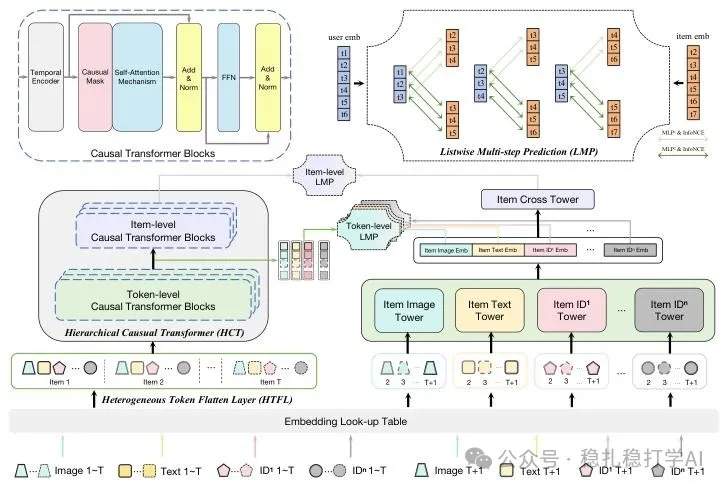

# 推荐算法(2025.3.4)：阿里层级因果Transformer融合异构信息做序列推荐

> 原文：https://mp.weixin.qq.com/s?__biz=MzkzNDYyNjM1NA==&mid=2247484283&idx=1&sn=179c3aae8b34adfa7cb679f5b5632af0&scene=21#wechat_redirect
> 作者：算法工程师刘明星（稳扎稳打学AI）| 发表于 2025-03-04
> 本文拆自《推荐算法(2025.3.4)：速看！阿里Meta的最新研究成果》，同期 2 篇：[阿里层级因果 Transformer](../behavior-sequence-modeling/2025-03-04-ali-hct-sequential-rec.md)、[Meta 高效 LLM CTR 训练范式](../llm4rec/2025-03-04-meta-llm-ctr-training.md)。

关注我，每天为你精挑细选最优质、最新鲜的推荐算法paper，陪你一起保持进步、不断精进！

> [English version](2025-03-04-ali-hct-sequential-rec.full.en.md)

Hierarchical Causal Transformer with Heterogeneous Information for Expandable Sequential Recommendation

网址：https://arxiv.org/pdf/2503.01469

公司：阿里

方向：顺序推荐

解读：

序列推荐是一个经典问题，在这个领域，研究者们一直在探索如何更好地建模用户的行为序列。最近，随着大模型的发展，序列推荐的方法也在不断演进。在推荐系统中，用户的行为序列通常包含多种异构信息，例如用户的点击、购买、收藏等行为，以及物品的类别、品牌、价格等属性。这些异构信息对于理解用户的兴趣至关重要，但是，如何有效地利用这些异构信息，是一个挑战。

（1）异构信息分解（HTFL）：这里的关键技术是：我们先用一个基于 Transformer 的编码器，将用户的历史行为序列编码成一个向量，然后，我们将这个向量分解成两个部分：一个是用户兴趣的表示，另一个是异构信息的表示。这里的想法是：用户兴趣的表示应该是稳定的，而异构信息的表示应该是动态的。分解之后，我们再将这两个部分重新组合，得到最终的用户表示。

（2）层级因果Transformer（HCT）：这里的关键技术是：我们先用一个基于 Transformer 的编码器，将用户的历史行为序列编码成一个向量，然后，我们将这个向量分解成两个部分：一个是用户兴趣的表示，另一个是异构信息的表示。这里的想法是：用户兴趣的表示应该是稳定的，而异构信息的表示应该是动态的。分解之后，我们再将这两个部分重新组合，得到最终的用户表示。

可信度：生产

推荐等级：推荐看看

