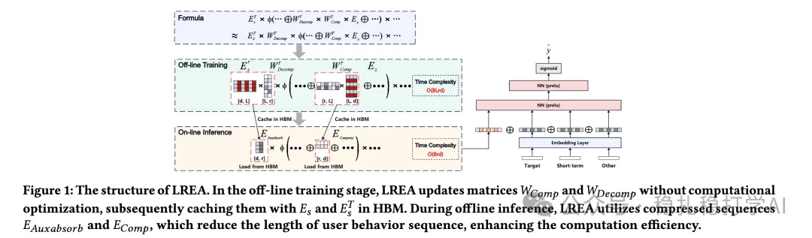

# Recommendation papers (2025.3.5): Alibaba models long behavior sequences efficiently with low-rank compression
> [中文版](2025-03-05-ali-lrea-low-rank-attention.md)

> Source: WeChat post https://mp.weixin.qq.com/s?__biz=MzkzNDYyNjM1NA==&mid=2247484290&idx=1&sn=7febb51dd122338fb676f3d5f90e934c&scene=21#wechat_redirect, published 2025-03-05.
> Split from the roundup "Recommendation papers (2025.3.5): the spring breeze of large models keeps blowing, Baidu and Alibaba bring surprises"; same issue: [Baidu cascaded sparse + dense generative recommendation](../generative-recommendation/2025-03-05-baidu-sparse-dense-generative.full.en.md), [Alibaba LREA low-rank attention for long sequences](../behavior-sequence-modeling/2025-03-05-ali-lrea-low-rank-attention.full.en.md).

Efficient Long Sequential Low-rank Adaptive Attention for Click-through rate Prediction

Link: https://arxiv.org/pdf/2503.02542

Company: Alibaba

Area: long behavior sequence recommendation

Overview:

Proposes a new attention mechanism for modeling user interest from long behavior sequences: it handles long sequences efficiently through low-rank compression and matrix absorption.

What is low-rank compression?

We all know that the longer a user's behavior sequence, the more information it holds for the model, but computing attention on it directly is very expensive in both compute and storage. So the common way to handle long behavior sequences is to compress the sequence first and then compute attention over the compressed sequence. There are many ways to compress; common ones are truncation, sampling, clustering and pooling. Recently a new compression method, low-rank compression, has been getting more and more attention.

The basic idea of low-rank compression: assume the matrix we want to compress is low-rank, then we can find a low-rank approximation to replace the original matrix. Say the embedding matrix of the original sequence is E; we find two low-rank matrices W and H such that E≈W·H, where W and H are both smaller than E. We can then use W and H in place of E, reducing compute and storage overhead while keeping as much of the original information as possible. It is based on the "low-rank approximation" principle from linear algebra, and it is a common technique in large models.

Takeaways:

Long sequences are a research hotspot, and with large models as the main force, the enthusiasm is even higher. Compared with earlier information-filtering methods, compressing the information in long sequences is a proven good direction.

Credibility: production

Recommendation: worth reading

Figure 1: The structure of LREA. In the off-line training stage, LREA updates matrices W_comp and W_decomp without computational optimization, subsequently caching them with E_s and E_t^A in HBM. During offline inference, LREA utilizes compressed sequences E_AuxAbsorb and E_Comp, which reduce the length of user behavior sequence, enhancing the computation efficiency.
