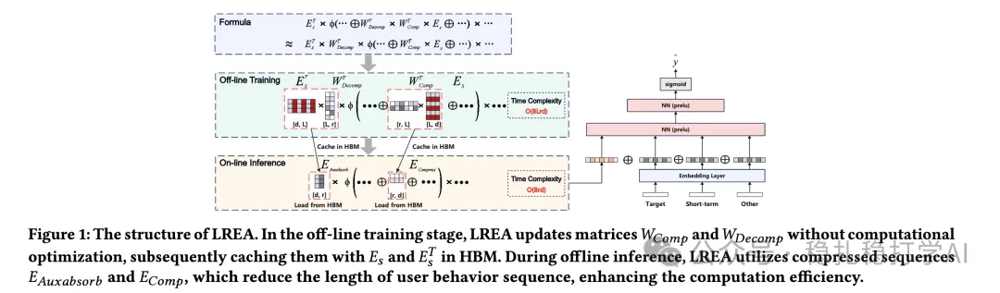

# 推荐算法(2025.3.5)：阿里用低秩压缩高效建模长行为序列

> 原文：https://mp.weixin.qq.com/s?__biz=MzkzNDYyNjM1NA==&mid=2247484290&idx=1&sn=7febb51dd122338fb676f3d5f90e934c&scene=21#wechat_redirect
> 作者：算法工程师刘明星（稳扎稳打学AI）| 发表于 2025-03-05
> 本文拆自《推荐算法(2025.3.5)：大模型的春风吹呀吹，百度、阿里带来惊喜》，同期 2 篇：[百度稀疏+稠密级联生成式推荐](../generative-recommendation/2025-03-05-baidu-sparse-dense-generative.md)、[阿里低秩长序列注意力 LREA](../behavior-sequence-modeling/2025-03-05-ali-lrea-low-rank-attention.md)。

关注我，每天为你精挑细选最优质、最新鲜的推荐算法paper，陪你一起保持进步、不断精进！

> [English version](2025-03-05-ali-lrea-low-rank-attention.full.en.md)

Efficient Long Sequential Low-rank Adaptive Attention for Click-through rate Prediction

网址：https://arxiv.org/pdf/2503.02542

公司：阿里

方向：长行为序列推荐

解读：

提出了一种新颖的长行为序列用户兴趣建模的注意力机制——通过低秩压缩和矩阵吸收高效处理长序列。

什么是低秩压缩？

我们都知道，对模型来说，用户的行为序列越长，它包含的信息越多，但是直接拿过来计算attention，计算量和存储都非常大。所以，处理长行为序列的常用方法是先将长序列进行压缩，然后再对压缩后的序列进行attention计算。压缩的方法有许多种，比较常见的有截断、采样、聚类、池化等。最近，有一种新的压缩方法——低秩压缩，正在受到越来越多的关注。

低秩压缩的基本思想是：假设我们要压缩的矩阵是低秩的，那么我们可以通过找到一个低秩的近似矩阵，来替代原始的矩阵。假设原始序列的embedding矩阵是E，那么我们可以通过找到两个低秩矩阵W和H，使得E≈W·H，其中W和H的维度都比E小。这样，我们就可以用W和H来替代E，从而减少计算量和存储的开销，同时尽量保留原始信息。它基于线性代数中的“低秩近似”原理。这在大模型里是常用技术。

心得：

长序列是一个研究热点，特别是在大模型的主力下，热情更加高涨。相比之前的信息过滤方法，长序列的信息压缩是一个被证明了的好方向。

可信度：生产

推荐等级：推荐看看

Figure 1: The structure of LREA. In the off-line training stage, LREA updates matrices W_comp and W_decomp without computational optimization, subsequently caching them with E_s and E_t^A in HBM. During offline inference, LREA utilizes compressed sequences E_AuxAbsorb and E_Comp, which reduce the length of user behavior sequence, enhancing the computation efficiency.
