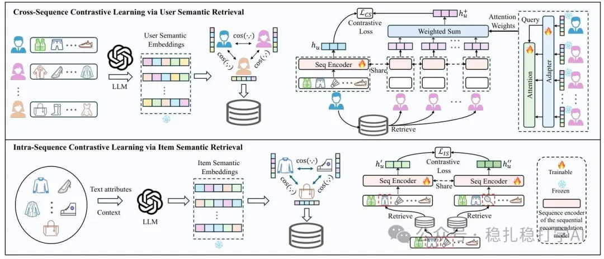

# Recommendation algorithms (2025.3.7): Tencent shows again that similar users and items improve recommendation

> [中文版](2025-03-07-tencent-sracl.md)

1 Semantic Retrieval Augmented Contrastive Learning for Sequential Recommendation

Link: https://arxiv.org/pdf/2503.04162

Company: Tencent

Area: behavior sequences + cold start (users and items)

Overview:

As you may have noticed recently, there are quite a few papers on improving recommendation with similar items, but far fewer on improving it with similar users or similar behaviors. This paper combines the two into one, which is somewhat novel and somewhat interesting.

Put simply, the authors argue that methods for bringing similarity information into sequential recommendation can be divided into intra-sequence contrastive learning and cross-sequence contrastive learning.

Intra-sequence contrastive learning: find items similar to a sequence item and randomly substitute them in as positive samples. This paper's innovation is that similar items are not found using plain text similarity alone; instead, an LLM does semantic understanding of the item's text attributes to find similar items. The authors also bring in some techniques from contrastive learning, such as using similar items' embeddings as positives and dissimilar items' embeddings as negatives.

Cross-sequence contrastive learning: find the sequences of users similar to this user and build positive samples for contrastive learning. This paper's innovation is that the retrieval unit changes from groups to individual users.

Takeaways:

Changing the retrieval unit from groups to users and items is an interesting idea. The reason it didn't work before is that the technology wasn't mature; now that LLMs have developed, doing this kind of retrieval and recommendation comes naturally.

Cold start is a big problem, and similar users and similar items can ease it. Bringing this methodology back at this point in time should definitely work fairly well. As you have seen, there are many papers on improving recommendation with similar items, and quite a few on similar users and similar behaviors too.

Credibility: offline

Recommendation: worth a look

