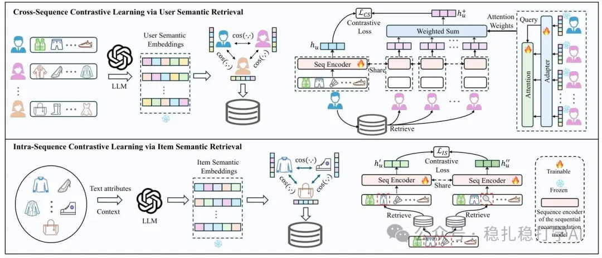

# 推荐算法(2025.3.7)：腾讯再次证明相似用户和物料提升推荐效果

> 原文：https://mp.weixin.qq.com/s?__biz=MzkzNDYyNjM1NA==&mid=2247484296&idx=1&sn=f24a6d6b38309f620ccbc5041cc1f32e&scene=21#wechat_redirect
> 作者：算法工程师刘明星（稳扎稳打学AI）| 发表于 2025-03-07

关注我，每天为你精挑细选最优质、最新鲜的推荐算法paper，陪你一起保持进步、不断精进！

📄 [本公众号paper推荐原则](https://mp.weixin.qq.com/s?__biz=MzkzNDYyNjM1NA==&mid=2247484097&idx=1&sn=18322c279290b555eb030e12953b7c7f&scene=21#wechat_redirect)

1 Semantic Retrieval Augmented Contrastive Learning for Sequential Recommendation

网址：https://arxiv.org/pdf/2503.04162

公司：腾讯

方向：行为序列+冷启（用户和物料）

解读：

最近大家看到了，相似物料提升推荐效果的paper不少，相似用户、相似行为提升推荐效果的paper则少的多。这篇paper将这两个合二为一，有点创新，有点意思。

简单来说，作者认为将相似信息融入序列推荐建模的方法可以分为序列内对比学习和跨序列对比学习。

序列内对比学习：找sequence item相似的item random替换作为正样本，这篇paper的创新就是相似item的生成不是简单地只用了文本相似度，而是用了一个LLM对item的text attributes做语义理解，来找相似item。同时，作者还引入了对比学习中的一些技术，例如将相似item的embedding作为正样本，将不相似item的embedding作为负样本。

跨序列对比学习：找用户相似的user的序列，构建正样本对比学习。这篇paper的创新就是搜索单元从群组变成用户。

心得：

把检索的单元，从群组，变成用户和item，这个想法有意思。为什么之前做不起来，是因为技术不成熟；现在LLM发展起来了，再做这种检索、推荐，就自然了。

冷启动问题是个大问题，相似用户和相似物料可以缓解。这一套方法论在现在这个时间点再拿出来做，效果肯定还不错。就像大家看到的，相似物料提升推荐效果的paper很多，相似用户、相似行为提升推荐效果的paper也不少。

可信度：离线

推荐等级：推荐看看

请帮忙点赞、转发，谢谢。您认为哪篇论文最有潜力应用到实际业务中？

推荐您继续阅读：

■ [推荐算法(2025.3.5)：大模型的春风吹呀吹，百度、阿里带来惊喜](https://mp.weixin.qq.com/s?__biz=MzkzNDYyNjM1NA==&mid=2247484290&idx=1&sn=7febb51dd122338fb676f3d5f90e934c&scene=21#wechat_redirect)

■ [推荐算法(2025.3.4)：速看！阿里Meta的最新研究成果](https://mp.weixin.qq.com/s?__biz=MzkzNDYyNjM1NA==&mid=2247484283&idx=1&sn=179c3aae8b34adfa7cb679f5b5632af0&scene=21#wechat_redirect)

■ [推荐算法(2025.3.3)：速看！快手两篇工业风的最新研究成果](https://mp.weixin.qq.com/s?__biz=MzkzNDYyNjM1NA==&mid=2247484276&idx=1&sn=134d4e8c042b893caaad63a3666429c2&scene=21#wechat_redirect)

个人观点，仅供参考
