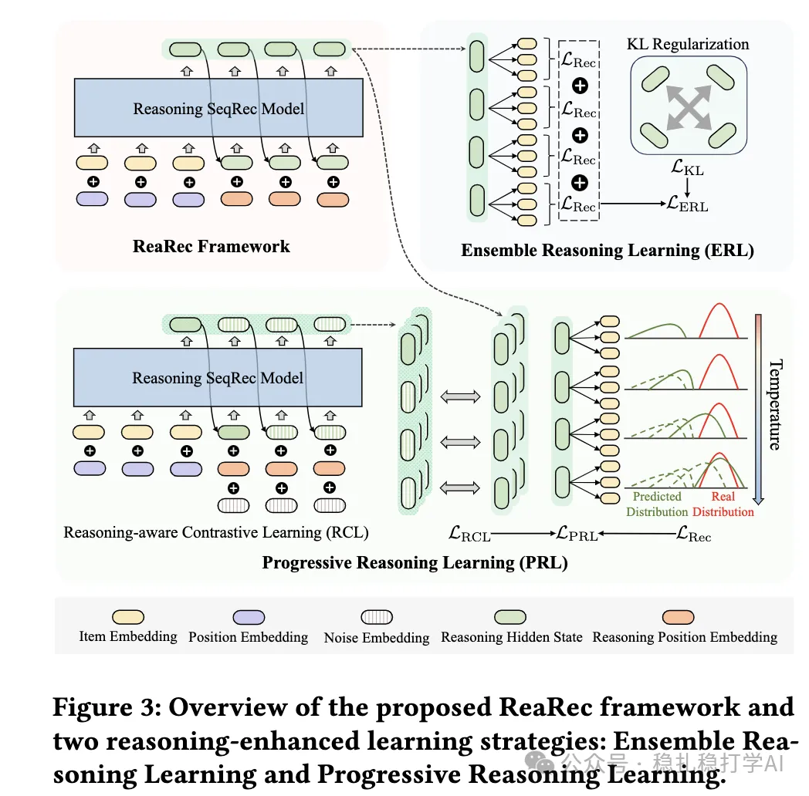

# Recommendation algorithms (2025.3.31): Alibaba's attempt at chain-of-thought

> [中文版](2025-03-31-ali-rearec.md)

1 Think Before Recommend: Unleashing the Latent Reasoning Power for Sequential Recommendation

Link: https://arxiv.org/pdf/2503.22675

Company: Alibaba

Area: sequential recommendation + chain-of-thought

Overview:

An attempt to bring chain-of-thought into recommendation algorithms, specifically behavior sequence modeling.

At inference, the last hidden state of the sequence encoder is fed back into the model several times autoregressively, performing K steps of implicit reasoning. This deepens feature crossing and approximates the user's true interest distribution more precisely.

Takeaways: still needs further validation by industry.

Credibility: offline

Recommendation: worth a look if you have time

Figure 3: Overview of the proposed ReaRec framework and… (the caption was truncated in the captured view)
