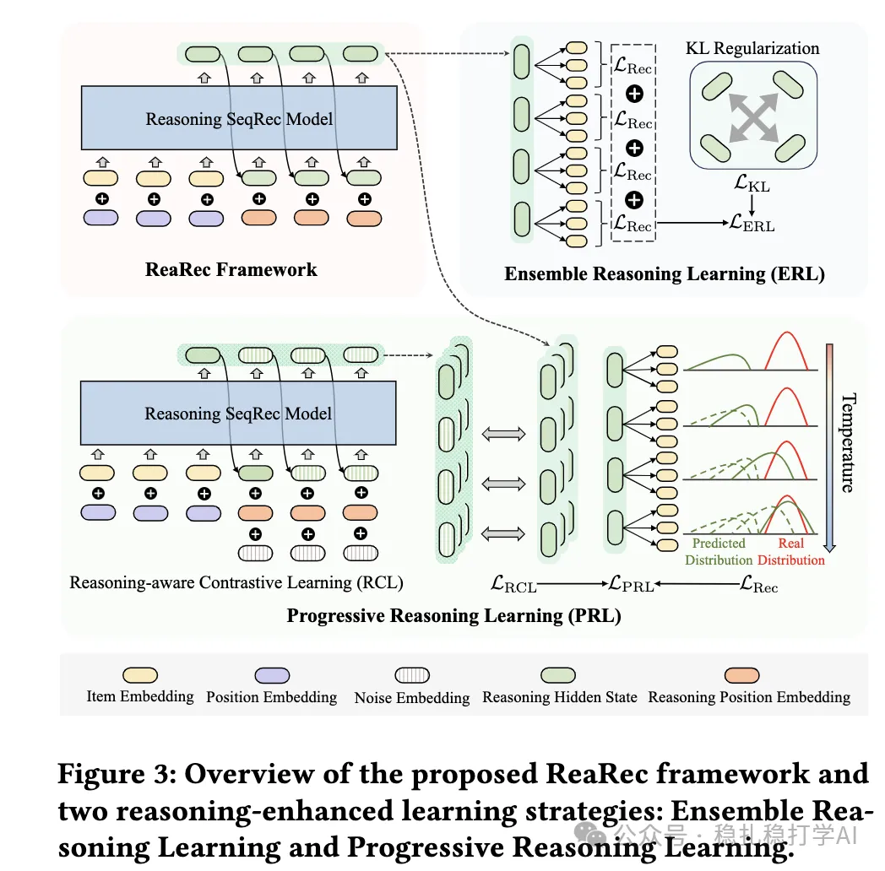

# 推荐算法(2025.3.31)：阿里的思维链尝试

> 原文：https://mp.weixin.qq.com/s?__biz=MzkzNDYyNjM1NA==&mid=2247484381&idx=1&sn=bdd18a629eb6c668c3ad9002f10c77c3&scene=21#wechat_redirect
> 作者：算法工程师刘明星（稳扎稳打学AI）| 发表于 2025-03-31（标题已修改；修改于 2025-03-31）

嘿，记得给“稳扎稳打学AI”添加星标

关注我，每天为你精挑细选最优质、最新鲜的推荐算法paper，陪你一起保持进步、不断精进！

> [English version](2025-03-31-ali-rearec.full.en.md)

📄 [本公众号paper推荐原则](https://mp.weixin.qq.com/s?__biz=MzkzNDYyNjM1NA==&mid=2247484097&idx=1&sn=18322c279290b555eb030e12953b7c7f&scene=21#wechat_redirect)

1 Think Before Recommend: Unleashing the Latent Reasoning Power for Sequential Recommendation

网址：https://arxiv.org/pdf/2503.22675

公司：阿里

方向：序列推荐+思维链

解读：

思维链在推荐算法上的尝试——行为序列建模。

在推理阶段通过自回归方式（autoregressive）将序列编码器的最后一个隐藏状态多次反馈到模型中，执行 K 步隐式推理，从而深化特征交叉（feature crossing），更精确地逼近用户真实兴趣分布。

心得：有待业界进一步验证。

可信度：离线

推荐等级：有时间看看

Figure 3: Overview of the proposed ReaRec framework and…（图注在抓取视图中被截断）

请帮忙点赞、转发，谢谢。您认为哪篇论文最有潜力应用到实际业务中？

## 欢迎干货投稿 \ 论文宣传 \ 合作交流

推荐您继续阅读：

■ [推荐算法周报(2025.3.29)：“生成式”正当时](https://mp.weixin.qq.com/s?__biz=MzkzNDYyNjM1NA==&mid=2247484375&idx=1&sn=58bbb69e51905e3894f86a3d328ed32f&scene=21#wechat_redirect)

■ [推荐算法(2025.3.28)：阿里把刀磨的锃亮](https://mp.weixin.qq.com/s?__biz=MzkzNDYyNjM1NA==&mid=2247484367&idx=1&sn=7c13d464e011a462340a2d19ec24ea03&scene=21#wechat_redirect)

■ [推荐算法(2025.3.26)：Amazon的通用多模态检索方案](https://mp.weixin.qq.com/s?__biz=MzkzNDYyNjM1NA==&mid=2247484361&idx=1&sn=ef14cd71ae96be68b2b0c0268bff11f5&scene=21#wechat_redirect)

历史文章索引：https://docs.qq.com/sheet/DYXZTZ0sseHRyZGtt?tab=BB08J2

由于公众号试行乱序推送，您可能不再准时收到稳扎稳打学AI的推送。为了第一时间收到本号的干货内容， 请将本号设为星标，以及常点文末右下角的“在看”。

喜欢的话点个在看吧 👇

个人观点，仅供参考

修改于2025年3月31日
