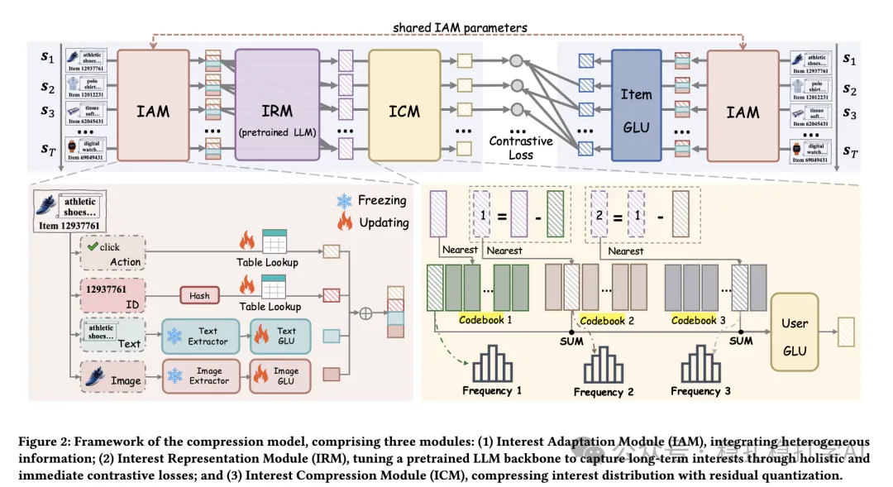

# Recommendation papers (2025.4.13): Alibaba IRM, extracting multiple interests in sequential recommendation with an interest relation graph
> [中文版](2025-04-13-ali-irm-multi-interest.md)

> Source: WeChat post https://mp.weixin.qq.com/s?__biz=MzkzNDYyNjM1NA==&mid=2247484463&idx=1&sn=90353108084037be368a109f3df35b2d&scene=21#wechat_redirect, published 2025-04-13.
> Split from the roundup "Recommendation papers (2025.4.13): RQ-VAE is like the Transformer, reshaping recommendation"; same issue: [Meituan RQ-VAE in industrial practice](../sid/2025-04-13-meituan-rq-vae.full.en.md), [Alibaba IRM multi-interest extraction](../behavior-sequence-modeling/2025-04-13-ali-irm-multi-interest.full.en.md), [Huawei MTGRec multi-identifier item tokenization](../sid/2025-04-13-huawei-mtgrec-multi-identifier.full.en.md).

Interest Relation Model (IRM): Multi-interest Extraction in Sequential Recommendation

Link: https://arxiv.org/pdf/2504.04920

Company: Alibaba

Area: multi-interest modeling

Overview:

The paper proposes the Interest Relation Model (IRM), which turns the items interacted with in a sequence into interest nodes and extracts the user's multiple interests through an interest relation graph.

(1) Graph construction: an interest graph is built from the user's interaction sequence; nodes are user interests, and edges express how strongly interests are related.

(2) Interest relation graph: the interest relation graph model learns the relations among user interests jointly, capturing long-term global interests and recent local interests separately. Many loss terms are computed in a single forward pass, which cuts compute cost significantly.

(3) Learning objective: an instant loss and an interest-centered loss are optimized together, so interest extraction attends to both immediate behavior and long-term behavior.

Takeaways: multi-interest learning is a very important topic.

Credibility: offline

Recommendation: worth reading

