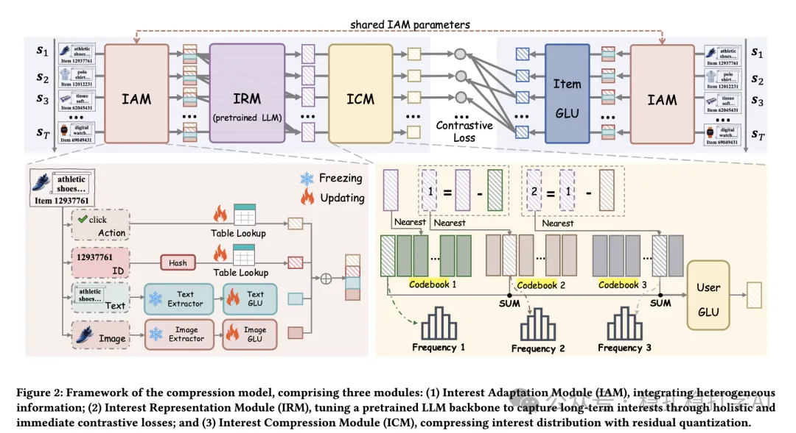

# 推荐算法(2025.4.13)：阿里IRM，用兴趣关系图提取序列推荐中的多兴趣

> 原文：https://mp.weixin.qq.com/s?__biz=MzkzNDYyNjM1NA==&mid=2247484463&idx=1&sn=90353108084037be368a109f3df35b2d&scene=21#wechat_redirect
> 作者：算法工程师刘明星（稳扎稳打学AI）| 发表于 2025-04-13
> 本文拆自《推荐算法(2025.4.13)：RQ-VAE犹如Transformer，重塑推荐》，同期 3 篇：[美团 RQ-VAE 工业实践](../sid/2025-04-13-meituan-rq-vae.md)、[阿里 IRM 多兴趣提取](../behavior-sequence-modeling/2025-04-13-ali-irm-multi-interest.md)、[华为 MTGRec 多标识 item tokenization](../sid/2025-04-13-huawei-mtgrec-multi-identifier.md)。

关注我，每天为你精挑细选最优质、最新鲜的推荐算法paper，陪你一起保持进步、不断精进！

> [English version](2025-04-13-ali-irm-multi-interest.full.en.md)

Interest Relation Model (IRM): Multi-interest Extraction in Sequential Recommendation

网址：https://arxiv.org/pdf/2504.04920

公司：阿里

方向：多兴趣建模

解读：

提出了兴趣关系模型（IRM），通过将序列中交互的项目转化为兴趣节点，并通过兴趣关系图提取用户多兴趣。

（1）建图：利用用户交互序列建立兴趣图，节点为用户兴趣，边表示兴趣之间的关联程度。

（2）兴趣关系图：通过兴趣关系图模型同时学习用户兴趣之间的相互关系，分别捕捉长期全局兴趣和近期局部兴趣。通过单次前向传播计算大量损失项，显著降低计算成本。

（3）学习目标：通过即时损失（instant loss）和兴趣中心损失（interest-centered loss）共同优化，使得兴趣提取既关注即时行为又关注长期行为。

心得：多兴趣学习是一个非常重要的话题。

可信度：离线

推荐等级：推荐看看

