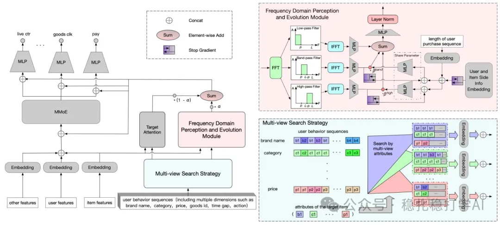

# Recommendation papers (2025.4.28): Kuaishou FIM, modeling periodic interests with multi-view search and the Fourier transform
> [中文版](2025-04-28-kuaishou-fim-periodic-interest.md)

> Source: WeChat post https://mp.weixin.qq.com/s?__biz=MzkzNDYyNjM1NA==&mid=2247484600&idx=1&sn=20790b6a927172aeb58c03d084de83e9&scene=21#wechat_redirect, published 2025-04-28.
> Split from the roundup "Recommendation papers (2025.4.28): Kuaishou and Pinterest, results full of industrial flavor"; same issue: [Pinterest OmniSage graph representation learning](../representation-quality/2025-04-28-pinterest-omnisage.full.en.md), [Kuaishou FIM periodic interest modeling](../behavior-sequence-modeling/2025-04-28-kuaishou-fim-periodic-interest.full.en.md).

Intro of this issue:

Today I introduce two papers: one is Pinterest's graph-learning representation method, the other is Kuaishou's periodic interest modeling.

FIM: Frequency-aware Interest Modeling

Link: https://arxiv.org/pdf/2504.17814

Company: Kuaishou

Area: behavior sequence modeling, periodic interest modeling

Overview: from Kuaishou Local Services, a very typical method for modeling periodic purchase interests. Two tricks try to capture users' periodic purchase interests. It proposes a multi-view search strategy that decomposes the user's needs from different views to separate their different periodic intents, and it also proposes a frequency-domain perception and evolution module. This module uses the Fourier transform to move the user's temporal behavior into the frequency domain, letting the model dynamically perceive their periodic patterns. The outputs of multi-view interest modeling and frequency-aware modeling are fused with weights and fed into a multi-gate mixture-of-experts model (MMoE) for multi-task learning (e.g. CTR prediction, watch time estimation, purchase rate prediction); this is the PPNet-style shortcut approach.

Specifically:

(1) Multi-view search strategy (MSS): decomposes user needs from four views (price, brand, category, author) and extracts the behavior subsequences related to a specific need, capturing latent periodic patterns. In short, the subsequences obtained from the 4 views are the inputs to TA (target attention) and FPEM downstream.

(2) Frequency-domain perception and evolution module (FPEM): uses the fast Fourier transform (FFT) to move the user behavior sequence from the time domain to the frequency domain, separates periodic patterns with filters for different frequency bands, and uses a frequency evolution module to dynamically capture how user interests evolve.

Why generate four subsequences?

(1) Diversity: each view reflects a different aspect of user interest (price reflects spending power, brand reflects loyalty, category reflects the type of need, author reflects trust). A single view (e.g. category only) cannot fully capture the user's complex needs.

(2) Separating periodicities: subsequences from different views correspond to behaviors with different periodicities. For example, the price view may capture high-frequency spending (small daily purchases), while the category view may capture low-frequency behavior (seasonal travel).

(3) Complementarity: the four subsequences complement each other and together give a more complete interest representation. For example, the price and brand views may reveal a user's preference for good-value brands, while the category and author views may reveal loyalty to a particular type of service.

Takeaways: the A/B results look good, and it lives up to "full of industrial flavor". In a two-week A/B test on Kuaishou's local services platform, MSS improved GMV (+8.462%), paid orders (+7.122%) and number of buyers (+6.010%).

Credibility: production

Recommendation: worth reading

