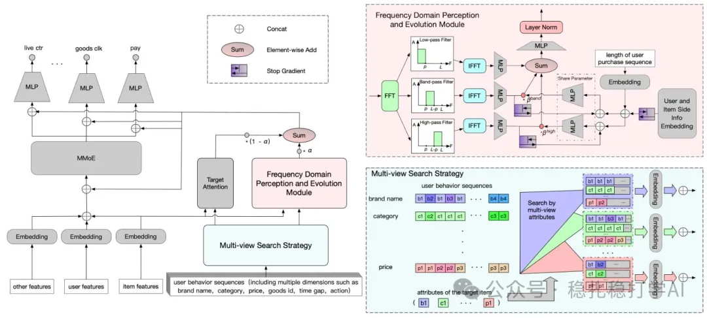

# 推荐算法(2025.4.28)：快手FIM，用多视图搜索和傅里叶变换建模周期性兴趣

> 原文：https://mp.weixin.qq.com/s?__biz=MzkzNDYyNjM1NA==&mid=2247484600&idx=1&sn=20790b6a927172aeb58c03d084de83e9&scene=21#wechat_redirect
> 作者：算法工程师刘明星（稳扎稳打学AI）| 发表于 2025-04-28（修改于 2025-04-28）
> 本文拆自《推荐算法(2025.4.28)：快手、Pinterest的满满工业风成果》，同期 2 篇：[Pinterest OmniSage 图表征学习](../representation-quality/2025-04-28-pinterest-omnisage.md)、[快手 FIM 周期性兴趣建模](../behavior-sequence-modeling/2025-04-28-kuaishou-fim-periodic-interest.md)。

关注我，每天为你精挑细选最优质、最新鲜的推荐算法paper，陪你一起保持进步、不断精进！

> [English version](2025-04-28-kuaishou-fim-periodic-interest.full.en.md)

当期前言：

今天介绍两篇，一篇是Pinterest的图学习表征方法，一篇是快手的周期性兴趣建模。

FIM: Frequency-aware Interest Modeling

网址：https://arxiv.org/pdf/2504.17814

公司：快手

方向：行为序列建模、周期性兴趣建模

解读：快手本地生活，一个很典型的周期性购买兴趣建模方法。两个trick试图抓取用户的周期性购买兴趣。提出了一种多视图搜索策略，该策略从不同的视角分解用户的需求，以分离出他们不同的周期性意图；还提出了一个频域感知与进化模块。该模块利用傅里叶变换将用户的时间行为转换到频域，使模型能够动态感知他们的周期性特征。将多视图兴趣建模和频率感知建模的输出加权融合，输入到多门混合专家模型（MMoE）进行多任务学习（如点击率预测、观看时间估计、购买率预测），这是ppnet的shortcut方式。

具体的，

（1）多视图搜索策略（MSS）：从价格、品牌、类别、作者四个视角分解用户需求，提取与特定需求相关的行为子序列，捕获潜在的周期性特征。就是从4个视角获得的子序列，下游做TA和FPEM的输入。

（2）频率域感知与演化模块（FPEM）：利用快速傅里叶变换（FFT）将用户行为序列从时域转换到频域，通过不同频率带滤波器分离周期性特征，并使用频率演化模块动态捕捉用户兴趣的演变。

为什么生成四个子序列？

（1）多样性：每个视角反映了用户兴趣的不同方面（价格反映消费能力，品牌反映忠诚度，类别反映需求类型，作者反映信任度）。单一视角（如仅类别）无法全面捕获用户的复杂需求。

（2）周期性分离：不同视角的子序列对应不同周期性的行为。例如，价格视角可能捕获高频消费行为（每日小额消费），而类别视角可能捕获低频行为（每季出行）。

（3）互补性：四个子序列互补，共同提供更全面的兴趣表示。例如，价格和品牌视角可能揭示用户对高性价比品牌的偏好，而类别和作者视角可能揭示用户对特定服务类型的忠诚度。

心得：看AB效果不错，也配得上工业风满满。在快手本地生活服务平台进行为期两周的A/B测试，MSS提升了GMV（+8.462%）、支付订单数（+7.122%）和买家数（+6.010%）。

可信度：生产

推荐等级：推荐看看

