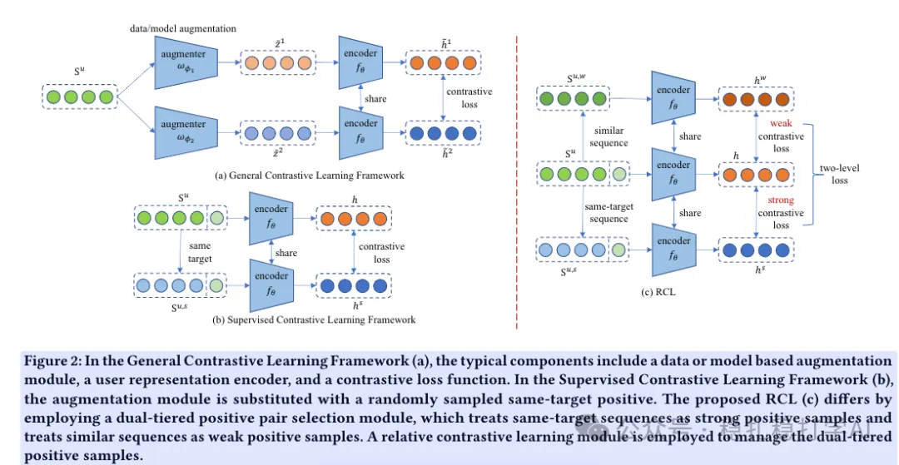

# Recommendation algorithms (2025.4.29): Meituan's method for boosting behavior sequence models

> [中文版](2025-04-29-meituan-rcl.md)

1 Relative Contrastive Learning for Sequential Recommendation with Similarity-based Positive Pair Selection

Link: https://arxiv.org/pdf/2504.19178

Company: Meituan

Area: behavior sequences + contrastive learning

Overview: For a user behavior sequence, find some weak positives and strong positives for data augmentation, and improve the model through contrastive learning. Weak positives are sequences similar to the given sequence under several similarity measures; strong positives are sequences with the same target item. During modeling, strong positives are kept closer to the sequence than weak positives.

Two modules are designed: a dual-tier positive sample selection module and a relative contrastive learning module.

(1) Dual-tier positive sample selection module:

1) Strong positives: select sequences that share the same target item as the anchor sequence, and randomly sample one as the strong positive. This is the method of the earlier work SCL. Its problems: there aren't enough contrastive signals because sequences with the same target are scarce, and how to make effective use of similar sequences (different target items but similar intent) as positives remains challenging.

2) Weak positives: based on several similarity measures (Jaccard, TF-IDF, N-grams, Levenshtein Distance, Semantic Distance), select sequences that are similar to the anchor sequence but have a different target item, with sampling probability proportional to the similarity score. This solves the scarcity of positives in SCL and ensures every sequence has a positive.

(2) Relative contrastive learning module:

Through the relative contrastive learning module, the model learns the relative relationship between strong and weak positives, which improves the model.

Credibility: offline

Recommendation: worth a look if you have time

