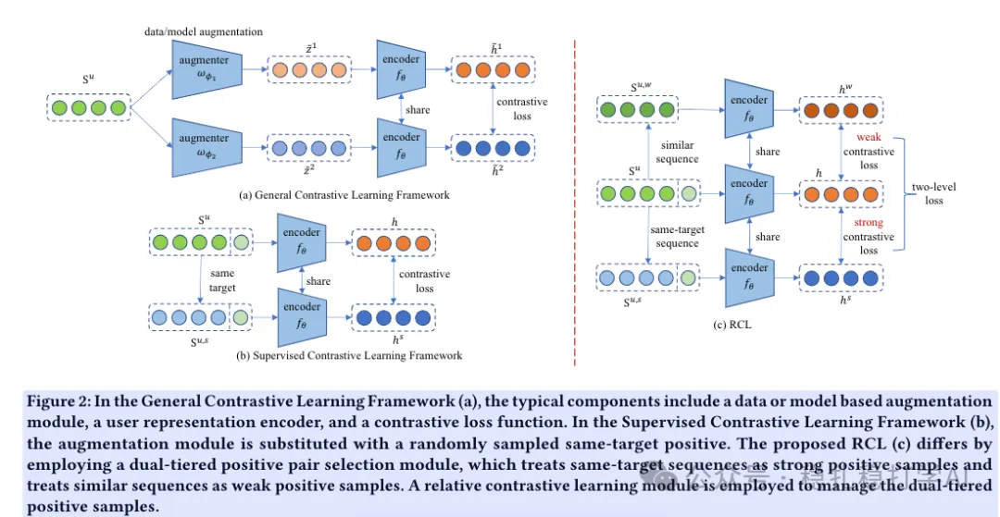

# 推荐算法(2025.4.29)：美团的行为序列效果增强方法

> 原文：https://mp.weixin.qq.com/s?__biz=MzkzNDYyNjM1NA==&mid=2247484607&idx=1&sn=ebcf93dd74a44fd9c0c9eaae9e6c3713&scene=21#wechat_redirect
> 作者：算法工程师刘明星（稳扎稳打学AI）| 发表于 2025-04-29

嘿，记得给“稳扎稳打学AI”添加星标

关注我，每天为你精挑细选最优质、最新鲜的推荐算法paper，陪你一起保持进步、不断精进！

📄 [本公众号paper推荐原则](https://mp.weixin.qq.com/s?__biz=MzkzNDYyNjM1NA==&mid=2247484097&idx=1&sn=18322c279290b555eb030e12953b7c7f&scene=21#wechat_redirect)

1 Relative Contrastive Learning for Sequential Recommendation with Similarity-based Positive Pair Selection

网址：https://arxiv.org/pdf/2504.19178

公司：美团

方向：行为序列+对比学习

解读：为用户行为序列找到一些弱正样本、强正样本做数据增强，通过对比学习提升模型效果。弱正样本就是基于多种相似性度量与序列相似的序列；强正样本就是相同target item的序列。建模过程中，保证强正样本相比弱样本，离序列更近。

设计两个模块——双层正样本选择模块和相对对比学习模块

（1）双层正样本选择模块：

1）强正样本：选择与中心序列具有相同目标项的序列，随机采样一个作为强正样本。这是之前工作SCL的方法。这个方法存在的问题：因相同目标序列不足而缺乏足够的对比信号，且如何有效利用相似序列（不同目标项但意图相近）作为正样本仍具挑战性。

2）弱正样本：基于多种相似性度量（Jaccard、TF-IDF、N-grams、Levenshtein Distance、Semantic Distance）选择与中心序列相似但目标项不同的序列，采样概率与相似性分数成正比。解决SCL中正样本稀缺问题，确保所有序列都有正样本。

（2）相对对比学习模块：

通过相对对比学习模块，模型能够学习到强正样本与弱正样本之间的相对关系，从而提升模型的效果。

可信度：离线

推荐看看：有时间看看

请帮忙点赞、转发，谢谢。您认为哪篇论文最有潜力应用到实际业务中？

## 欢迎干货投稿 \ 论文宣传 \ 合作交流

推荐您继续阅读：

■ [推荐算法(2025.4.28)：快手、Pinterest的满满工业风成果](https://mp.weixin.qq.com/s?__biz=MzkzNDYyNjM1NA==&mid=2247484600&idx=1&sn=20790b6a927172aeb58c03d084de83e9&scene=21#wechat_redirect)

■ [推荐算法周报(2025.4.26)：华为、快手、meta的最新工作](https://mp.weixin.qq.com/s?__biz=MzkzNDYyNjM1NA==&mid=2247484586&idx=1&sn=e1a1cb251d46b89a7b5f66a31bc4e926&scene=21#wechat_redirect)

■ [推荐算法(2025.4.24)：华为的召回与排序的一致性工作](https://mp.weixin.qq.com/s?__biz=MzkzNDYyNjM1NA==&mid=2247484578&idx=1&sn=669b17677b3096be3432ee6b0e53e0fc&scene=21#wechat_redirect)

历史文章索引：https://docs.qq.com/sheet/DYXZTZ0tseHRyZGtt?tab=BB08J2

由于公众号试行乱序推送，您可能不再准时收到稳扎稳打学AI的推送。为了第一时间收到本号的干货内容，请将本号设为星标，以及常点文末右下角的“在看”。

喜欢的话点个在看吧👇

个人观点，仅供参考
