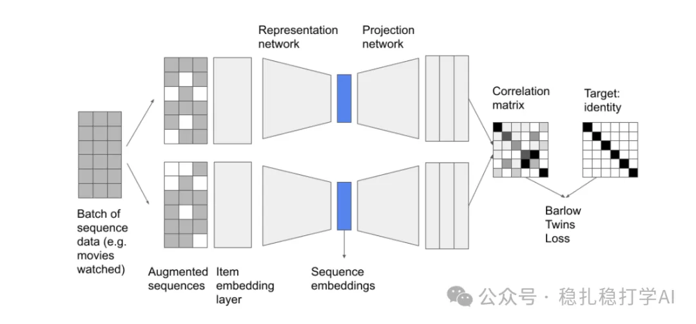

# Recommendation algorithms (2025.5.5): Google's augmented behavior sequence modeling

> [中文版](2025-05-06-google-barlow-twins.md)

1 Sequence Augmentation with Barlow Twins for Sequential Recommendation

Link: https://arxiv.org/pdf/2504.20980

Company: Google

Area: behavior sequence modeling

Overview: This paper proposes a sequence augmentation method based on Barlow Twins to tackle the sparsity of user behavior sequence data in recommender systems. By augmenting user behavior sequences and optimizing the sequence representations with the Barlow Twins loss, the model learns more robust user interest representations, significantly improving recommendation performance.

Core method:

(1) Sequence augmentation: apply augmentations such as random masking, random substitution and random shuffling to the user behavior sequence, generating multiple augmented versions.

(2) Barlow Twins loss: optimize the representations of the augmented sequences with the Barlow Twins loss, so that representations of different augmented versions are as similar as possible, while different feature dimensions are as uncorrelated as possible.

A primer on Barlow Twins: as in the figure, a sample goes through different augmentations and into the same network to get two representations, and the loss forces their cross-correlation matrix to be close to the identity matrix. This means the feature representations extracted from different augmented versions of the same sample are very similar, and the feature vectors are also close to orthogonal (i.e. uncorrelated).

Although Barlow Twins is regarded as a self-supervised learning (SSL) method that needs no explicit negatives, its core goal is to optimize representations through the cross-correlation matrix, so that representations of a sample's augmented samples are as similar as possible, while different feature dimensions are as uncorrelated as possible (redundancy reduction).

Takeaways:

(1) Sequence augmentation is a very effective method and can be used to address data sparsity.

(2) Bringing in the Barlow Twins loss offers a new angle for sequence modeling.

Credibility: production (Google)

Recommendation: worth a look

