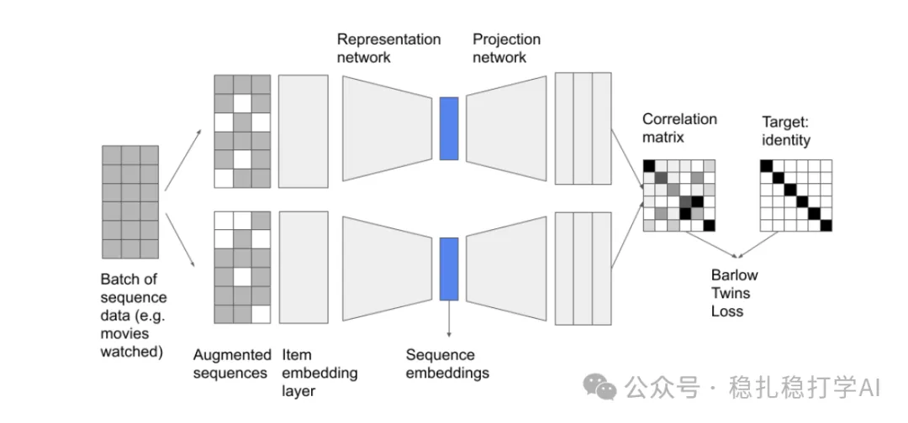

# 推荐算法(2025.5.5)：Google的行为序列增强建模

> 原文：https://mp.weixin.qq.com/s?__biz=MzkzNDYyNjM1NA==&mid=2247484629&idx=1&sn=46d01e06bb13402cb70a638b9f2f02fe&scene=21#wechat_redirect
> 作者：算法工程师刘明星（稳扎稳打学AI）| 发表于 2025-05-06

嘿，记得给“稳扎稳打学AI”添加星标

关注我，每天为你精挑细选最优质、最新鲜的推荐算法paper，陪你一起保持进步、不断精进！

> [English version](2025-05-06-google-barlow-twins.full.en.md)

📄 [本公众号paper推荐原则](https://mp.weixin.qq.com/s?__biz=MzkzNDYyNjM1NA==&mid=2247484097&idx=1&sn=18322c279290b555eb030e12953b7c7f&scene=21#wechat_redirect)

1 Sequence Augmentation with Barlow Twins for Sequential Recommendation

网址：https://arxiv.org/pdf/2504.20980

公司：Google

方向：行为序列建模

解读：本文提出了一种基于Barlow Twins的序列增强方法，用于解决推荐系统中用户行为序列数据稀疏的问题。通过对用户行为序列进行增强，并利用Barlow Twins损失函数优化序列表示，模型能够学习到更鲁棒的用户兴趣表示，显著提升推荐系统的性能。

核心方法：

（1）序列增强：对用户行为序列进行随机掩码、随机替换和随机打乱等增强操作，生成多个增强版本。

（2）Barlow Twins损失：利用Barlow Twins损失函数优化增强序列的表示，使得不同增强版本之间的表示尽可能相似，同时不同特征维度之间的表示尽可能不相关。

科普Barlow Twins：如图，将样本经过不同增广送入同一网络中得到两种表示，利用损失函数迫使它们的互相关矩阵接近于恒等矩阵：这意味着同一样本不同的增广版本下提取出的特征表示非常类似，同时特征向量也非常接近正交（即不相关）。

虽然Barlow Twins被认为是一种无需显式负样本的自监督学习（SSL）方法，但Barlow Twins的核心目标是通过互相关矩阵优化表示，使得一个样本的增广样本（augmented samples）之间的表示尽可能相似，同时不同特征维度之间的表示尽可能不相关（冗余减少）。

心得：

（1）序列增强是一个非常有效的方法，可以用来解决数据稀疏问题。

（2）Barlow Twins损失函数的引入为序列建模提供了新的思路。

可信度：生产——Google

推荐等级：值得看看

请帮忙点赞、转发，谢谢。您认为哪篇论文最有潜力应用到实际业务中？

## 欢迎干货投稿 \ 论文宣传 \ 合作交流

推荐您继续阅读：

■ [推荐算法周报(2025.5.4)：工业风就是简单有效重细节](https://mp.weixin.qq.com/s?__biz=MzkzNDYyNjM1NA==&mid=2247484623&idx=1&sn=a3eaaa163da1ba5f8485a837d996b0d7&scene=21#wechat_redirect)

■ [推荐算法(2025.5.1)：Snap的跨域用户表征学习](https://mp.weixin.qq.com/s?__biz=MzkzNDYyNjM1NA==&mid=2247484613&idx=1&sn=02d4e14ae3ed05a4602f809d48db6590&scene=21#wechat_redirect)

■ [推荐算法(2025.4.29)：美团的行为序列效果增强方法](https://mp.weixin.qq.com/s?__biz=MzkzNDYyNjM1NA==&mid=2247484607&idx=1&sn=ebcf93dd74a44fd9c0c9eaae9e6c3713&scene=21#wechat_redirect)

历史文章索引：https://docs.qq.com/sheet/DYXZTZ0tseHRyZGtt?tab=BB08J2

由于公众号试行乱序推送，您可能不再准时收到稳扎稳打学AI的推送。为了第一时间收到本号的干货内容，请将本号设为星标，以及常点文末右下角的“在看”。

喜欢的话点个在看吧👇

个人观点，仅供参考
