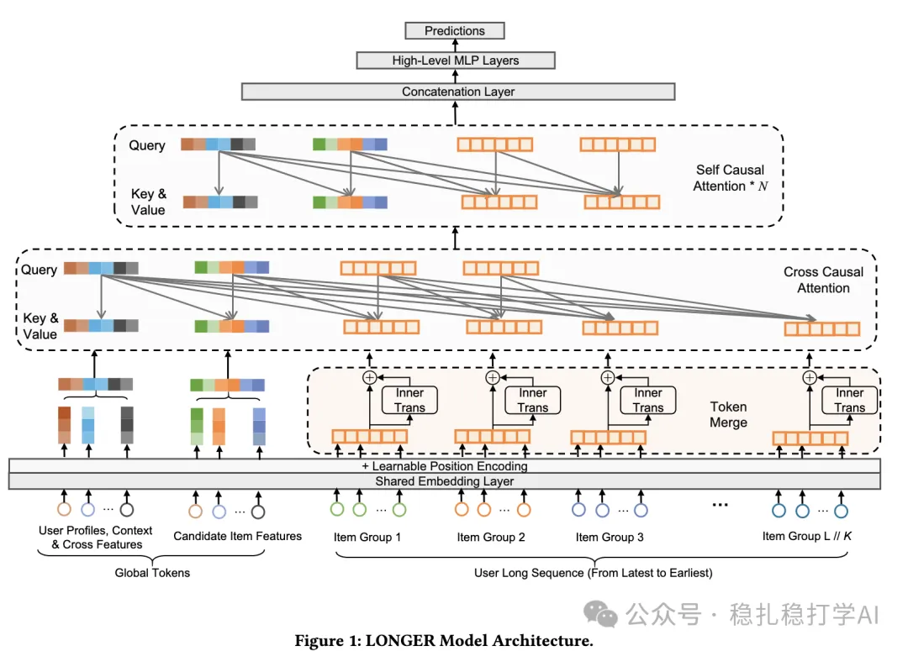

# Recommendation papers (2025.5.8): ByteDance S3, a simple and scalable self-supervised long-sequence modeling framework
> [中文版](2025-05-08-bytedance-s3-long-sequence.md)

> Source: WeChat post https://mp.weixin.qq.com/s?__biz=MzkzNDYyNjM1NA==&mid=2247484636&idx=1&sn=8ab523471efbb4cd3e03edb68ca79dea&scene=21#wechat_redirect, published 2025-05-08.
> Split from the roundup "Recommendation papers (2025.5.8): great work from eBay, ByteDance and Xiaohongshu"; same issue: [eBay hierarchical GNN + LLM ad keyword recommendation](../deep-retrieval/2025-05-08-ebay-ad-keyword-gnn-llm.full.en.md), [ByteDance S3 self-supervised long-sequence modeling](../behavior-sequence-modeling/2025-05-08-bytedance-s3-long-sequence.full.en.md), [Xiaohongshu action-oriented sequence modeling](../behavior-sequence-modeling/2025-05-08-xiaohongshu-action-oriented-seq.full.en.md).

S3: A Simple and Scalable Self-Supervised Long Sequence Modeling Framework for User Behavior Sequence

Link: https://arxiv.org/pdf/2504.21511

Company: ByteDance

Area: behavior sequence modeling

Overview: This paper proposes a simple and scalable self-supervised long-sequence modeling framework (S3) for handling long user behavior sequences. Through segment compression, token merging and a hybrid attention mechanism, S3 models long sequences efficiently and clearly improves recommendation performance.

Core method:

(1) Sequence segmentation and compression: split the long sequence into multiple chunks; within each chunk the sequence is compressed with attention into a global vector (global token) that represents the chunk as a whole.

(3) Token merging and InnerTrans: within each chunk, tokens are processed by InnerTrans to capture local dependencies inside the chunk. Token merging combines multiple tokens into one global vector, reducing computation.

(3) Hybrid attention: combines Cross Causal Attention and Self Causal Attention to process long sequences efficiently. Cross attention highlights the key parts of the sequence, self attention captures higher-order dependencies, and together they clearly improve modeling expressiveness.

A quick explainer: Cross Causal Attention does mean that, in the attention mechanism, the attention for a given item (or token) only considers items that come earlier in time. This design preserves causality in the time series, i.e. future information does not affect current or past predictions, which suits sequence modeling in recommender systems particularly well.

A/B: in the online A/B test on Douyin, CTR rose 0.23% and interaction rate rose 0.46%.

Takeaways:

(1) Long-sequence modeling is a very important direction and worth studying in depth.

(2) The simplicity and scalability of the S3 framework give it strong practical value.

Credibility: production (Douyin)

Recommendation: worth a look

