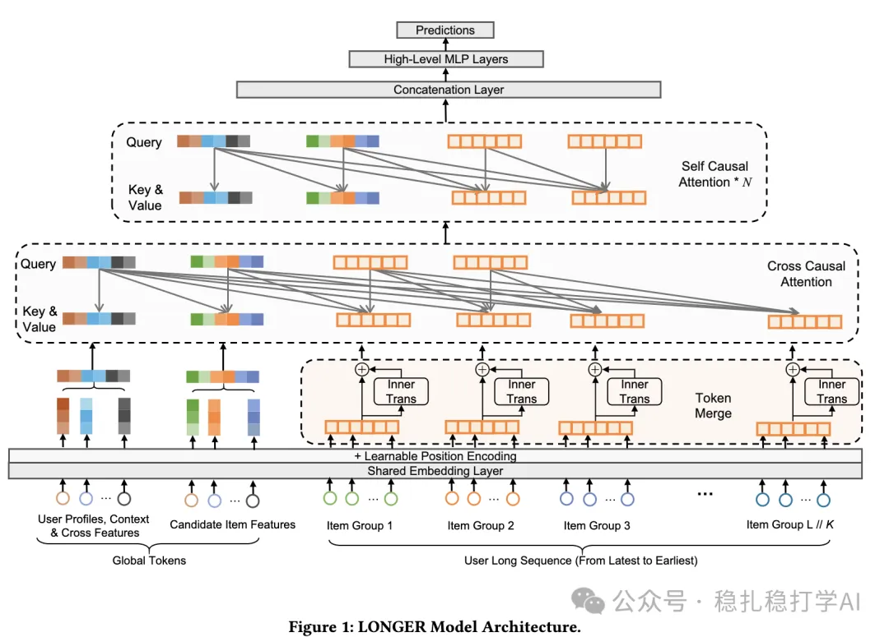

# 推荐算法(2025.5.8)：字节S3，简单可扩展的自监督长序列建模框架

> 原文：https://mp.weixin.qq.com/s?__biz=MzkzNDYyNjM1NA==&mid=2247484636&idx=1&sn=8ab523471efbb4cd3e03edb68ca79dea&scene=21#wechat_redirect
> 作者：算法工程师刘明星（稳扎稳打学AI）| 发表于 2025-05-08
> 本文拆自《推荐算法(2025.5.8)：ebay、字节和小红书的精彩工作》，同期 3 篇：[eBay 层次 GNN+LLM 广告关键词推荐](../deep-retrieval/2025-05-08-ebay-ad-keyword-gnn-llm.md)、[字节 S3 自监督长序列建模](../behavior-sequence-modeling/2025-05-08-bytedance-s3-long-sequence.md)、[小红书动作导向序列建模](../behavior-sequence-modeling/2025-05-08-xiaohongshu-action-oriented-seq.md)。

关注我，每天为你精挑细选最优质、最新鲜的推荐算法paper，陪你一起保持进步、不断精进！

> [English version](2025-05-08-bytedance-s3-long-sequence.full.en.md)

S3: A Simple and Scalable Self-Supervised Long Sequence Modeling Framework for User Behavior Sequence

网址：https://arxiv.org/pdf/2504.21511

公司：字节跳动

方向：行为序列建模

解读：本文提出了一种简单且可扩展的自监督长序列建模框架（S3），用于处理用户行为序列中的长序列问题。S3通过分段压缩、标记合并和混合注意力机制，实现了对长序列的高效建模，显著提升了推荐系统的性能。

核心方法：

（1）序列分段与压缩：将长序列分成多个块，每个块内的序列通过注意力机制进行压缩，生成一个全局向量（global token），用于表示该块的整体信息。

（3）标记合并与InnerTrans：在每个块内，标记通过InnerTrans进行处理，捕捉块内的局部依赖关系。标记合并将多个标记合并为一个全局向量，减少计算量。

（3）混合注意力机制：结合交叉因果注意力（Cross Causal Attention）和自因果注意力（Self Causal Attention），高效处理长序列。交叉注意力突出序列中的关键部分，自注意力捕获高阶依赖，显著提升建模表达能力。

科普一下，Cross Causal Attention（交叉因果注意力）确实是指在注意力机制中，某个 item（或 token）的注意力计算只考虑时间上早于它的 items。这种设计确保了时间序列的因果关系，即未来的信息不会影响当前或过去的预测，特别适用于推荐系统中的序列建模。

AB：线上AB实验中，在抖音场景下，点击率提升了0.23%，互动率提升了0.46%。

心得：

（1）长序列建模是一个非常重要的方向，值得深入研究。

（2）S3框架的简单性和可扩展性使其具有很强的实用价值。

可信度：生产——抖音

推荐等级：值得看看

