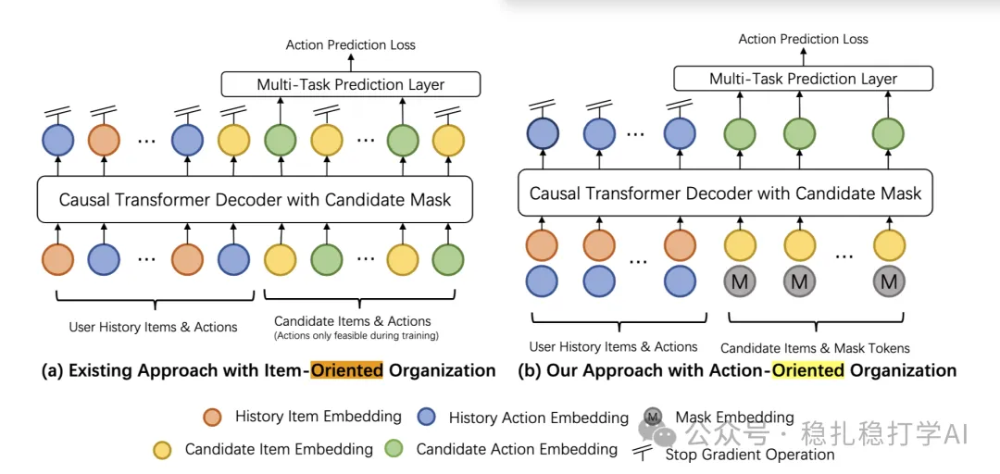

# Recommendation papers (2025.5.8): Xiaohongshu models sequences with actions as the unit, halving sequence length
> [中文版](2025-05-08-xiaohongshu-action-oriented-seq.md)

> Source: WeChat post https://mp.weixin.qq.com/s?__biz=MzkzNDYyNjM1NA==&mid=2247484636&idx=1&sn=8ab523471efbb4cd3e03edb68ca79dea&scene=21#wechat_redirect, published 2025-05-08.
> Split from the roundup "Recommendation papers (2025.5.8): great work from eBay, ByteDance and Xiaohongshu"; same issue: [eBay hierarchical GNN + LLM ad keyword recommendation](../deep-retrieval/2025-05-08-ebay-ad-keyword-gnn-llm.full.en.md), [ByteDance S3 self-supervised long-sequence modeling](../behavior-sequence-modeling/2025-05-08-bytedance-s3-long-sequence.full.en.md), [Xiaohongshu action-oriented sequence modeling](../behavior-sequence-modeling/2025-05-08-xiaohongshu-action-oriented-seq.full.en.md).

Action-Oriented Sequence Modeling for Recommendation

Link: https://arxiv.org/pdf/2504.19123

Company: Xiaohongshu

Area: behavior sequence modeling

Overview: This paper proposes an action-oriented sequence modeling method to address the efficiency problem of item-oriented sequence modeling in traditional recommender systems. By changing the unit of sequence modeling from items to actions, the model captures the dynamics in user behavior sequences more efficiently and clearly improves recommendation performance.

Core method:

(1) Traditional methods (such as HSTU) use the item as the sequence unit and interleave items and actions, which doubles the sequence length and is computationally expensive. This paper uses the action as the sequence unit and the item as positional information, predicting the action associated with each item. Sequence length is halved, attention cost drops by 75%, and linear projection cost drops by 50%.

(2) Positional information fusion: item information (such as item ID, category, etc.) is used as a positional encoding and fused with the action representation, strengthening the model's understanding of items.

A/B: in the online A/B test, CTR rose 0.45% and interaction rate rose 0.32%.

Takeaways:

(1) Action-oriented sequence modeling is a very creative idea and worth studying in depth.

(2) The method performs well in practice and has strong practical value.

Credibility: production (Xiaohongshu)

Recommendation: worth a look

