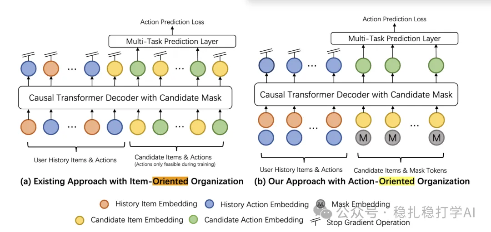

# 推荐算法(2025.5.8)：小红书以动作为单位做序列建模，序列长度减半

> 原文：https://mp.weixin.qq.com/s?__biz=MzkzNDYyNjM1NA==&mid=2247484636&idx=1&sn=8ab523471efbb4cd3e03edb68ca79dea&scene=21#wechat_redirect
> 作者：算法工程师刘明星（稳扎稳打学AI）| 发表于 2025-05-08
> 本文拆自《推荐算法(2025.5.8)：ebay、字节和小红书的精彩工作》，同期 3 篇：[eBay 层次 GNN+LLM 广告关键词推荐](../deep-retrieval/2025-05-08-ebay-ad-keyword-gnn-llm.md)、[字节 S3 自监督长序列建模](../behavior-sequence-modeling/2025-05-08-bytedance-s3-long-sequence.md)、[小红书动作导向序列建模](../behavior-sequence-modeling/2025-05-08-xiaohongshu-action-oriented-seq.md)。

关注我，每天为你精挑细选最优质、最新鲜的推荐算法paper，陪你一起保持进步、不断精进！

> [English version](2025-05-08-xiaohongshu-action-oriented-seq.full.en.md)

Action-Oriented Sequence Modeling for Recommendation

网址：https://arxiv.org/pdf/2504.19123

公司：小红书

方向：行为序列建模

解读：本文提出了一种以动作为导向的序列建模方法，用于解决传统推荐系统中物品导向序列建模的效率问题。通过将序列建模的单位从物品改为动作，模型能够更高效地捕捉用户行为序列中的动态信息，显著提升推荐系统的性能。

核心方法：

（1）传统方法（如HSTU）以物品为序列单位，交错物品和动作，导致序列长度翻倍，计算开销大。本文以动作为序列单位，物品作为位置信息，预测与每个物品相关的动作，序列长度减半，注意力机制成本降低75%，线性投影成本降低50%。

（2）位置信息融合：将物品的位置信息（如物品ID、类别等）作为位置编码，与动作的表示进行融合，增强模型对物品的理解。

AB：线上AB实验中，点击率提升了0.45%，互动率提升了0.32%。

心得：

（1）以动作为导向的序列建模是一个非常有创意的想法，值得深入研究。

（2）这种方法在实际应用中表现出色，具有很强的实用价值。

可信度：生产——小红书

推荐等级：值得看看

