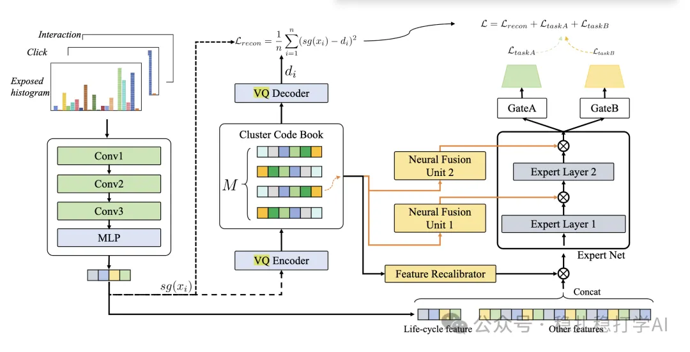

# Recommendation algorithms (2025.5.14): NetEase's innovation in grouped generalization

> [中文版](2025-05-14-netease-grouped-quantization.md)

1 Grouped Quantization for Generalizing Interests Modeling in Sequential Recommendation

Link: https://arxiv.org/pdf/2505.06611

Company: NetEase

Area: modeling, grouped generalization

Overview: Traditional feature grouping represents a user's multiple interests as multiple vectors and models them separately. This makes it hard to represent fine-grained interest preferences and fails to generalize user interests precisely.

This paper proposes Grouped Quantization (GQ), an encoding technique for modeling user interest representations that achieves efficient interest modeling by splitting the user interest representation into multiple discrete groups. The GQ model models the lifecycle of user interests, splits the user interest representation into multiple discrete groups, and encodes it with Vector Quantization (VQ) for efficient interest modeling. The model groups the user interest representation and generalizes user interests based on the grouping, thereby modeling user interests precisely.

The method can be understood in two parts:

(1) Histogram representation of user interest: histograms describe how a user's interest changes over a period of time (the interest lifecycle). A histogram quantifies the strength of the user's interest in content related to the candidate at different points in time, capturing the temporal distribution of interest and thus reflecting changes in the interest lifecycle (e.g. emerging, stable or declining stages). For example, the exposure-activity histogram represents how active the user is with exposures to candidate-related content on different days. The horizontal axis is time (days); the vertical axis is activity level (computed as a weighted sum).

(2) Grouped generalization of user interest: split the user interest representation into multiple groups, each corresponding to an interest category, and encode the user interest representation with a VQ Encoder to produce a vector-quantized representation. GQ uses a multi-expert network (Mixture of Experts, MoE) to model the user interest representation, using the MoE to group it and generalizing user interests based on the grouping.

A/B: in online A/B experiments, the model significantly improves recommendation performance: CTR +0.8%, conversion rate +1.2%.

Takeaways:

(1) The paper says the histograms above model the user interest lifecycle (emerging, stable and declining stages). I think that's just one explanation, one way of understanding it. Really it's an embedding of a user grouping over user interest representations. It may mean what the authors say, or something broader. That doesn't actually matter. I understand them too: a paper has to give a reasonable explanation.

(2) The overall idea of this approach is much like classic clustering + self-supervised learning, and it works well too.

(3) Generalizing after grouping is the key point; it improves the model's generalization.

Credibility: production (NetEase)

Recommendation: worth a look

