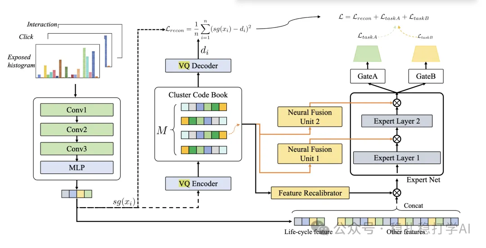

# 推荐算法(2025.5.14)：网易的分组泛化创新

> 原文：https://mp.weixin.qq.com/s?__biz=MzkzNDYyNjM1NA==&mid=2247484654&idx=1&sn=d9f296188e2dba7d153c7ac6f41223db&scene=21#wechat_redirect
> 作者：算法工程师刘明星（稳扎稳打学AI）| 发表于 2025-05-14

嘿，记得给“稳扎稳打学AI”添加星标

关注我，每天为你精挑细选最优质、最新鲜的推荐算法paper，陪你一起保持进步、不断精进！

> [English version](2025-05-14-netease-grouped-quantization.full.en.md)

📄 [本公众号paper推荐原则](https://mp.weixin.qq.com/s?__biz=MzkzNDYyNjM1NA==&mid=2247484097&idx=1&sn=18322c279290b555eb030e12953b7c7f&scene=21#wechat_redirect)

1 Grouped Quantization for Generalizing Interests Modeling in Sequential Recommendation

网址：https://arxiv.org/pdf/2505.06611

公司：网易

方向：建模、分组泛化

解读：传统的特征分组将多个用户兴趣表示为多个向量，分别建模，难以表示细粒度的用户兴趣偏好，无法实现精确的用户兴趣泛化。

本文提出分组量化方法（Grouped Quantization，简称GQ），是一种用于建模用户兴趣表示的编码技术，通过将用户兴趣表示划分为多个离散组来实现高效的用户兴趣建模。GQ模型对用户兴趣的生命周期进行建模，将用户兴趣表示划分为多个离散组，并采用向量量化（Vector Quantization，简称VQ）技术对用户兴趣表示进行编码，实现高效的用户兴趣建模。模型对用户兴趣表示进行分组，并根据分组结果进行用户兴趣的泛化，从而实现用户兴趣的精确建模。

这个方法可以分成两个部分来理解：

（1）用户兴趣的直方图表示：利用直方图来描述用户在一段时间内的兴趣变化（兴趣生命周期）。直方图能够量化用户在不同时间点对候选项相关内容的兴趣强度，捕捉兴趣的时序分布，从而反映兴趣的生命周期变化（例如新兴、稳定或衰退阶段）。如，曝光活跃直方图用于表示用户在不同日期对候选项相关内容的曝光活跃程度。横轴表示时间（天），纵轴表示活跃程度（通过权重和计算）。

（2）用户兴趣的分组泛化：将用户兴趣表示划分为多个组，每个组对应一个兴趣类别，并利用VQ Encoder对用户兴趣表示进行编码，生成一个用户兴趣表示的向量量化表示。GQ使用多层专家网络（Mixture of Experts，简称MoE）对用户兴趣表示进行建模，利用MoE对用户兴趣表示进行分组，并根据分组结果进行用户兴趣的泛化。

AB：线上AB实验中，模型在推荐效果上显著提升，具体包括：点击率提升了0.8%，转化率提升了1.2%。

心得：

（1）paper说上面提到的直方图建模的是用户兴趣生命周期（包括新兴、稳定和衰退三个阶段），我认为这只是一种解释，一种理解。其实就是一个用户兴趣表征的用户分组的embedding。它可能表示的是作者说的意思，也可能有更广的意思。其实这个不重要。我也理解他们，写paper是要给出一个合理解释的。

（2）这套做法的整体思想与经典的聚类+自监督学习很像，效果也不错。

（3）分组后泛化是重点，它可以提升模型的泛化能力。

可信度：生产——网易

推荐等级：值得看看

请帮忙点赞、转发，谢谢。您认为哪篇论文最有潜力应用到实际业务中？

## 欢迎干货投稿 \ 论文宣传 \ 合作交流

推荐您继续阅读：

■ [推荐算法(2025.5.13)：淘宝、沃尔玛的AB效果不错](https://mp.weixin.qq.com/s?__biz=MzkzNDYyNjM1NA==&mid=2247484648&idx=1&sn=ba92085c8ad14ae822333e6dd23a00b3&scene=21#wechat_redirect)

■ [推荐算法(2025.5.12)：Pinterest的小发现](https://mp.weixin.qq.com/s?__biz=MzkzNDYyNjM1NA==&mid=2247484641&idx=1&sn=f9eb875e09957224758daf49b3536b24&scene=21#wechat_redirect)

■ [推荐算法(2025.5.8)：ebay、字节和小红书的精彩工作](https://mp.weixin.qq.com/s?__biz=MzkzNDYyNjM1NA==&mid=2247484636&idx=1&sn=8ab523471efbb4cd3e03edb68ca79dea&scene=21#wechat_redirect)

历史文章索引：https://docs.qq.com/sheet/DYXZTZ0tseHRyZGtt?tab=BB08J2

由于公众号试行乱序推送，您可能不再准时收到稳扎稳打学AI的推送。为了第一时间收到本号的干货内容，请将本号设为星标，以及常点文末右下角的“在看”。

喜欢的话点个在看吧👇

个人观点，仅供参考
