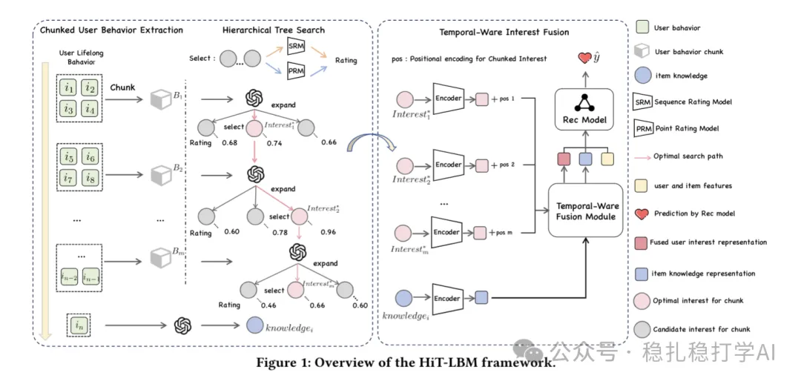

# Recommendation Paper Pick (2025.6.1): Kuaishou's long-sequence modeling is quite interesting

> [中文版](2025-06-01-kuaishou-hit-lbm.md)

### Paper 1: Hierarchical Tree Search-based User Lifelong Behavior Modeling on Large Language Model
### Link: https://arxiv.org/pdf/2505.19505
### Company: Kuaishou
### Area: long-sequence modeling + LLMs

## Overview:

When LLMs model long user behavior sequences, they are biased toward the beginning and the end, and they struggle to understand how interests evolve over time. To address this, the paper proposes a user lifelong behavior modeling framework based on hierarchical tree search. It has two sequential stages: the first runs offline, the second does attention in real time. The implementation:

(1) Segment the sequence, and mine user interests hierarchically in each segment

The user's lifelong behavior sequence is split at equal intervals into multiple behavior chunks of suitable size, to fit the LLM's context length limit.

Each chunk is evaluated by two rating models, one for interest continuity and one for interest validity, and the two are combined into one score. Across adjacent chunks, the model learns the user's interests and how they evolve, analyzing the interest change in the current chunk together with the interest summary of the previous chunk. For each chunk, the highest-scoring interest (in text form) is selected.

If the AUC of the current interest is higher than the AUC of the previous K interests, it is labeled positive and added to the continuity dataset, meaning it carries continuity and information gain; if it is higher than the AUC of the current behavior chunk, it is labeled positive and added to the validity dataset, meaning it effectively represents the immediate interest. See the paper for more details.

(2) Temporal-aware interest fusion module

An encoder encodes the extracted text interests into dense vectors. Masked self-attention layers and cross-attention layers then integrate the interests from different behavior chunks into a lifelong user interest representation. This representation can be embedded into the main model to improve performance.

A/B results: in a 14-day A/B test on Kuaishou's ad platform, HiT-LBM raised revenue by 3.5% and conversion rate by 2.3%. For long-tail users (few interactions), revenue and conversion rate rose by 4.5% and 3.1% respectively.

## Takeaways:

(1) The way interests are generated is quite interesting; it can't be explained in a few sentences, so I recommend reading the paper itself.

(2) Since the sequence is too long to process in real time, it is segmented offline and each segment is summarized, which cuts time complexity substantially, by one or two orders of magnitude.

(3) LLMs' understanding of user interests and intent is an advantage.

## Credibility: production

## Recommendation: worth a look

