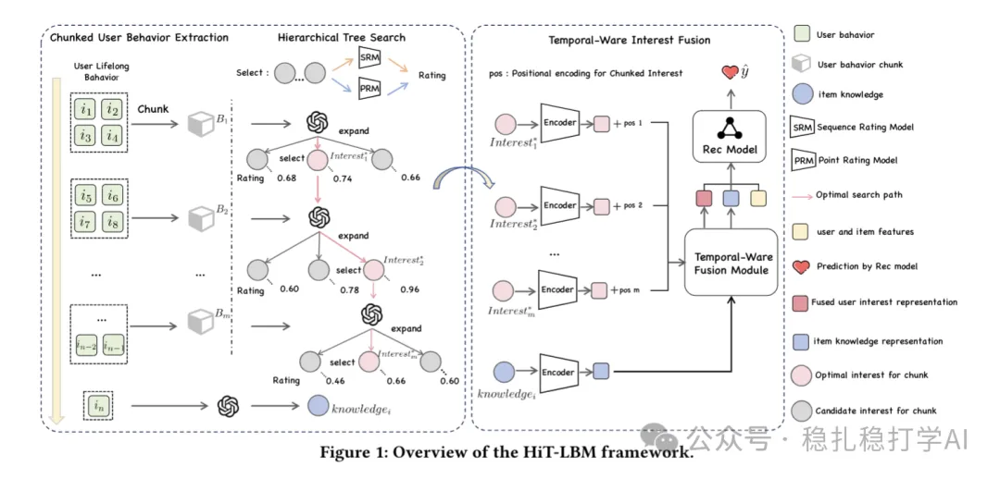

# 推荐算法(2025.6.1)：快手的长序列建模挺有趣

> 原文：https://mp.weixin.qq.com/s?__biz=MzkzNDYyNjM1NA==&mid=2247484733&idx=1&sn=85ffc9a50c38da3f3862e2f8af0269a3&scene=21#wechat_redirect
> 作者：算法工程师刘明星（稳扎稳打学AI）| 发表于 2025-06-01

嘿，记得给“稳扎稳打学AI”添加星标

关注我，每天为你精挑细选最优质、最新鲜的推荐算法paper，陪你一起保持进步、不断精进！

> [English version](2025-06-01-kuaishou-hit-lbm.full.en.md)

👆 [本公众号paper推荐原则](https://mp.weixin.qq.com/s?__biz=MzkzNDYyNjM1NA==&mid=2247484097&idx=1&sn=18322c279290b555eb030e12953b7c7f&scene=21#wechat_redirect)

1 Hierarchical Tree Search-based User Lifelong Behavior Modeling on Large Language Model

网址：https://arxiv.org/pdf/2505.19505

公司：快手

方向：长序列建模+LLMs

解读：

因为LLMs在长用户行为序列建模时偏向开头和结尾，且难以从时序视角理解兴趣演变，提出了一种基于层次树搜索的用户终身行为建模框架。分成了2个顺序阶段，前者是离线的，后者是实时做attention，具体实现包括：

（1）序列分段，每段层次化挖掘用户兴趣

将用户终身行为序列等距分割成多个适当大小的行为块，以适应LLMs的上下文长度限制。

每个模块分别通过两种评分模型，分别评估兴趣的连续性和有效性，综合两者获得一个评分。相邻行为块间学习用户兴趣及其演变，结合前一块的兴趣总结分析当前块的兴趣变化。每个模块选择分数最高的兴趣（文本形式）。

当前兴趣的AUC若高于前K个兴趣的AUC，则标记为正样本，加入连续性数据集，表示延续性和信息增益；若高于当前行为块的AUC，则标记为正样本，加入有效性数据集，表示有效表征即时兴趣。想了解更多详情请参考paper。

（2）时序感知的兴趣融合模块

通过encoder将提取的文本兴趣编码为密集向量表示。并掩码自注意力层和交叉注意力层整合不同行为块的兴趣，形成用户终身兴趣表示。该表示可嵌入主模型以提升性能。

贴一下AB：在快手广告平台上进行14天A/B测试，HiT-LBM使收入提升3.5%，转化率提升2.3%。对于长尾用户（交互较少），收入和转化率分别提升4.5%和3.1%。

心得：

（1）生成兴趣的方法很有意思，几句话无法讲清楚，推荐看正文了解。

（2）因为序列太长无法实时出来，那么离线分段，对每段归纳总结，从而大幅降低了时间复杂度，一两个数量级的降低。

（3）大模型的用户兴趣意图的理解，是一个优势。

可信度：生产

推荐等级：推荐看看

请帮忙点赞、转发，谢谢。您认为哪篇论文最有潜力应用到实际业务中？

## 欢迎干货投稿 \ 论文宣传 \ 合作交流

推荐您继续阅读：

■ [推荐算法(2025.5.31)：阿里证明相似物料提升推荐效果](https://mp.weixin.qq.com/s?__biz=MzkzNDYyNjM1NA==&mid=2247484727&idx=1&sn=b1a72be48cec890839cdf23735fe1189&scene=21#wechat_redirect)

■ [推荐算法(2025.5.30)：腾讯的增强双塔粗排有良好效果](https://mp.weixin.qq.com/s?__biz=MzkzNDYyNjM1NA==&mid=2247484722&idx=1&sn=e760ad3274d52ff38c471914c19d9404&scene=21#wechat_redirect)

■ [推荐算法(2025.5.29)：美团的生成式推荐落地方案](https://mp.weixin.qq.com/s?__biz=MzkzNDYyNjM1NA==&mid=2247484715&idx=1&sn=8471058be40bd73c024774e2d09d3ba2&scene=21#wechat_redirect)

历史文章索引：https://docs.qq.com/sheet/DYXZTZ0tseHRyZGtt?tab=BB08J2

由于公众号试行乱序推送，您可能不再准时收到稳扎稳打学AI的推送。为了第一时间收到本号的干货内容， 请将本号设为星标，以及常点文末右下角的“在看”。

喜欢的话点个在看吧👇

个人观点，仅供参考
