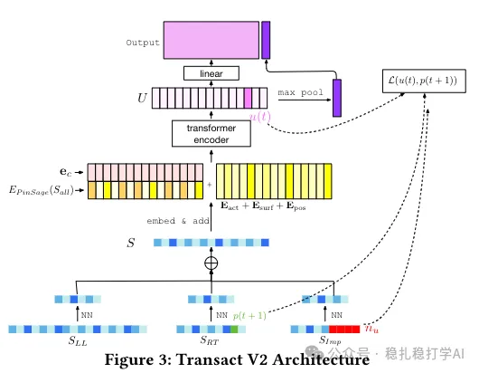

# Recommendation Paper Pick (2025.6.4): Pinterest's long-sequence modeling, with clear gains

> [中文版](2025-06-04-pinterest-transact-v2.md)

### Paper 1: TransAct V2: Lifelong User Action Sequences Modeling for User Interest Modeling at Pinterest
### Link: https://arxiv.org/pdf/2505.24578
### Company: Pinterest
### Area: long-sequence modeling

## Overview:

In Pinterest's recommender system, user behavior sequences matter a lot. A user's behavior sequence reflects their interests and so improves recommendation accuracy.

(1) The core of TransAct V2 is improving recommendation accuracy by modeling users' long behavior sequences. Specifically, TransAct V2 models long behavior sequences in the following ways:

1) Lifelong sequence modeling: the user's entire behavior history is taken as input and modeled with a Transformer.

2) Multi-granularity modeling: the behavior sequence is modeled at different granularities, including short-term and long-term behavior sequences.

3) Multimodal modeling: the behavior sequence is modeled with multimodal features, including text, images, and so on.

4) Efficient computation: long behavior sequences are modeled efficiently, including with an efficient Transformer model and efficient computation methods.

(2) Difference from TransAct

The main difference between TransAct V2 and TransAct is that TransAct V2 improves recommendation accuracy by modeling users' long behavior sequences, while TransAct only models the short-term behavior sequence.

(3) Difference from PinFM

The main difference between TransAct V2 and PinFM is that TransAct V2 improves recommendation accuracy by modeling users' long behavior sequences, while PinFM improves recommendation accuracy by modeling users' behavior sequences.

The A/B gains are clear: in an A/B test on 1.5% of Homefeed traffic, against a TransAct (RT sequence) baseline, repins rose 6.35%, hides fell 12.80%, impression diversity rose 0.45%, and user time spent rose 1.41%.

## Credibility: production

## Recommendation: practically useful

