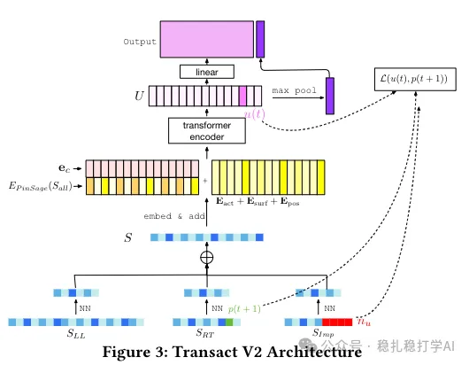

# 推荐算法(2025.6.4)：Pinterest的长序列建模，效果明显

> 原文：https://mp.weixin.qq.com/s?__biz=MzkzNDYyNjM1NA==&mid=2247484745&idx=1&sn=4a6b0151837fbd4b9c5367de112f756e&scene=21#wechat_redirect
> 作者：算法工程师刘明星（稳扎稳打学AI）| 发表于 2025-06-04

嘿，记得给“稳扎稳打学AI”添加星标

关注我，每天为你精挑细选最优质、最新鲜的推荐算法paper，陪你一起保持进步、不断精进！

> [English version](2025-06-04-pinterest-transact-v2.full.en.md)

👆 [本公众号paper推荐原则](https://mp.weixin.qq.com/s?__biz=MzkzNDYyNjM1NA==&mid=2247484097&idx=1&sn=18322c279290b555eb030e12953b7c7f&scene=21#wechat_redirect)

1 TransAct V2: Lifelong User Action Sequences Modeling for User Interest Modeling at Pinterest

网址：https://arxiv.org/pdf/2505.24578

公司：Pinterest

方向：长序列建模

解读：

在Pinterest的推荐系统中，用户的行为序列是很重要的。用户的行为序列可以反映用户的兴趣，从而提高推荐的准确性。

（1）TransAct V2的核心是，通过建模用户的长序列行为，来提高推荐的准确性。具体来说，TransAct V2通过以下几个方面来建模用户的长序列行为：

1）终身序列建模：将用户的全部历史行为序列作为输入，通过Transformer模型进行建模。

2）多粒度建模：通过不同的粒度来建模用户的行为序列，包括短期行为序列和长期行为序列。

3）多模态建模：通过多模态特征来建模用户的行为序列，包括文本、图像等。

4）高效计算：通过高效计算来建模用户的长序列行为，包括使用高效的Transformer模型和高效的计算方法。

（2）与TransAct的区别

TransAct V2与TransAct的主要区别在于，TransAct V2通过建模用户的长序列行为，来提高推荐的准确性。而TransAct只建模用户的短期行为序列。

（3）与PinFM的区别

TransAct V2与PinFM的主要区别在于，TransAct V2通过建模用户的长序列行为，来提高推荐的准确性。而PinFM通过建模用户的行为序列，来提高推荐的准确性。

AB效果明显，贴一下：对 1.5% Homefeed 流量进行 A/B 测试，基线为 TransAct（RT 序列），提升 repin 量 6.35%，降低 hide 量 12.80%，提升展示多样性 0.45%，用户使用时长增加 1.41%。

可信度：生产

推荐等级：有实践价值

请帮忙点赞、转发，谢谢。您认为哪篇论文最有潜力应用到实际业务中？

## 欢迎干货投稿 \ 论文宣传 \ 合作交流

推荐您继续阅读：

■ [推荐算法(2025.6.3)：Spotify的LLM应用，效果明显](https://mp.weixin.qq.com/s?__biz=MzkzNDYyNjM1NA==&mid=2247484739&idx=1&sn=427bd6b06eb2c005e7ce0eac79f30f3d&scene=21#wechat_redirect)

■ [推荐算法(2025.6.1)：快手的长序列建模有趣](https://mp.weixin.qq.com/s?__biz=MzkzNDYyNjM1NA==&mid=2247484733&idx=1&sn=85ffc9a50c38da3f3862e2f8af0269a3&scene=21#wechat_redirect)

■ [推荐算法(2025.5.31)：阿里近邻相似物料提升推荐效果](https://mp.weixin.qq.com/s?__biz=MzkzNDYyNjM1NA==&mid=2247484727&idx=1&sn=b1a72be48cec890839cdf23735fe1189&scene=21#wechat_redirect)

历史文章索引：https://docs.qq.com/sheet/DYXZTZ0tseHRyZGtt?tab=BB08J2

由于公众号试行乱序推送，您可能不再准时收到稳扎稳打学AI的推送。为了第一时间收到本号的干货内容， 请将本号设为星标，以及常点文末右下角的“在看”。

喜欢的话点个在看吧👇

个人观点，仅供参考
