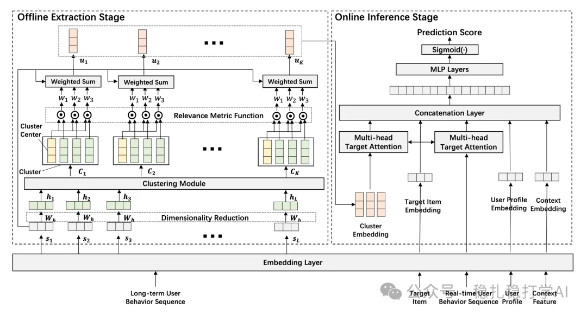

# Recommendation Paper Pick (2025.8.24): Alibaba's long behavior sequence modeling

> [中文版](2025-08-24-ali-encode-long-sequence.md)

### Paper 1: ENCODE: Breaking the Trade-off Between Performance and Efficiency in Long-term User Behavior Modeling
### Link: https://arxiv.org/pdf/2508.13567
### Company: Alibaba
### Area: long behavior sequences

## Overview:

Offline, run k-means over all items in the long sequence to get K clusters; within each cluster, do an attention computation over the items in that cluster, giving K user embeddings; then do target attention between these and the candidate item.

(1) Clustering

The same operation is applied to every item in the behavior sequence: transform it with a random projection matrix to get an embedding h, then run k-means per user. Each cluster then contains a different number of sequence items.

(2) Attention within each cluster

Inside a cluster, for each item belonging to it, compute its distance to the cluster centroid's embedding, apply softmax to get attention weights, and take the weighted sum.

To update the random matrix above, for each sequence embedding h, two other items are randomly picked from the sequence and, by a certain rule, one is designated the positive and the other the negative; a Triplet Loss is used to optimize the weights. Concretely, distances are computed with their original embeddings: the closer one is the positive, the farther one the negative.

## Takeaways:

(1) If something matters a lot, there can still be gains even if it can't be done end to end. Here, long behavior sequences matter a lot, so it was done this way.

(2) Clustering has become a common way to speed up expensive operations.

## Credibility: offline

## Recommendation: worth a look

