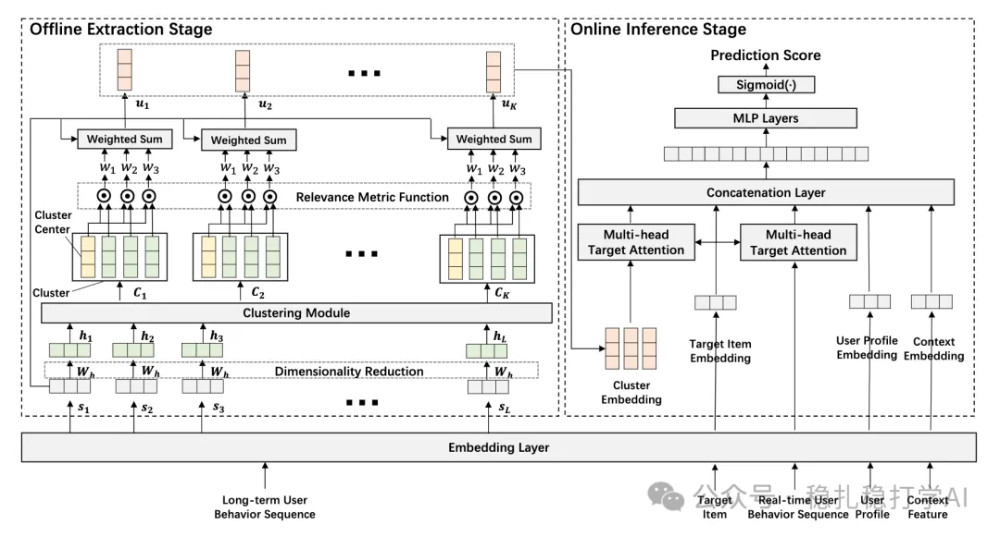

# 推荐算法(2025.8.24)：阿里的长行为序列建模

> 原文：https://mp.weixin.qq.com/s/MEqTzLzRXp5TdNNvL1kybA
> 作者：算法工程师刘明星（稳扎稳打学AI）| 发表于 2025-08-24

嘿，记得给“稳扎稳打学AI”添加星标

关注我，每天为你精挑细选最优质、最新鲜的推荐算法paper，陪你一起保持进步、不断精进！

👆 [本公众号paper推荐原则](https://mp.weixin.qq.com/s?__biz=MzkzNDYyNjM1NA==&mid=2247484097&idx=1&sn=18322c279290b555eb030e12953b7c7f&scene=21#wechat_redirect)

1 ENCODE: Breaking the Trade-off Between Performance and Efficiency in Long-term User Behavior Modeling

网址：https://arxiv.org/pdf/2508.13567

公司：阿里

方向：长行为序列

解读：

离线，对长序列里的所有item做kmeans，获取K个cluster，在每个cluster里对该cluster内的item做attention计算，获得K个user embedding，再与candidate item做target attention。

（1）聚类

对行为序列里的每个item做同样的操作：就是用一个随机转换矩阵转化之后，获得embed——h，以user为单位，做kmeans。那么每个cluster里包含不同数量的序列item。

（2）cluster做attention计算

在cluster里，每个归属该cluster的item，跟cluter centroid的embed，算距离，做softmax获得attention，并对它们做加权求和。

为了update上面的随机矩阵，对每个序列embed h，从序列中随机选两个其他item，一定的方式确定它们一个正样本、一个负样本，使用Triplet Loss，优化weights。具体方式，是用它们的原始embed计算距离，距离近的正样本，远的负样本。

心得：

（1）如果很重要，不能端到端，也可能有收益。这里的，长行为序列很重要，所以这样做了。

（2）聚类是已经成为加速耗时操作的一个常见方法。

可信度：离线

推荐等级：推荐看看

请帮忙点赞、转发，谢谢。您认为哪篇论文最有潜力应用到实际业务中？

## 欢迎干货投稿 \ 论文宣传 \ 合作交流

推荐您继续阅读：

■ [推荐算法(2025.8.14)：沃尔玛的MTL模型，架构/特征/样本的工作面面俱到](https://mp.weixin.qq.com/s/65rzOhDJMvuTuWS7Xts9-g)

■ [推荐算法(2025.8.13)：Spotify的模型开发的好帮手](https://mp.weixin.qq.com/s/CDoMAyTyhUsUCHvNLaVJ2g)

历史文章索引：https://docs.qq.com/sheet/DYXZTZ0tseHRyZGtt?tab=BB08J2

请入微信群，群内我会给出更深入的解读，还可以共同讨论技术方案、发招聘广告、内推和交友等。

• 铁粉标准：关注一个月以上，且累计10次互动（评论、爱心、转发）、投稿1次。

• 入群方法：请您加个人微信lmxhappy，我拉您入群，请备注（只我个人看，不公开）。

由于公众号试行乱序推送，您可能不再准时收到稳扎稳打学AI的推送。为了第一时间收到本号的干货内容， 请将本号设为星标，以及常点文末右下角的“在看”。

喜欢的话点个在看吧👇

个人观点，仅供参考
