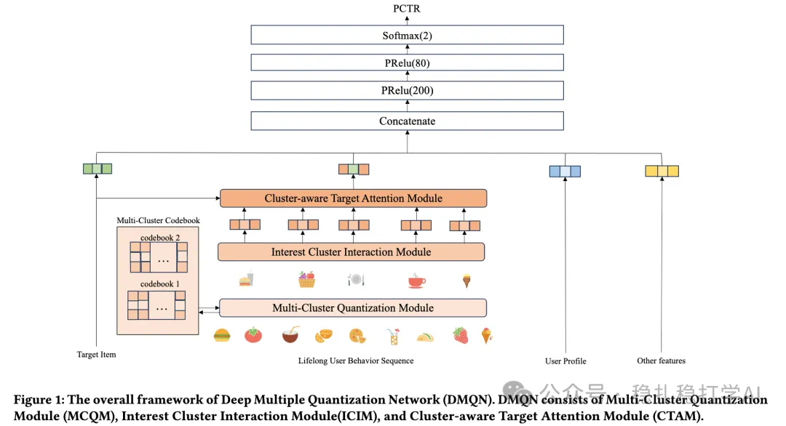

# Recommendation Paper Pick (2025.9.3): Meituan compresses long behavior sequences with codebooks, with good results

> [中文版](2025-09-03-meituan-dmqn.md)

### Paper 1: DMQN: Learning Multiple Quantization for User Representation in Sequential Recommendation
### Link: https://arxiv.org/pdf/2508.20865
### Company: Meituan
### Area: codebooks + long sequences

## Overview:

A long-sequence compression method that uses codebook clustering. Specifically:

(1) Clustering

Concretely, a codebook assigns an index to each element of the user behavior sequence; elements with the same cluster index are grouped and their embeddings averaged, giving the user's embeddings under W clusters (W is much smaller than the sequence length).

Highlight 1: the clustering method. Instead of K-Means, a neural network learns the clustering. Specifically, a neural network learns the cluster centroids, which performs the clustering.

Highlight 2: Gumbel-Softmax instead of softmax is used to pick the cluster index. Gumbel-Softmax adds Gumbel noise, which increases randomness and encourages exploration, making sampling more uniform and avoiding always picking the highest-probability entry.

(2) Interaction

Interaction is done across clusters. Specifically, the embeddings of the different clusters are fed into a Transformer to get interacted embeddings.

(3) Target attention

Based on the target item, relevant clusters are selected from the cluster embeddings for target attention. Specifically, the similarity between the target item and each cluster is computed, and the most similar clusters are selected for target attention.

A/B test: on Meituan, CTR +2.1% over the baseline.

## Takeaways:

(1) The idea of this paper is very simple and direct: compress long behavior sequences with codebook clustering. The benefit is that it improves long-sequence modeling without adding much compute. (2) The paper's use of Gumbel-Softmax is also well worth borrowing. Gumbel-Softmax adds randomness and encourages exploration, which improves the clustering.

## Credibility: production

## Recommendation: practically useful

