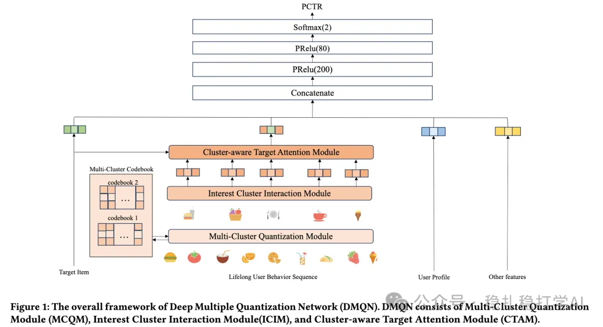

# 推荐算法(2025.9.3)：美团通过码本压缩长行为序列，有不错效果

> 原文：https://mp.weixin.qq.com/s/i6mzrdDVh1kJXUh5g3nMVw
> 作者：算法工程师刘明星（稳扎稳打学AI）| 发表于 2025-09-03（修改于2025年9月3日）

嘿，记得给“稳扎稳打学AI”添加星标

关注我，每天为你精挑细选最优质、最新鲜的推荐算法paper，陪你一起保持进步、不断精进！

👆 [本公众号paper推荐原则](https://mp.weixin.qq.com/s/BhVGu0qH5kTz9N5zpsD3KA)

1 DMQN: Learning Multiple Quantization for User Representation in Sequential Recommendation

网址：https://arxiv.org/pdf/2508.20865

公司：美团

方向：码本+长序列

解读：长序列压缩方法，用码本聚类的方法。具体的：

（1）聚类

具体的，通过codebook将用户行为蓄力的每个序列元素获得index，并归拢并计算同一个cluster index下的平均embed，那么就能获得该用户W个cluster下的embed（W远小于序列长度）。

亮点1，聚类方法。不是用K-Means，而是用一个神经网络，学习聚类。具体的：用一个神经网络，学习聚类中心，从而实现聚类。

亮点2，是使用Gumbel-Softmax而不是softmax选择cluster index。Gumbel-Softmax：引入 Gumbel 噪声，增加随机性，促进探索（exploration），使采样更均匀，避免总是选择最高概率项。

（2）交互

不同的cluster之间做交互。具体的：将不同cluster的embed，输入到一个Transformer模型中，得到交互后的embed。

（3）目标注意力

根据目标item，从cluster的embed中选择相关的cluster，做目标注意力。具体的：根据目标item，计算与每个cluster的相似度，选择相似度最高的cluster，做目标注意力。

AB实验：在美团上，相比基线，CTR +2.1%。

心得：（1）本文的思路非常简单直接：用码本聚类的方法，压缩长行为序列。这种方法的好处是：可以在不增加太多计算量的情况下，提升长序列建模的效果。（2）本文的Gumbel-Softmax方法也非常值得借鉴。Gumbel-Softmax可以增加随机性，促进探索，从而提升聚类的效果。

可信度：生产

推荐等级：有实践价值

请帮忙点赞、转发，谢谢。您认为哪篇论文最有潜力应用到实际业务中？

## 欢迎干货投稿 \ 论文宣传 \ 合作交流

推荐您继续阅读：

■ [推荐算法(2025.9.1)：Meta的底座+专家](https://mp.weixin.qq.com/s/h0vr5j0X4hBgDc8PXDohJg)

■ [推荐算法(2025.8.30)：微软的语义embed对齐，简单有效](https://mp.weixin.qq.com/s/aFfTgavsGzsvU9j5XYianw)

历史文章索引：https://docs.qq.com/sheet/DYXZTZ0tseHRyZGtt?tab=BB08J2

请入微信群，群内我会给出更深入的解读，还可以共同讨论技术方案、发招聘广告、内推和交友等。

• 铁粉标准：关注一个月以上，且累计10次互动（评论、爱心、转发）、或投稿1次。

• 入群方法：请您加个人微信lmxhappy，我拉您入群，请备注（只我个人看，不公开）。

喜欢的话点个在看吧👇

个人观点，仅供参考

修改于2025年9月3日
