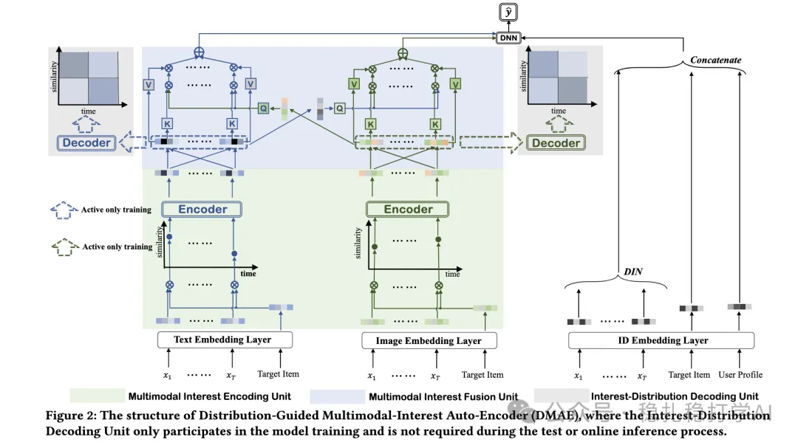
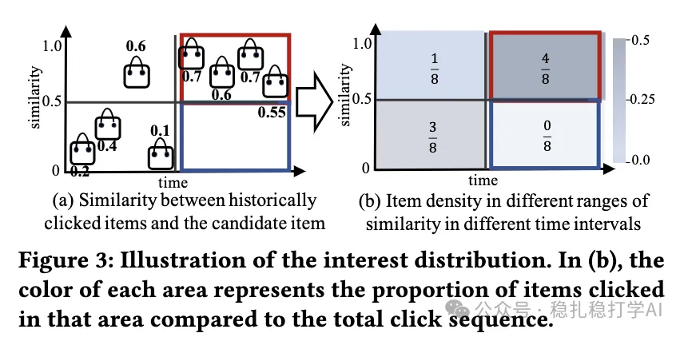

# Recommendation Paper Pick (2025.9.22): Alibaba's multimodal behavior sequence modeling, with big gains

> [中文版](2025-09-22-ali-multimodal-dgae.md)

### Paper 1: Distribution-Guided Auto-Encoder for User Multimodal Interest Cross Fusion
### Link: https://arxiv.org/pdf/2508.14485
### Company: Alibaba
### Area: multimodal behavior sequence modeling

## Overview:

This paper mainly presents a method for multimodal interest sequence modeling: generate intra-modal representations, then model them with contrastive learning and similar techniques to get intra-modal and cross-modal interest representations, fuse within each modality, then fuse across modalities, and so on.

(1) Multimodal interest encoding

1) Multimodal encoding of the user behavior sequence. For each item in the behavior sequence, its multimodal information (e.g. text, images) goes through its own encoder to get multimodal representations.

2) Alignment. The representations of different modalities are aligned into the same space with contrastive learning.

3) Sliding window. Concretely, look at the previous w/2 items and the next w/2 items to compute the representation of the center item.

(3) Getting interest representations

1) Intra-modal fusion gives an interest representation for each modality.

2) Cross-modal fusion gives a cross-modal interest representation.

(4) Interest distribution prediction

1) Interest distribution. The interest representations from (3) are used to predict the user's interest distribution. Specifically, the interest representation is fed into an MLP to get the interest distribution.

2) Interest sampling. The user's interest representation is sampled from the interest distribution.

A/B: on Alibaba ads, CTR +1.2% over the baseline.

## Takeaways:

(1) The idea of this paper is very simple and direct: use multimodal information to strengthen behavior sequence modeling. The benefit is that multimodal information provides richer item information and so improves the model's expressiveness. (2) The paper's sliding window and interest distribution prediction are also well worth borrowing. The sliding window captures local information in user behavior, and interest distribution prediction captures distributional information about user interests.

## Caveats: none

## Credibility: production

## Recommendation: practically useful

