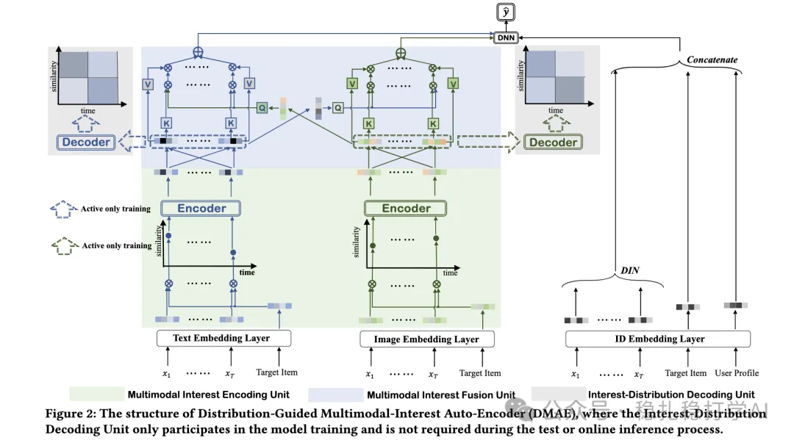
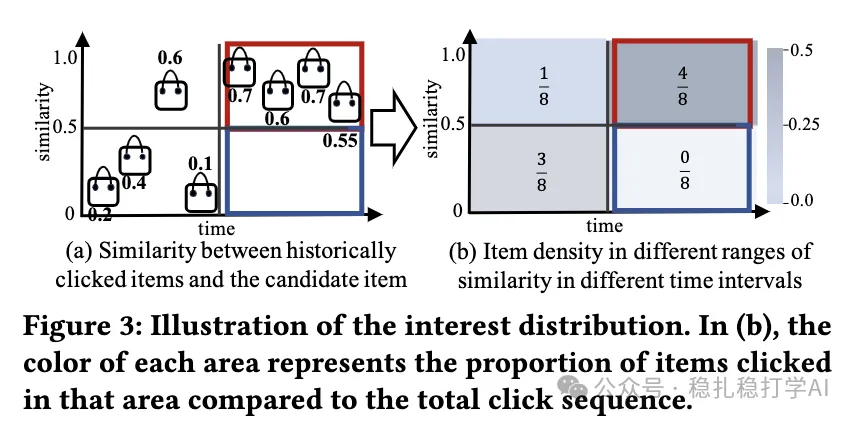

# 推荐算法(2025.9.22)：阿里的多模态行为序列建模，效果很大

> 原文：https://mp.weixin.qq.com/s/aXaavKdcurG8DdiCKboscQ
> 作者：算法工程师刘明星（稳扎稳打学AI）| 发表于 2025-09-22

嘿，记得给“稳扎稳打学AI”添加星标

关注我，每天为你精挑细选最优质、最新鲜的推荐算法paper，陪你一起保持进步、不断精进！

> [English version](2025-09-22-ali-multimodal-dgae.full.en.md)

👆 [本公众号paper推荐原则](https://mp.weixin.qq.com/s/BhVGu0qH5kTz9N5zpsD3KA)

1 Distribution-Guided Auto-Encoder for User Multimodal Interest Cross Fusion

网址：https://arxiv.org/pdf/2508.14485

公司：阿里

方向：多模态行为序列建模

解读：本文主要介绍多模态的兴趣序列建模方法，通过生成模态内表征，然后通过对比学习等方式建模，获得模态内/模态间兴趣表征，并对其做模态内融合，再做模态间融合等。

（1）多模态兴趣编码

1）用户行为序列的多模态编码。行为序列中的item，其多模态信息（如文本、图像）经过各自的encoder，得到多模态表征。

2）对齐。不同模态的表征，通过对比学习，对齐到同一空间。

3）滑动窗口。具体的，就是看前w/2个item和后w/2个item，计算中心item的表征。

（3）获得兴趣表征

1）通过模态内融合，获得每个模态的兴趣表征。

2）通过模态间融合，获得跨模态的兴趣表征。

（4）兴趣分布预测

1）兴趣分布。通过（3）获得的兴趣表征，预测用户的兴趣分布。具体的：将兴趣表征输入到一个MLP中，得到兴趣分布。

2）兴趣采样。根据兴趣分布，采样得到用户的兴趣表征。

A/B：在阿里广告上，相比基线，CTR +1.2%。

心得：（1）本文的思路非常简单直接：用多模态信息来增强行为序列建模。这种方法的好处是：多模态信息可以提供更丰富的物品信息，从而提升模型的表达能力。（2）本文的滑动窗口和兴趣分布预测也非常值得借鉴。滑动窗口可以捕捉到用户行为的局部信息，而兴趣分布预测可以捕捉到用户兴趣的分布信息。

愚见：空

可信度：生产

推荐等级：有实践价值

请帮忙点赞、转发，谢谢。

## 欢迎干货投稿 \ 论文宣传 \ 合作交流

推荐您继续阅读：

■ [推荐算法(2025.9.19)：Snap的序列样本的数据增强方法，有实践价值](https://mp.weixin.qq.com/s/gpTJFQA2WLBYsVFDlOw5TA)

■ [推荐算法(2025.9.18)：蚂蚁的双塔粗排，kmeans聚类助力用户塔](https://mp.weixin.qq.com/s/ZbbHYMc-_UCrH8UyKV1LpQ)

历史文章索引：https://docs.qq.com/sheet/DYXZTZ0tseHRyZGtt?tab=BB08J2

请入微信群，群内我会给出更深入的解读，还可以共同讨论技术方案、发招聘广告、内推和交友等。

• 铁粉标准：关注公众号一个月以上，且在公众号上累计10次互动（评论、爱心、转发）、或投稿1次。

• 入群方法：请您加个人微信lmxhappy，我拉您入群，请备注（只我个人看，不公开）。

喜欢的话点个在看吧👇

个人观点，仅供参考
