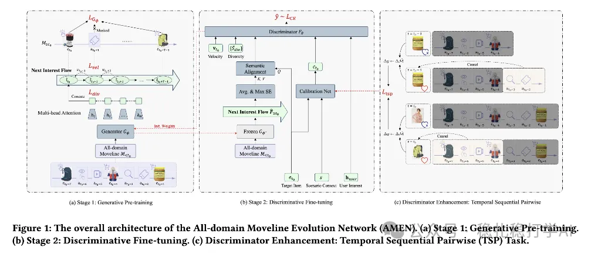

# Recommendation Paper Pick (2025.10.23): Alibaba's method of compressing behavior sequences to strengthen the main model

> [中文版](2025-10-23-ali-amen-next-interest-flow.md)

### Paper 1: Next Interest Flow: Self-Supervised Sequence Compression for User Modeling in Large-Scale Recommenders
### Link: https://arxiv.org/pdf/2510.11317
### Company: Alibaba
### Idea: sequence compression (sequence understanding, long-sequence compression, main-model enhancement) + generative pretraining (self-supervised)
### Area: behavior sequence compression

## Overview:

The paper uses self-supervised generative pretraining to compress a user's long behavior sequence into a short sequence, which is then fed into the main model as input. Specifically:

(1) Self-supervised pretraining

1) Interest flow construction. The user behavior sequences collected from all domains are concatenated into one long sequence, ordered by timestamp from earliest to latest.

2) Interest flow compression. The long sequence from (1) is fed into an autoregressive model, which generates a short sequence. This short sequence has length T and can be understood as the interest flow of the user's next T behaviors.

3) Interest flow training. Training method: given the history sequence, predict the future sequence. Specifically, given the history sequence, predict the next T behaviors to get T predictions; then compare the T predictions with the actual next T behaviors and compute the loss.

(2) Target attention

The length-T sequence obtained in (1) (the Next Interest Flow) goes through target attention with the target item to get a vector, which is used as an input feature of the main model.

## Takeaways:

(1) The idea of this paper is very simple and direct: use self-supervised generative pretraining to compress the user's long behavior sequence into a short sequence, then feed it into the main model as input. If the method were applied only to the sequence from a single scenario, the gain would probably be small, so sequences gathered from all domains are fed into the model in the hope of a bigger effect. (2) The method is also very flexible: the length of the compressed sequence can be adjusted per scenario to strike different balances between effectiveness and efficiency.

## Caveats:

Using the All-domain Moveline to better capture user intent is a good idea, but it has little to do with the paper's method itself: the method's input does not restrict which domain the behavior sequence comes from.

## Credibility: production

## Recommendation: practically useful

