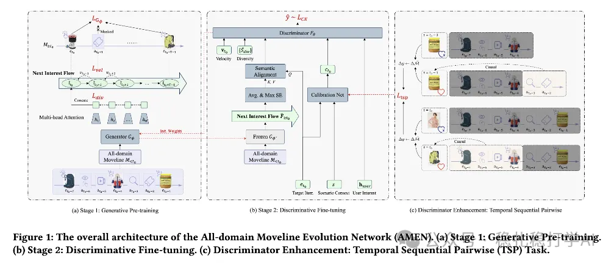

# 推荐算法(2025.10.23)：阿里的行为序列压缩强化主模型方法

> 原文：https://mp.weixin.qq.com/s/QU8SzAl7NDVZAH_1Ybo7zA
> 作者：算法工程师刘明星（稳扎稳打学AI）| 发表于 2025-10-23

嘿，记得给“稳扎稳打学AI”添加星标

关注我，每天为你精挑细选最优质、最新鲜的推荐算法paper，陪你一起保持进步、不断精进！

> [English version](2025-10-23-ali-amen-next-interest-flow.full.en.md)

👆 [本公众号paper推荐原则](https://mp.weixin.qq.com/s/BhVGu0qH5kTz9N5zpsD3KA)

1 Next Interest Flow: Self-Supervised Sequence Compression for User Modeling in Large-Scale Recommenders

网址：https://arxiv.org/pdf/2510.11317

公司：阿里

思想：序列压缩（序列理解、长序列压缩、主模型增强）+生成式预训练（自监督）

方向：行为序列压缩

解读：本文主要是用自监督的生成式预训练方法，将用户的长行为序列压缩成一个短序列，再将其作为输入，输入到主模型中。具体的：

（1）自监督预训练

1）兴趣流生成。将所有域里收集到的用户行为序列，按时间戳从小到大，拼接成一个长序列。

2）兴趣流压缩。将（1）中的长序列，输入到一个自回归模型中，生成一个短序列。这个短序列的长度为T，可以理解为用户未来T个行为的兴趣流。

3）兴趣流训练。训练方法：给定历史序列，预测未来序列。具体的：给定历史序列，预测未来T个行为，得到T个预测结果；然后，将T个预测结果与真实未来T个行为做对比，计算损失。

（2）target attention

将（1）中获得的长T的序列（ext Interest Flow），与目标item做target attention，得到一个向量，将其作为主模型的一个输入特征。

心得：（1）本文的思路非常简单直接：用自监督的生成式预训练方法，将用户的长行为序列压缩成一个短序列，再将其作为输入，输入到主模型中。如果仅仅将一个场景里的序列用本文方法，效果大概不明显，所以将全域搜罗的序列塞入到模型，以期待更大的效果。（2）本文的方法也非常灵活：可以根据不同的场景，调整压缩后的序列长度，从而达到不同的效果和效率的平衡。

愚见：本文使用All-domain Moveline更好的抓住用户意图想法是好的，但是与方法本文的方法关系不大，其输入并不限制行为序列的来源域。

可信度：生产

推荐等级：有实践价值

请帮忙点赞、转发，谢谢。

## 欢迎干货投稿 \ 论文宣传 \ 合作交流

推荐您继续阅读：

■ [推荐算法(2025.10.21)：meta的CTR模型，动态网络玩的真6啊](https://mp.weixin.qq.com/s/hEmQcaD5RSjcarkFq9_PWg)

■ [推荐算法(2025.10.14)：meta的跨域方法，贴心的详细探讨了生效原理](https://mp.weixin.qq.com/s/b2QXIxOtFWNpY95N9_GRAw)

历史文章索引：https://docs.qq.com/sheet/DYXZTZ0tseHRyZGtt?tab=BB08J2

请入微信群，群内我会给出更深入的解读，还可以共同讨论技术方案、发招聘广告、内推和交友等。

• 铁粉标准：关注公众号一个月以上，且在公众号上累计15次互动（评论、爱心、转发）、或投稿1次。

• 入群方法：请您加个人微信lmxhappy，我拉您入群，请备注（只我个人看，不公开）。

喜欢的话点个在看吧👇

个人观点，仅供参考
