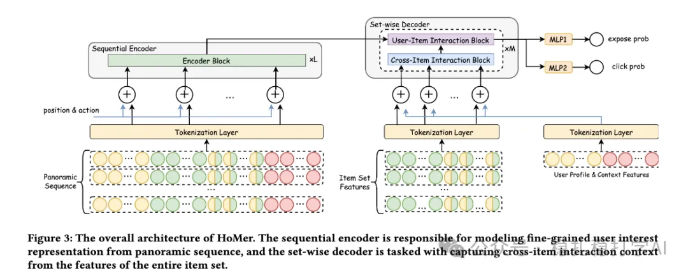

# Recommendation Paper Pick (2025.10.25): Meituan stacks more features and more context for a 2% gain

> [中文版](2025-10-25-meituan-homer.md)

### Paper 1: HoMer: A Novel Framework for Holistic CTR Prediction via Panoramic Sequence Modeling and Cross-Item Context
### Link: https://arxiv.org/pdf/2510.11100
### Company: Meituan
### Idea: long sequences (more context) + stacking features (feature engineering)
### Area: CTR modeling

## Overview:

The paper mainly stacks more features and more context, getting a 2% online gain. Specifically:

(1) More features

1) The user's historical behavior sequence. 2) The set of all items exposed at the same impression position. 3) The current user's profile features and context features (e.g. time, location, device, network environment).

(2) More context

1) Sequence encoder. 1) + 3) from (1) are summed with the item id, action id and position id as input, and modeled with a transformer to get a fine-grained user interest representation.

2) Set encoder. 2) + 3) from (1) are summed with the item id as input, and modeled with a transformer to get a cross-item interaction context representation.

(3) Ranking

1) Input. The outputs of 1) and 2) in (2) are the input.

2) Exposure and click modeling. One MLP each models exposure probability and click probability. Specifically, the input to exposure probability modeling is the concatenation of the cross-item interaction context representation and the fine-grained user interest representation; the input to click probability modeling is the concatenation of the fine-grained user interest representation and the cross-item interaction context representation.

3) Loss. The exposure and click losses are summed with weights.

A/B: on Meituan, CTR +2% and CVR +2% over the baseline.

## Takeaways:

(1) The idea of this paper is very simple and direct: stack more features and more context. The benefit is that no complex model structure is needed; just feeding more features and context into the model improves it. (2) The paper's sequence encoder and set encoder are also well worth borrowing. The sequence encoder models the user's fine-grained interests, and the set encoder models cross-item interaction context.

## Caveats:

Deploying this method surely has engineering challenges. Writing the corresponding solutions into the paper would add a lot to it. Many large international companies do this.

