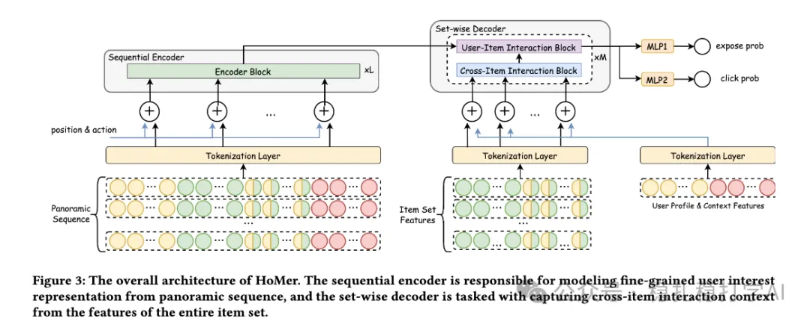

# 推荐算法(2025.10.25)：美团堆更多特征、堆更多上下文，2%效果

> 原文：https://mp.weixin.qq.com/s/c5Fx867rNsZxgsNBhRu-kg
> 作者：算法工程师刘明星（稳扎稳打学AI）| 发表于 2025-10-25

嘿，记得给“稳扎稳打学AI”添加星标

关注我，每天为你精挑细选最优质、最新鲜的推荐算法paper，陪你一起保持进步、不断精进！

> [English version](2025-10-25-meituan-homer.full.en.md)

👆 [本公众号paper推荐原则](https://mp.weixin.qq.com/s/BhVGu0qH5kTz9N5zpsD3KA)

1 HoMer: A Novel Framework for Holistic CTR Prediction via Panoramic Sequence Modeling and Cross-Item Context

网址：https://arxiv.org/pdf/2510.11100

公司：美团

思想：长序列（更多的上下文）+堆特征（特征工程）

方向：CTR建模

解读：本文主要是堆更多特征、堆更多上下文，从而获得2%的线上效果。具体的：

（1）更多的特征

1）用户历史行为序列。2）同一曝光位置下，曝光过的所有商品集合。3）当前用户画像特征，及其上下文特征（如时间、位置、设备、网络环境等）。

（2）更多的上下文

1）序列编码器。将（1）中的1）+3）与item id、action id、位置 id 做加和，作为输入，通过transformer做建模，得到细粒度用户兴趣表征。

2）集合编码器。将（1）中的2）+3）与item id做加和，作为输入，通过transformer做建模，得到跨item交互上下文表征。

（3）排序

1）输入。将（2）中的1）、2）的输出作为输入。

2）曝光、点击建模。分别用一个MLP做曝光概率、点击概率的建模。具体的：曝光概率建模的输入是跨item交互上下文表征与细粒度用户兴趣表征的拼接；点击概率建模的输入是细粒度用户兴趣表征与跨item交互上下文表征的拼接。

3）损失。将曝光、点击的损失加权求和。

AB：在美团上，相比基线，CTR +2%，CVR +2%。

心得：（1）本文的思路非常简单直接：堆更多特征、堆更多上下文。这种方法的好处是：不需要复杂的模型结构，只需要将更多的特征和上下文信息输入到模型中，就可以提升模型的效果。（2）本文的序列编码器和集合编码器也非常值得借鉴。序列编码器可以建模用户的细粒度兴趣，而集合编码器可以建模跨item的交互上下文。

愚见：这个方法的落地，肯定有工程上的挑战，如果把相应的应对方法，写入paper，会增彩不少。这个，很多国际大厂会这么干。

请帮忙点赞、转发，谢谢。

## 欢迎干货投稿 \ 论文宣传 \ 合作交流

推荐您继续阅读：

历史文章索引：https://docs.qq.com/sheet/DYXZTZ0tseHRyZGtt?tab=BB08J2

请入微信群，群内我会给出更深入的解读，还可以共同讨论技术方案、发招聘广告、内推和交友等。

• 铁粉标准：关注公众号一个月以上，且在公众号上累计15次互动（评论、爱心、转发）、或投稿1次，只欢迎技术同学。

• 入群方法：请您加个人微信lmxhappy，我拉您入群，请备注（只我个人看，不公开）。

喜欢的话点个在看吧👇

个人观点，仅供参考
