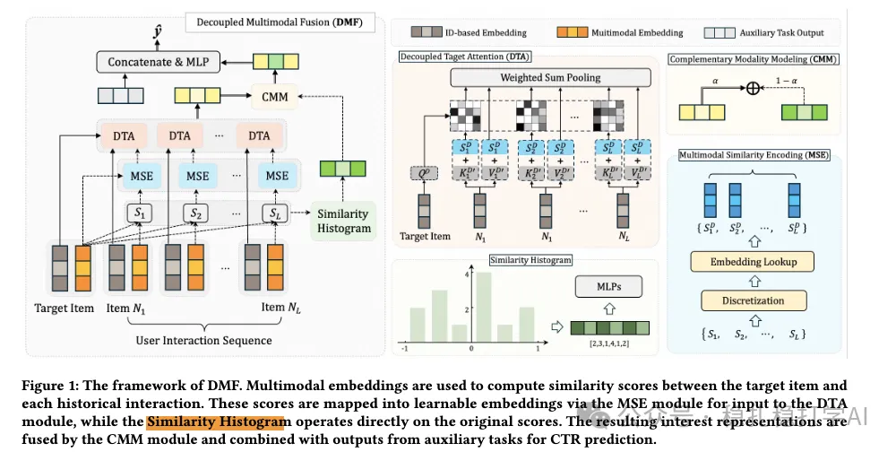

# Recommendation Paper Pick (2025.10.28): Alibaba's multimodal behavior sequence modeling, GMV +7.43%

> [中文版](2025-10-28-ali-dmf-lazada.md)

### Paper 1: Decoupled Multimodal Fusion for Sequential Recommendation
### Link: https://arxiv.org/pdf/2510.11066
### Company: Alibaba (Lazada)
### Idea: multimodal + sequence modeling (similarity, histogram, complementary module)
### Area: multimodal behavior sequence modeling

## Overview:

The paper mainly uses multimodal information for behavior sequence modeling. The core is: when modeling the behavior sequence with target attention, the items' multimodal information is also used as input. There are two ways, mixed and independent. Mixed means the ID embedding and the multimodal embedding are modeled "mixed" together. Independent means the multimodal information gets its own sequence modeling.

(1) Multimodal information

The multimodal information of the items in the history sequence is compared with that of the target item, computing similarities to get a list. Specifically:

1) Multimodal features: a pretrained model extracts the item's multimodal information, such as images and text, into a vector.

2) Similarity computation: the cosine similarity between each history item's multimodal vector and the target item's multimodal vector is computed, giving a similarity list.

(2) Multimodal sequence modeling

1) Similarity histogram

The value range of the similarity is manually divided into N buckets, and the similarities (the list) obtained in 1) of step (1) are assigned to the buckets, forming a vector of length N whose elements are the counts of similarities in each bucket. This goes into an MLP to get a vector.

2) Similarity embedding

Figure 1 is not drawn clearly. The similarities obtained in 1), then MSE, are discretized and turned by an embedding layer into an embedding of the same length as the ID embedding.

(3) Complementary modality module

1) Modeling

The results computed in (2), the similarity histogram and the similarity embedding, are used to model the multimodal information. Concretely, the similarity histogram and the similarity embedding are concatenated and fed into an MLP to get a multimodal interest vector.

2) Fusion

The multimodal interest vector is fused with the ID interest vector to get the final interest vector. Concretely, a gating mechanism controls the weights of the multimodal interest vector and the ID interest vector, which are then summed with those weights.

A/B: on Lazada, GMV +7.43%.

## Takeaways:

(1) The idea of this paper is very simple and direct: use multimodal information to strengthen behavior sequence modeling. The benefit is that multimodal information provides richer item information and so improves the model's expressiveness. (2) The paper's similarity histogram and similarity embedding are also well worth borrowing. The similarity histogram captures distributional information about the similarities, and the similarity embedding turns similarity information into an embedding so it can be fused better with ID information.

## Caveats: none

## Credibility: production

## Recommendation: practically useful

